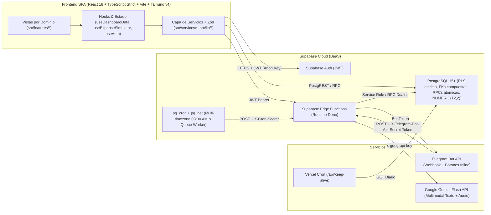

# SB-Finance

**Plataforma privada de gestión financiera personal, control de liquidez real y toma de decisiones patrimoniales**, diseñada e implementada bajo metodología **Spec-Driven Development (SDD)**.

[](https://react.dev/)
[](https://www.typescriptlang.org/)
[](https://vitejs.dev/)
[](https://tailwindcss.com/)
[](https://supabase.com/)
[](https://deno.com/)
[](https://ai.google.dev/)
[](https://core.telegram.org/bots/api)
[](https://zod.dev/)
[](https://recharts.org/)
[](https://vercel.com/)

---

## Resumen Ejecutivo

### ¿Qué problema resuelve?
Las aplicaciones tradicionales de finanzas personales y los extractos bancarios muestran el **saldo bruto de la cuenta**, generando una **ilusión de liquidez**: mezclan dinero que ya está comprometido en alquiler, servicios y cuotas futuras con fondos destinados al ahorro o al gasto diario discrecional. Además, exigir la carga manual de cada compra en formularios web genera fricción y provoca abandono en el registro cotidiano.

### Propuesta de valor
**SB-Finance** calcula en todo momento el **Disponible Real del Mes** —descontando automáticamente desde el día 1 el tope máximo de gastos fijos y cuotas comprometidas, los objetivos de ahorro y las inversiones inmovilizadas— mientras mantiene el patrimonio ahorrado estrictamente aislado de la vista operativa diaria. Para eliminar la fricción de carga, incorpora un **Bot de Telegram con IA multimodal (texto y notas de voz)** respaldado por una cola persistente ante fallas externas y herramientas interactivas de simulación, priorización y planificación presupuestaria.

### Ingeniería guiada por especificaciones (SDD)
Todo el sistema fue diseñado e implementado iterativamente bajo **Spec-Driven Development (SDD)** antes de escribir el código de cada fase:
- [Constitution (`specs/constitution.md`)](./specs/constitution.md): reglas invariantes de arquitectura, seguridad BaaS/RLS, precisión monetaria (`NUMERIC(12,2)`), manejo local de fechas y aislamiento de runtime Deno/React.
- [Product Roadmap (`specs/product_roadmap.md`)](./specs/product_roadmap.md): mapa de 12 módulos y evolución incremental por fases.
- Especificaciones funcionales, técnicas, planes de tareas por oleadas y auditorías integrales en [`specs/fase-1-core/`](./specs/fase-1-core/), [`specs/fase-2-automation/`](./specs/fase-2-automation/) y [`specs/fase-3-decision-tools/`](./specs/fase-3-decision-tools/).

---

## Funcionalidades Clave por Módulo

### 1. Módulo Core: Contabilidad Mensual, Snapshots y Bóveda Aislada
- **Cálculo exacto del Disponible Real:**
  ```text
  Disponible Real = (Sueldo Fijo + Ingresos Extra + Retornos de Plazo Fijo acreditados al mes)
                  - max(Límite Gastos Fijos, Fijos + Cuotas No-Gustito + Sobrante Fijos Trasladado)
                  - (Ahorro Mensual Objetivo + Aportes Operativos a Ahorros)
                  - Gastos Variables No-Gustito
                  - (Gastado en Gustitos del Mes + Sobrante Gustitos Trasladado)
                  - Plazos Fijos constituidos desde Disponible del Mes
  ```
- **Inmutabilidad histórica (`monthly_budgets` y `monthly_category_snapshots`):** Inicialización idempotente bajo demanda (`ensure_monthly_period`) que congela sueldo, metas, topes y configuración de categorías (`YYYY-MM-01`) por período; cambiar metas o sueldos actuales jamás altera cierres de meses pasados.
- **Arquitectura unificada de Compromisos (`monthly_commitments`):**
  - *Gastos Fijos Recurrentes:* Plantillas con *Lazy Initialization* mensual y ajuste puntual por mes sin sobreescribir el valor base futuro ni instancias ya abonadas.
  - *Compras en Cuotas:* *Eager Pre-generation* atómica en PostgreSQL (`Cuota 1/N ... N/N`) con `ON DELETE CASCADE` para anulaciones limpias y preservación de cuotas ya pagadas al editar.
- **Bóveda de Ahorros Aislada (`/savings`):** El ahorro mensual apartado y los aportes extra (incluyendo ingresos extra enviados directo a ahorros con `save_to_savings`) se descuentan automáticamente del `Disponible Real` y permanecen ocultos del Dashboard principal, discriminando **Saldo Líquido**, **Capital Inmovilizado en Plazos Fijos** y **Patrimonio Total** con privacidad enmascarada por defecto (`$ ••••••••`).
- **Categorías con Borrado Lógico (`/categories`):** Catálogo separado de gastos (`expense`) e ingresos (`income`) protegido por `ON DELETE RESTRICT` y archivado reversible (`is_active = false`) para mantener intactos los gráficos históricos.
- **Dashboard Ejecutivo y Analítica (`/`)**: Cabecera ejecutiva de mínima carga cognitiva, indicador `Pendiente de Abonar`, barras progresivas unificadas `0% → 100%`, sub-pestañas accesibles (`Resumen y Gráficos`, `Pendientes de Pago`, `Movimientos del Mes`) y gráficos responsivos en Recharts (dona por categoría, balance del mes y evolución de 6 meses).

### 2. Módulo de Automatización e IA Multimodal (Telegram + Cron)
- **Vinculación privada multi-usuario 1:1 (`/settings`):** Generación de códigos temporales de 6 caracteres sin caracteres ambiguos (TTL 15 min) con invalidación automática de códigos previos y vínculo estricto `user_id ↔ telegram_chat_id`.
- **Bot de Telegram Multimodal (`telegram-webhook` + Gemini Flash):**
  - Interpreta **texto y notas de voz/audio** (hasta 60 s / 5 MB, codificados por bloques `Uint8Array` a Base64 sin dependencias externas en Deno).
  - Soporta 5 intenciones: `expense`, `income` (con envío directo a ahorros), `installment_purchase` (sin división automática de totales), `pay_installments` y `fixed_term_deposit`.
  - Acuse de recibo inmediato, máquina de estados multi-turno con teclado inline (`telegram_conversation_sessions`) para resolver datos faltantes, respuesta enriquecida con saldo restante y botón inline **`[❌ Anular]`** válido por 24 horas (bloqueado automáticamente si existen cuotas pagadas o plazos acreditados).
- **Resiliencia ante saturación de IA (`telegram_pending_requests`):** Si la API de Gemini presenta errores transitorios (`503`, `429`, `5xx` o timeout) tras reintento y fallback de modelo, el webhook persiste el payload completo (incluyendo audio y `local_date` original) y el worker `process-telegram-queue` (`pg_cron` cada minuto) lo procesa en orden cronológico con *backoff* exponencial y bloqueo optimista hasta un máximo de 2 horas.
- **Bolsa de "Gustitos" y Límites por Categoría:** Presupuesto discrecional compartido que vive dentro del `Disponible Real` y descuenta al gastarse (aplicable a gastos variables, cuotas de Gustito y excepciones puntuales), con alertas en tiempo real (`notify-gustitos-alert`) al alcanzar o superar el `100%` (`>= presupuesto`).
- **Motor de Alertas Proactivas Multi-Timezone (`daily-alerts`):** Ejecutado cada hora por `pg_cron` + `pg_net` y filtrado exactamente a las `08:00 AM` locales de cada usuario (`Intl.DateTimeFormat`), enviando alertas con cooldown semanal por límites (`> 80%` y `>= 100%`), recordatorios de cuentas impagas (día 15 y 7 días antes de fin de mes), vencimientos de plazos fijos (`-3 días` y hoy) y aviso de revisión de cierre mensual (`<= 3` días para fin de mes).

### 3. Módulo de Herramientas de Decisión e Inversiones
- **Adelanto / Pago Múltiple de `N` Cuotas:** RPC transaccional (`advance_installments`) que selecciona cronológicamente las `N` cuotas pendientes más próximas, las traslada al mes actual marcadas como pagadas, prorratea un nuevo monto total en centavos enteros ajustando el resto en la última cuota y permite reversión completa por lote (`installment_payment_batches`) tanto desde Web como desde Telegram (`[❌ Anular]`).
- **Revisión Guiada de Cierre y Día de Cobro Configurable:** Soporte de día de cobro habitual (último día hábil lun–vie `0` o día fijo `1..31`) y modal guiado en 2 pasos (`SurplusCloseModal`) para auditar gastos olvidados y transferir sobrantes reales del tope de Fijos a la Bóveda de Ahorros (sin doble descuento) o liberarlos al Disponible Real.
- **Matriz de Prioridad Interactiva (`/priority-matrix`):** Matriz cartesiana 2×2 (*Impacto vs. Costo*) con tarjetas arrastrables mediante **HTML5 Drag & Drop nativo** en escritorio, pestañas accesibles por cuadrante (`useRovingTabs`) en móvil/teclado y conversión atómica (`convert_priority_item_to_purchase`) a gasto al contado o compra en cuotas ajustando el monto real pagado.
- **Simulador de Gastos ("¿Qué pasa si...?" — `/simulator`):** Workbench efímero 100% en memoria (sin escritura en BD ni `localStorage`) para modelar múltiples compras hipotéticas combinadas (al contado o en cuotas, inicio este mes o el próximo) y comparar en vivo el impacto sobre `Disponible Real`, tope de Fijos, Bolsa de Gustitos y límites de categoría.
- **Plazos Fijos Conectados a Bóveda (`/fixed-terms`):** Registro por Web o Telegram (con cálculo determinístico de rendimiento por `%` o TNA en Deno), validación atómica de saldo líquido vía `pg_advisory_xact_lock`, seguimiento temporal del vencimiento y acreditación manual al vencer hacia la Bóveda de Ahorros o al Disponible Real del Mes.
- **Asistente de Distribución de Presupuesto con IA (`/budget-assistant`):** Analiza sueldo fijo, compromisos vigentes, historial de los últimos 3 meses con actividad, ítems de la Matriz de Prioridad y saldo líquido de la Bóveda aceptando consultas por texto (hasta 500 caracteres) o **grabación de audio con micrófono mediante `MediaRecorder` nativo** (hasta 60 s). Genera una propuesta estructurada con deltas comparativos y aplicación atómica en un clic (`apply_budget_assistant_limits`).

---

## Arquitectura y Stack Tecnológico

### Diagrama de Arquitectura



### Decisiones Técnicas Clave
- **Frontend SPA:** React 18 + TypeScript (`strict: true`), React Router v7 con carga diferida (`React.lazy`), Tailwind CSS v4 en `src/index.css`, validación cliente con `zod`, gráficos responsivos en `recharts` y notificaciones en `react-hot-toast`. Construcción sin dependencias pesadas externas para Drag & Drop (HTML5 nativo) ni grabación de audio (`MediaRecorder`).
- **Precisión Financiera y Calendario:** Todos los importes se almacenan en `NUMERIC(12, 2)` en PostgreSQL y se operan en **centavos enteros (`toCents` / `roundCurrency`)** en TypeScript/Deno para eliminar imprecisiones IEEE-754. Las fechas contables usan tipo `DATE` (`YYYY-MM-DD` local) evitando desfases por UTC en cierres nocturnos.
- **Seguridad BaaS en Profundidad:**
  - **Row Level Security (RLS)** habilitado en el 100% de las tablas filtrando por `auth.uid() = user_id`.
  - **Claves foráneas compuestas `(category_id, user_id)`** para impedir referencias cruzadas entre usuarios (*cross-tenant FK*).
  - **RPCs transaccionales duales (`SECURITY INVOKER`)** con `pg_advisory_xact_lock`, validación compatible con tokens JWT y llaves `sb_secret_` (`current_user = 'service_role'`), privilegios explícitos (`REVOKE`/`GRANT`) y flag transaccional local `sb_finance.allow_system_dml` para impedir manipulaciones directas vía PostgREST sobre tablas contables sensibles.
  - **Cero secretos en el cliente:** Únicamente `VITE_SUPABASE_URL`, `VITE_SUPABASE_ANON_KEY` y `VITE_TELEGRAM_BOT_USERNAME` viven en Vite; `GEMINI_API_KEY`, `TELEGRAM_BOT_TOKEN`, `TELEGRAM_WEBHOOK_SECRET` y `CRON_INTERNAL_SECRET` residen exclusivamente en Supabase Edge Functions y Vault.
  - **Protección HTTP en Edge:** Verificación de firma de webhook con comparación en tiempo constante (`timingSafeEqualStr`), CORS restringido mediante `ALLOWED_ORIGINS`, rate limiting en `budget_assistant_logs` (10 req/h por usuario) y sanitización contra *prompt injection*.

### Estructura de Directorios

```text
SB-Finance/
├── api/
│   └── keep-alive.ts                     # Vercel Serverless Cron para keep-alive de Supabase en producción
├── docs/
│   └── screenshots/                      # Directorio destinado a capturas de pantalla del portafolio
├── scripts/
│   └── bundle-edge-functions.mjs         # Generador de bundles autocontenidos para despliegue de Edge Functions
├── specs/                                # Documentación Spec-Driven Development (SDD)
│   ├── constitution.md                   # Reglas invariantes de arquitectura, seguridad y stack
│   ├── product_roadmap.md                # Mapa completo de 12 módulos y roadmap por fases
│   ├── fase-1-core/                      # Especificaciones funcionales, técnicas, tareas y auditoría (MVP)
│   ├── fase-2-automation/                # Especificaciones de Telegram, IA multimodal, Gustitos y Cron
│   └── fase-3-decision-tools/            # Especificaciones de Simulador, Matriz, Plazos Fijos y Asistente IA
├── src/
│   ├── components/
│   │   ├── layout/                       # AppShell, TopNavbar (menús agrupados + drawer móvil), PageSubnav, MonthSelectorBar
│   │   └── ui/                           # Sistema UI accesible (Button, Card, Modal con focus trap, InputField, SelectField, Badge, EmptyState)
│   ├── features/                         # Módulos de dominio organizados por feature
│   │   ├── auth/                         # LoginPage y ProtectedRoute
│   │   ├── budget-assistant/             # Asistente IA multimodal (texto + MediaRecorder)
│   │   ├── categories/                   # CRUD de categorías con borrado lógico, Gustitos y límites
│   │   ├── commitments/                  # Plantillas de gastos fijos, cuotas y adelanto/reversión por lote
│   │   ├── dashboard/                    # Vista ejecutiva, KPI Disponible Real, sub-pestañas, gráficos y cierre mensual
│   │   ├── fixed-terms/                  # Plazos fijos, cálculo de rendimiento y acreditación al vencimiento
│   │   ├── priority-matrix/              # Matriz 2x2 con HTML5 Drag & Drop y conversión atómica a compra
│   │   ├── savings/                      # Bóveda de ahorros aislada con privacidad enmascarada
│   │   ├── settings/                     # Configuración base, día de cobro, vinculación Telegram y alta admin
│   │   ├── simulator/                    # Simulador efímero "¿Qué pasa si...?"
│   │   └── transactions/                 # Movimientos manuales, filtros dinámicos e historial de compromisos abonados
│   ├── hooks/                            # useAuth, useDashboardData, useExpenseSimulator, useMonthlyPeriod, useRovingTabs
│   ├── lib/                              # supabaseClient tipado, formatters (toCents/fechas locales) y esquemas zod
│   ├── services/                         # Servicios desacoplados de acceso a datos y RPCs
│   └── types/                            # Contratos TypeScript strict y esquema completo Database
├── supabase/
│   ├── deploy-bundles/                   # Bundles Deno autocontenidos listos para despliegue en Editor Cloud
│   ├── functions/
│   │   ├── _shared/                      # Helpers financieros multi-timezone, API de Telegram y procesador Gemini
│   │   ├── admin-create-user/            # Alta administrativa de usuarios verificando is_admin en servidor
│   │   ├── budget-assistant/             # Recomendador de presupuesto multimodal con rate limiting y guardrails
│   │   ├── daily-alerts/                 # Cron multi-timezone 08:00 AM (límites, pendientes, plazos fijos y cierre)
│   │   ├── notify-gustitos-alert/        # Alertas instantáneas a Telegram al agotar Bolsa de Gustitos desde Web
│   │   ├── process-telegram-queue/       # Worker de resiliencia con backoff exponencial (pg_cron cada 1 min)
│   │   └── telegram-webhook/             # Webhook autenticado de Telegram (texto, audio, multi-turno y [❌ Anular])
│   └── migrations/                       # 8 migraciones SQL incrementales (esquema, RLS, triggers, RPCs y pg_cron)
├── .env.example                          # Plantilla documentada de variables de entorno públicas y secretos
├── index.html
├── package.json
├── tsconfig.json
├── vercel.json                           # Configuración de rewrites SPA y Vercel Cron diario
└── vite.config.ts                        # Manual chunks optimizados (react, supabase, recharts) + Tailwind v4
```

---

## Instalación y Ejecución Local

### Prerrequisitos
- **Node.js** >= 18 y **npm** >= 9
- Cuenta y proyecto en **Supabase Cloud** (o Supabase CLI local)
- **Deno** >= 2.x *(opcional, únicamente si deseas validar o desplegar Edge Functions localmente)*
- Token de Bot de Telegram (`@BotFather`) y clave de API de **Google Gemini** *(opcionales para las integraciones de bot y asistente IA)*

### 1. Clonar el repositorio e instalar dependencias
```bash
git clone https://github.com/NicolasSbar/SB-Finance.git
cd SB-Finance
npm install
```

### 2. Configurar variables de entorno del cliente
Copiá la plantilla de variables públicas y completá tus credenciales de Supabase:
```bash
cp .env.example .env
```
Editá `.env`:
```env
VITE_SUPABASE_URL=https://tu-proyecto.supabase.co
VITE_SUPABASE_ANON_KEY=tu_anon_key_publica
VITE_TELEGRAM_BOT_USERNAME=NombreDeTuBotSinArroba
```

### 3. Aplicar migraciones de base de datos en Supabase
Ejecutá en orden cronológico los scripts de [`supabase/migrations/`](./supabase/migrations/) desde el SQL Editor de Supabase o mediante Supabase CLI (`supabase db push`):
1. `20261115000001_phase1_core_mvp.sql`
2. `20261115000002_phase1_audit_security_fixes.sql`
3. `20261116000001_phase2_automation.sql`
4. `20261116000002_phase2_audit_fixes.sql`
5. `20261117000001_phase3_decision_tools.sql`
6. `20261117000002_phase3_audit_fixes.sql`
7. `20261118000001_closing_alerts_and_payday.sql`
8. `20261118000002_audit_consistency_fixes.sql`

> **Nota sobre Cron y Vault:** Para habilitar las alertas automáticas (`daily-alerts`) y el worker de reintentos (`process-telegram-queue`), activá las extensiones `pg_cron` y `pg_net` en Supabase y registrá en **Supabase Vault** los secretos `supabase_project_url`, `supabase_anon_key` y `cron_internal_secret`.

### 4. Desplegar Edge Functions y configurar secretos (Opcional para IA / Telegram)
Configurá los secretos del entorno Deno en Supabase:
```bash
supabase secrets set \
  TELEGRAM_BOT_TOKEN="tu_bot_token" \
  TELEGRAM_WEBHOOK_SECRET="tu_secreto_aleatorio" \
  GEMINI_API_KEY="tu_gemini_api_key" \
  CRON_INTERNAL_SECRET="mismo_valor_que_en_vault" \
  ALLOWED_ORIGINS="http://localhost:5173,https://tu-app.vercel.app"
```
Desplegá las funciones desde [`supabase/functions/`](./supabase/functions/) *(recordando usar `--no-verify-jwt` en `telegram-webhook`, `daily-alerts` y `process-telegram-queue`, ya que validan sus propios secretos de webhook y cron)* o copiando los archivos autocontenidos generados por:
```bash
npm run bundle:functions
```

### 5. Ejecutar en desarrollo y compilar para producción
```bash
# Levantar servidor local Vite (http://localhost:5173)
npm run dev

# Verificar tipos estrictos y generar build de producción
npm run build
```

> **Primer acceso:** Como la plataforma deshabilita el registro público por privacidad, creá el primer usuario desde **Supabase Auth -> Users** y marcá `is_admin = true` sobre su fila en `public.user_settings` para habilitar la creación de cuentas adicionales desde `/settings`.

---

## Capturas de Pantalla

> Para completar la presentación visual del repositorio en tu portafolio, guardá las siguientes 3 capturas dentro de la carpeta [`docs/screenshots/`](./docs/screenshots/) respetando exactamente estos nombres de archivo (utilizando datos de demostración, nunca saldos o correos reales):

1. **`docs/screenshots/dashboard.png`** — Vista ejecutiva del **Dashboard** (`/`) mostrando la tarjeta protagonista *Disponible Real del Mes*, las dos barras progresivas `0% → 100%` (*Comprometido* y *Bolsa de Gustitos*) y la pestaña *Resumen y Gráficos* con los gráficos de Recharts.
2. **`docs/screenshots/decision-tools.png`** — Vista de la **Matriz de Prioridad** (`/priority-matrix`) con tarjetas distribuidas en los 4 cuadrantes *Impacto vs. Costo*, o una composición lado a lado junto al **Simulador de Gastos** (`/simulator`) mostrando la comparativa *Actual vs. Simulado*.
3. **`docs/screenshots/telegram-ai.png`** — Captura del **Asistente de Presupuesto IA** (`/budget-assistant`) mostrando una propuesta comparativa generada (junto al grabador de audio) o un flujo del **Bot de Telegram** registrando un gasto por audio con saldo restante y botón `[❌ Anular]`.

### Dashboard Ejecutivo y Analítica


### Herramientas de Decisión: Matriz de Prioridad y Simulador


### Inteligencia Artificial Multimodal y Bot de Telegram

