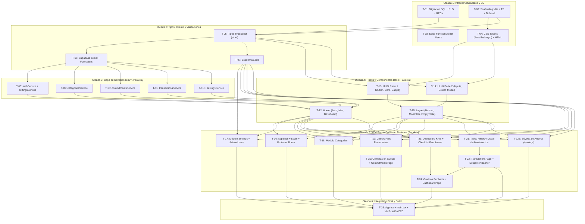

# Plan de Tareas Atómicas — Fase 1 (Core MVP) — SB-Finance

> **Versión:** 1.0.0  
> **Regla de aislamiento:** Ninguna tarea supera los **3 archivos** y las tareas marcadas dentro de una misma oleada paralela tienen **intersección cero de archivos** para evitar conflictos de escritura.

---

## Mapa de Oleadas y Dependencias (DAG de Ejecución)

---

## Oleada 1: Infraestructura Base, Base de Datos y Sistema Visual

### T-01 — Migración SQL de Fase 1 (Tablas, RLS, Índices, Triggers y Funciones RPC)
- **Archivos a crear/modificar (1):**
  - `supabase/migrations/20261115000001_phase1_core_mvp.sql`
- **Dependencias:**
  - **Bloqueada por:** Ninguna.
  - **Corre en paralelo con:** `T-02`, `T-03`.
- **Descripción:**
  Crear la migración SQL completa definida en la Sección 1 de `02-tech-spec.md`, incluyendo las 8 tablas (`user_settings`, `categories`, `monthly_budgets`, `fixed_expense_templates`, `installment_purchases`, `monthly_commitments`, `transactions`, `savings_entries`), restricciones `NUMERIC(12,2)` y `DATE`, llaves foráneas (`ON DELETE CASCADE` para cuotas e `ON DELETE RESTRICT` para categorías), políticas RLS por `auth.uid()`, el trigger `on_auth_user_created` con las categorías iniciales y las funciones RPC `ensure_monthly_period` (incluyendo `monthly_savings_target`), `create_installment_purchase` y `update_installment_purchase`.
- **Definition of Done (DoD):**
  - El archivo SQL es sintácticamente válido en PostgreSQL 15+.
  - Todas las tablas tienen `ENABLE ROW LEVEL SECURITY` y políticas para `SELECT`, `INSERT`, `UPDATE`, `DELETE` filtradas por `auth.uid() = user_id`.
  - La llave foránea `monthly_commitments.installment_purchase_id` tiene `ON DELETE CASCADE`.

---

### T-02 — Edge Function en Deno para Alta de Usuarios por el Administrador
- **Archivos a crear/modificar (2):**
  - `supabase/functions/admin-create-user/deno.json`
  - `supabase/functions/admin-create-user/index.ts`
- **Dependencias:**
  - **Bloqueada por:** Ninguna.
  - **Corre en paralelo con:** `T-01`, `T-03`.
- **Descripción:**
  Implementar la Supabase Edge Function en runtime **Deno** (usando importaciones `npm:@supabase/supabase-js@2` o `jsr:`). La función debe:
  1. Validar el header `Authorization: Bearer <jwt>` del usuario que realiza la petición.
  2. Consultar `public.user_settings` para verificar que el llamante tiene `is_admin = true` (devolver `403 Forbidden` en caso contrario).
  3. Usar `SUPABASE_SERVICE_ROLE_KEY` del entorno de Deno para ejecutar `supabaseAdmin.auth.admin.createUser({ email, password, email_confirm: true })`.
  4. Documentar las decisiones de arquitectura en los comentarios del encabezado.
- **Definition of Done (DoD):**
  - No importa ningún paquete desde el `package.json` del frontend.
  - Nunca expone la `service_role` key en las respuestas HTTP y bloquea con `401`/`403` a usuarios no administradores.

---

### T-03 — Inicialización del Proyecto Frontend (Vite + React + TypeScript + Tailwind)
- **Archivos a crear/modificar (3):**
  - `package.json`
  - `tsconfig.json`
  - `vite.config.ts`
- **Dependencias:**
  - **Bloqueada por:** Ninguna.
  - **Corre en paralelo con:** `T-01`, `T-02`.
- **Descripción:**
  Configurar el proyecto base con React, TypeScript (`strict: true`, `noImplicitAny: true`, `strictNullChecks: true`), Vite y únicamente las dependencias autorizadas en `specs/constitution.md` (`@supabase/supabase-js`, `zod`, `react-hot-toast`, `recharts`, `tailwindcss`, `@tailwindcss/vite`, `react-router-dom`).
- **Definition of Done (DoD):**
  - `npm install` finaliza sin errores.
  - No existe ninguna librería de Drag & Drop ni UI kit no declarado en `package.json`.
  - `tsconfig.json` tiene `"strict": true` activado.

---

### T-04 — Variables de Entorno, HTML Base y Tokens CSS (Paleta Amarillo y Negro)
- **Archivos a crear/modificar (3):**
  - `.env.example`
  - `index.html`
  - `src/index.css`
- **Dependencias:**
  - **Bloqueada por:** `T-03`.
  - **Corre en paralelo con:** `T-05`.
- **Descripción:**
  1. Crear `.env.example` con `VITE_SUPABASE_URL` y `VITE_SUPABASE_ANON_KEY`.
  2. Configurar `index.html` con `<html lang="es" data-type="software" data-radius="sharp">`, metadatos, título `"SB-Finance — Control de Disponible Real"` y carga de tipografías (`Plus Jakarta Sans` + `JetBrains Mono`).
  3. Definir en `src/index.css` los tokens de la paleta **Amarillo (`#FACC15`) y Negro (`#0A0A0A` / `#121212`)**, colores semánticos financieros (`#22C55E` y `#EF4444`), contenedor `.wrap` de bordes simétricos, utilidad `.tabular-nums` para cifras y micro-interacciones de hover/active.
- **Definition of Done (DoD):**
  - Cero uso de colores violeta o lavanda en `src/index.css`.
  - Las clases `.wrap`, `.tabular-nums` y las variables CSS de tema oscuro de alto contraste están definidas y listas.

---

## Oleada 2: Tipado Estricto, Utilidades Core y Esquemas de Validación

### T-05 — Definición de Interfaces y Tipos TypeScript (`strict: true`)
- **Archivos a crear/modificar (1):**
  - `src/types/database.types.ts`
- **Dependencias:**
  - **Bloqueada por:** `T-01`, `T-03`.
  - **Corre en paralelo con:** `T-04`.
- **Descripción:**
  Crear todas las interfaces de entidades de base de datos (`UserSettings`, `Category`, `MonthlyBudget`, `FixedExpenseTemplate`, `InstallmentPurchase`, `MonthlyCommitment`, `Transaction`, `SavingsEntry`), DTOs de entrada/actualización, filtros (`TransactionFilters`) y el modelo de lectura del Dashboard (`MonthlyFinancialSummary`, `CategoryBreakdownItem`, `MonthlyEvolutionPoint`).
- **Definition of Done (DoD):**
  - El archivo compila sin usar `any` en ninguna propiedad.
  - Está 100% alineado con las columnas SQL de `T-01`.

---

### T-06 — Cliente de Supabase y Formateadores de Moneda y Fechas Locales
- **Archivos a crear/modificar (2):**
  - `src/lib/supabaseClient.ts`
  - `src/lib/formatters.ts`
- **Dependencias:**
  - **Bloqueada por:** `T-05`.
  - **Corre en paralelo con:** `T-07`.
- **Descripción:**
  1. En `src/lib/supabaseClient.ts`: inicializar el cliente con `import.meta.env.VITE_SUPABASE_URL` y `import.meta.env.VITE_SUPABASE_ANON_KEY`, validando su presencia.
  2. En `src/lib/formatters.ts`: implementar funciones puras para:
     - Formatear dinero con `Intl.NumberFormat('es-AR', { style: 'currency', currency })`.
     - Obtener la fecha local hoy en formato `YYYY-MM-DD` sin desfase UTC (`toLocalISODate(date)`).
     - Normalizar cualquier fecha al primer día de su mes (`toMonthStartISODate(date)` $\rightarrow$ `'YYYY-MM-01'`).
     - Navegar entre meses (`addMonthsToMonthDate('2026-11-01', delta)`) y formatear etiquetas de mes (`'Noviembre 2026'`).
- **Definition of Done (DoD):**
  - Ninguna función de fecha usa `.toISOString().slice(0, 10)` directamente sobre un `new Date()` sin compensar el offset de zona horaria local.

---

### T-07 — Esquemas de Validación `zod` para Formularios
- **Archivos a crear/modificar (1):**
  - `src/lib/validations.ts`
- **Dependencias:**
  - **Bloqueada por:** `T-05`.
  - **Corre en paralelo con:** `T-06`.
- **Descripción:**
  Implementar todos los esquemas `zod` especificados en la Sección 2.2 de `02-tech-spec.md` (`loginSchema`, `adminCreateUserSchema`, `userSettingsSchema`, `monthlyBudgetSnapshotSchema`, `savingsEntrySchema`, `categorySchema`, `fixedExpenseTemplateSchema`, `installmentPurchaseSchema`, `transactionSchema`, `monthlyAmountEditSchema`) y exportar sus tipos inferidos (`z.infer<typeof ...>`).
- **Definition of Done (DoD):**
  - Todos los mensajes de error están en español claro.
  - Valida montos máximos `<= 9999999999.99`, cuotas enteras entre `1` y `120` y fechas `YYYY-MM-DD`.

---

## Oleada 3: Capa de Servicios de Acceso a Datos (`src/services/`)

### T-08 — Servicios de Autenticación (`authService`) y Configuraciones/Snapshots (`settingsService`)
- **Archivos a crear/modificar (2):**
  - `src/services/authService.ts`
  - `src/services/settingsService.ts`
- **Dependencias:**
  - **Bloqueada por:** `T-05`, `T-06`.
  - **Corre en paralelo con:** `T-09`, `T-10`, `T-11`.
- **Descripción:**
  1. `authService.ts`: `signInWithPassword`, `signOut`, `getCurrentSession`, `onAuthStateChange` y `adminCreateUser(email, password)` (que invoca `supabase.functions.invoke('admin-create-user', ...)`).
  2. `settingsService.ts`: obtener `user_settings`, actualizar `fixed_salary` y `fixed_expenses_limit` (sincronizando el snapshot del mes actual en `monthly_budgets` cuando corresponda), invocar la RPC `ensure_monthly_period(monthDate)` y obtener/actualizar un `monthly_budgets` específico.
- **Definition of Done (DoD):**
  - Todas las funciones manejan errores de Supabase lanzando instancias `Error` descriptivas en español.

---

### T-09 — Servicio de Categorías con Borrado Lógico (`categoriesService`)
- **Archivos a crear/modificar (1):**
  - `src/services/categoriesService.ts`
- **Dependencias:**
  - **Bloqueada por:** `T-05`, `T-06`.
  - **Corre en paralelo con:** `T-08`, `T-10`, `T-11`.
- **Descripción:**
  Implementar `getCategories({ includeInactive })`, `createCategory(input)`, `updateCategory(id, input)`, `archiveCategory(id)` (`is_active = false`) y `restoreCategory(id)` (`is_active = true`).
- **Definition of Done (DoD):**
  - Nunca ejecuta un `DELETE` físico destructivo sobre categorías que puedan tener historial; utiliza actualización de `is_active`.

---

### T-10 — Servicio de Gastos Fijos, Compras en Cuotas y Compromisos Mensuales (`commitmentsService`)
- **Archivos a crear/modificar (1):**
  - `src/services/commitmentsService.ts`
- **Dependencias:**
  - **Bloqueada por:** `T-05`, `T-06`.
  - **Corre en paralelo con:** `T-08`, `T-09`, `T-11`.
- **Descripción:**
  Implementar:
  1. **Plantillas de Gastos Fijos:** `getFixedExpenseTemplates()`, `createFixedExpenseTemplate(input, currentMonthDate)` (crea plantilla e instancia en el mes actual), `updateFixedExpenseTemplate(id, input, currentMonthDate)` (actualiza plantilla y sincroniza la instancia del mes actual solo si `is_paid = false`), `toggleFixedExpenseTemplateActive(id, isActive, currentMonthDate)`.
  2. **Compras en Cuotas:** `getInstallmentPurchases()`, `createInstallmentPurchase(input)` (vía RPC `create_installment_purchase`), `updateInstallmentPurchase(id, input)` (vía RPC `update_installment_purchase`), `deleteInstallmentPurchase(id)` (dispara `ON DELETE CASCADE`), y `getPaidInstallmentsCount(purchaseId)` para el aviso previo de anulación.
  3. **Compromisos del Mes:** `getMonthlyCommitments(monthDate)`, `toggleCommitmentPaidStatus(id, isPaid)` y `updateMonthlyCommitmentAmount(id, amount)`.
- **Definition of Done (DoD):**
  - Editar o pausar una plantilla nunca modifica instancias con `is_paid = true` ni instancias de meses pasados.

---

### T-11 — Servicio de Movimientos Manuales y Consultas de Historial (`transactionsService`)
- **Archivos a crear/modificar (1):**
  - `src/services/transactionsService.ts`
- **Dependencias:**
  - **Bloqueada por:** `T-05`, `T-06`.
  - **Corre en paralelo con:** `T-08`, `T-09`, `T-10`.
- **Descripción:**
  Implementar `getTransactionsByMonth(monthDate)`, `createTransaction(input)`, `updateTransaction(id, input)`, `deleteTransaction(id)` y `getSixMonthsEvolution(endMonthDate)` (obtiene los presupuestos, compromisos y movimientos de los últimos 6 meses para construir la serie histórica del gráfico de evolución).
- **Definition of Done (DoD):**
  - Filtra correctamente el rango de fechas de cada mes (`month_date` hasta el último día de ese mes) usando fechas locales `YYYY-MM-DD`.

---

### T-11B — Servicio de Bóveda de Ahorros Aislada (`savingsService`)
- **Archivos a crear/modificar (1):**
  - `src/services/savingsService.ts`
- **Dependencias:**
  - **Bloqueada por:** `T-05`, `T-06`.
  - **Corre en paralelo con:** `T-08`, `T-09`, `T-10`, `T-11`.
- **Descripción:**
  Implementar `getSavingsEntriesByMonth(monthDate)`, `getAccumulatedSavingsBalance()` (suma de `monthly_savings_target` de snapshots inicializados + `deposit` - `withdrawal` en `savings_entries`), `createSavingsEntry(input)` (validando que un retiro no deje la bóveda en negativo) y `deleteSavingsEntry(id)`.
- **Definition of Done (DoD):**
  - Calcula con precisión a 2 decimales el aporte mensual de ahorros y el saldo acumulado sin mezclarlos con `transactions`.

---

## Oleada 4: Custom Hooks y Componentes Base de UI

### T-12 — Custom Hooks de Autenticación, Período Mensual y Resumen del Dashboard
- **Archivos a crear/modificar (3):**
  - `src/hooks/useAuth.ts`
  - `src/hooks/useMonthlyPeriod.ts`
  - `src/hooks/useDashboardData.ts`
- **Dependencias:**
  - **Bloqueada por:** `T-08`, `T-09`, `T-10`, `T-11`, `T-11B`.
  - **Corre en paralelo con:** `T-13`, `T-14`.
- **Descripción:**
  1. `useAuth.ts`: estado de sesión del usuario autenticado y su registro `userSettings` (incluyendo `is_admin`).
  2. `useMonthlyPeriod.ts`: estado del mes seleccionado (`monthDate`, por defecto el mes calendario actual), funciones `goToPreviousMonth()`, `goToNextMonth()`, `goToCurrentMonth()`, `isCurrentMonth`, `isPastMonth`, `isFutureMonth`.
  3. `useDashboardData.ts`: carga el mes seleccionado; si es el mes actual, ejecuta automáticamente `ensure_monthly_period`. Calcula de forma exacta `MonthlyFinancialSummary` (`realAvailable`, `totalMonthlySavings`, `pendingCommitmentsTotal`, `committedLimitUsagePercent`, `isOverFixedLimit`), datos para gráficos y expone `refresh()`.
- **Definition of Done (DoD):**
  - La fórmula `realAvailable = (fixedSalary + extraIncomeTotal) - (fixedExpensesTotal + installmentsTotal) - totalMonthlySavings - variableExpensesTotal` se calcula con precisión a 2 decimales y sin división por cero cuando `fixedExpensesLimit === 0`.
  - El saldo acumulado total de la Bóveda de Ahorros no se suma ni se muestra en el `realAvailable`.

---

### T-13 — Kit UI Base (Parte 1): `Button`, `Card` y `Badge`
- **Archivos a crear/modificar (3):**
  - `src/components/ui/Button.tsx`
  - `src/components/ui/Card.tsx`
  - `src/components/ui/Badge.tsx`
- **Dependencias:**
  - **Bloqueada por:** `T-04`, `T-05`.
  - **Corre en paralelo con:** `T-12`, `T-14`.
- **Descripción:**
  Construir los componentes siguiendo la paleta amarillo/negro de alto contraste:
  - `Button`: variantes `primary` (fondo `#FACC15`, texto `#0A0A0A`, negrita), `secondary` (borde `#262626`, fondo `#141414`), `danger` (rojo semántico `#EF4444`) y `ghost`; soporte de `isLoading` con spinner integrado, altura mínima `44px` en mobile y micro-interacción de presión.
  - `Card`: contenedor oscuro (`#121212`) con borde `#262626` y opción `interactive` (elevación `-2px` en hover).
  - `Badge`: variantes `yellow`, `green` (Pagado / Ingreso), `red` (Alerta / Gasto), `neutral` (Pendiente / Archivada).
- **Definition of Done (DoD):**
  - Todos los botones aceptan `isLoading` y se deshabilitan mientras procesan.

---

### T-14 — Kit UI Base (Parte 2): `InputField`, `SelectField` y `Modal`
- **Archivos a crear/modificar (3):**
  - `src/components/ui/InputField.tsx`
  - `src/components/ui/SelectField.tsx`
  - `src/components/ui/Modal.tsx`
- **Dependencias:**
  - **Bloqueada por:** `T-04`, `T-05`.
  - **Corre en paralelo con:** `T-12`, `T-13`.
- **Descripción:**
  - `InputField` y `SelectField`: etiqueta visible obligatoria (`<label htmlFor>`), foco en amarillo `#FACC15`, soporte de mensaje de error individual debajo del campo (`role="alert"` en rojo `#EF4444`) y altura mínima `44px`.
  - `Modal`: diálogo accesible con cierre por tecla `Escape`, clic en backdrop y bloqueo de scroll del body.
- **Definition of Done (DoD):**
  - Cumple con las reglas de accesibilidad de teclado y formularios (`field-label`, `focus-ring`, error bajo cada campo).

---

### T-15 — Componentes de Navegación, Selector de Mes y Estado Vacío
- **Archivos a crear/modificar (3):**
  - `src/components/ui/EmptyState.tsx`
  - `src/components/layout/TopNavbar.tsx`
  - `src/components/layout/MonthSelectorBar.tsx`
- **Dependencias:**
  - **Bloqueada por:** `T-13`, `T-14`.
  - **Corre en paralelo con:** Ninguna (prepara `Wave 5`).
- **Descripción:**
  - `EmptyState.tsx`: estado vacío claro con título, explicación breve y botón de acción opcional.
  - `TopNavbar.tsx`: barra superior negro/amarillo con marca `SB-FINANCE`, enlaces a `Dashboard`, `Movimientos`, `Fijos y Cuotas`, `Ahorros`, `Categorías`, `Configuración`, indicador del correo del usuario y botón `"Cerrar sesión"`. Responsive con menú móvil de pantalla completa en `390px`.
  - `MonthSelectorBar.tsx`: selector interactivo `< Mes Año >`, badge indicador (`Mes Actual` | `Historial Cerrado` | `Proyección Futura`) y botón rápido `"Volver a hoy"`.
- **Definition of Done (DoD):**
  - Navegación limpia sin desbordamiento horizontal en `1440px`, `768px`, `390px` y `320px`.

---

## Oleada 5: Módulos de Dominio (`src/features/`)

### T-16 — `AppShell`, Pantalla de Login y Ruta Protegida (`auth`)
- **Archivos a crear/modificar (3):**
  - `src/components/layout/AppShell.tsx`
  - `src/features/auth/LoginPage.tsx`
  - `src/features/auth/ProtectedRoute.tsx`
- **Dependencias:**
  - **Bloqueada por:** `T-07`, `T-12`, `T-15`.
  - **Corre en paralelo con:** `T-17`, `T-18`, `T-19`, `T-21`, `T-23`.
- **Descripción:**
  - `LoginPage.tsx`: pantalla de inicio de sesión de alto contraste amarillo y negro, validación con `loginSchema` (`zod`), estado `isLoading` y notificaciones `react-hot-toast`. Sin registro público, con nota indicando que el acceso es privado por invitación del administrador.
  - `ProtectedRoute.tsx`: redirige a `/login` si no hay sesión activa.
  - `AppShell.tsx`: envuelve las páginas autenticadas con `TopNavbar`, contenedor `.wrap` de bordes simétricos y `Outlet`.
- **Definition of Done (DoD):**
  - Un usuario no autenticado jamás puede renderizar rutas privadas ni ver un formulario de registro público.

---

### T-17 — Módulo de Configuraciones (`settings`): Presupuesto y Alta de Usuarios Admin
- **Archivos a crear/modificar (3):**
  - `src/features/settings/BudgetSettingsForm.tsx`
  - `src/features/settings/AdminUserCreationCard.tsx`
  - `src/features/settings/SettingsPage.tsx`
- **Dependencias:**
  - **Bloqueada por:** `T-07`, `T-12`, `T-15`.
  - **Corre en paralelo con:** `T-16`, `T-18`, `T-19`, `T-21`, `T-23`.
- **Descripción:**
  1. `BudgetSettingsForm.tsx`: formulario validado con `userSettingsSchema` para configurar `Sueldo Fijo Mensual`, `Ahorro Mensual Objetivo` y `Límite de Gastos Fijos + Cuotas`, con opción de aplicar el cambio también al snapshot del mes actual en curso.
  2. `AdminUserCreationCard.tsx`: tarjeta renderizada **únicamente si `userSettings.is_admin === true`** que permite dar de alta un nuevo usuario (`email` + `password`) invocando `authService.adminCreateUser`, además de explicar cómo crear usuarios desde el panel de Supabase Auth.
  3. `SettingsPage.tsx`: integra ambos paneles y muestra información de la cuenta.
- **Definition of Done (DoD):**
  - Si `is_admin === false`, `AdminUserCreationCard` no se renderiza en el DOM.
  - Guardar cambios de sueldo/límite muestra estado de carga y `toast.success`.

---

### T-18 — Módulo de Categorías (`categories`): CRUD de Gastos/Ingresos y Archivado Lógico
- **Archivos a crear/modificar (2):**
  - `src/features/categories/CategoryFormModal.tsx`
  - `src/features/categories/CategoriesPage.tsx`
- **Dependencias:**
  - **Bloqueada por:** `T-07`, `T-12`, `T-15`.
  - **Corre en paralelo con:** `T-16`, `T-17`, `T-19`, `T-21`, `T-23`.
- **Descripción:**
  - Vista dividida o filtrable por tipo: **Categorías de Gastos (`expense`)** y **Categorías de Ingresos (`income`)**, más filtro para mostrar/ocultar categorías archivadas (`is_active = false`).
  - Creación y edición validada con `categorySchema`.
  - Botón `"Archivar categoría"` (borrado lógico `is_active = false` con explicación de que se conserva en el historial) y `"Restaurar categoría"` (`is_active = true`).
- **Definition of Done (DoD):**
  - El usuario puede crear y editar tanto categorías de gastos como de ingresos extra (ej. *Freelance*), y archivarlas sin afectar registros históricos.

---

### T-19 — Módulo de Compromisos (Parte 1): Plantillas de Gastos Fijos Recurrentes
- **Archivos a crear/modificar (2):**
  - `src/features/commitments/FixedExpenseFormModal.tsx`
  - `src/features/commitments/FixedExpensesList.tsx`
- **Dependencias:**
  - **Bloqueada por:** `T-07`, `T-12`, `T-15`.
  - **Corre en paralelo con:** `T-16`, `T-17`, `T-18`, `T-21`, `T-23`.
- **Descripción:**
  - Gestión de plantillas de gastos fijos recurrentes (`Alquiler`, `Internet`, `Expensas`, etc.) con nombre, categoría de gasto obligatoria, monto mensual por defecto y día estimado de vencimiento.
  - Alerta visual preventiva en el modal si al sumar el gasto fijo se supera el `Límite de Gastos Fijos + Cuotas`.
  - Acción para pausar/reactivar la plantilla y botón para marcar la instancia del mes seleccionado como `Pagado` / `Pendiente`.
- **Definition of Done (DoD):**
  - Crear o editar un gasto fijo actualiza la plantilla y sincroniza la instancia pendiente del mes actual.

---

### T-20 — Módulo de Compromisos (Parte 2): Compras en Cuotas y Página de Compromisos
- **Archivos a crear/modificar (3):**
  - `src/features/commitments/InstallmentFormModal.tsx`
  - `src/features/commitments/InstallmentsList.tsx`
  - `src/features/commitments/CommitmentsPage.tsx`
- **Dependencias:**
  - **Bloqueada por:** `T-19`.
  - **Corre en paralelo con:** `T-22`, `T-23`.
- **Descripción:**
  1. `InstallmentFormModal.tsx`: permite ingresar `Descripción`, `Categoría`, `Fecha de compra`, **`Fecha de la 1.ª cuota`**, `Monto por cuota` y `Cantidad de cuotas`. Calcula en tiempo real el monto total y el mes de finalización, y muestra una **alerta visual preventiva en rojo** si la cuota hace que el mes supere el `Límite de Gastos Fijos`.
  2. `InstallmentsList.tsx`: lista las compras en cuotas con barra de progreso de cuotas pagadas (`2/6 pagadas`), botón `"Editar compra"` y botón `"Anular compra"` (con modal de confirmación que informa cuántas cuotas pagadas y pendientes se borrarán en cascada).
  3. `CommitmentsPage.tsx`: página unificada que muestra el resumen del límite de fijos + cuotas del mes seleccionado, el checklist mensual de pagos (`Pagado` / `Pendiente`), las plantillas de Gastos Fijos y las Compras en Cuotas.
- **Definition of Done (DoD):**
  - Al anular una compra en cuotas, desaparecen todas sus cuotas asociadas (`1/N`..`N/N`) y se recalcula el compromiso mensual.

---

### T-21 — Módulo de Movimientos Manuales: Filtros, Tabla y Modal de Alta/Edición
- **Archivos a crear/modificar (3):**
  - `src/features/transactions/TransactionFiltersBar.tsx`
  - `src/features/transactions/TransactionsTable.tsx`
  - `src/features/transactions/TransactionFormModal.tsx`
- **Dependencias:**
  - **Bloqueada por:** `T-07`, `T-12`, `T-15`.
  - **Corre en paralelo con:** `T-16`, `T-17`, `T-18`, `T-19`, `T-23`.
- **Descripción:**
  1. `TransactionFormModal.tsx`: selector de tipo (`Gasto Variable` | `Ingreso Extra`); filtra automáticamente el desplegable obligatorio de categorías según el tipo elegido (preseleccionando `"Ingresos Extra"` cuando elige ingreso), monto, fecha y descripción.
  2. `TransactionFiltersBar.tsx`: filtros dinámicos por texto de búsqueda, tipo (`Todos | Gastos | Ingresos`), categoría y rango de fechas (`Desde` / `Hasta`).
  3. `TransactionsTable.tsx`: listado con montos en `tabular-nums` (verde para `income`, rojo/blanco para `expense`), categoría (indicando si fue archivada) y acciones de editar/eliminar con confirmación.
- **Definition of Done (DoD):**
  - Tanto gastos como ingresos requieren categoría obligatoria y el selector solo ofrece categorías activas del tipo correspondiente (más la categoría actual si se está editando un registro histórico con categoría archivada).

---

### T-22 — Página de Movimientos y Banner de Configuración Inicial (`SetupAlertBanner`)
- **Archivos a crear/modificar (2):**
  - `src/features/transactions/TransactionsPage.tsx`
  - `src/features/dashboard/SetupAlertBanner.tsx`
- **Dependencias:**
  - **Bloqueada por:** `T-21`.
  - **Corre en paralelo con:** `T-20`, `T-23`.
- **Descripción:**
  1. `TransactionsPage.tsx`: integra `MonthSelectorBar`, resumen rápido de ingresos/gastos filtrados, `TransactionFiltersBar`, `TransactionsTable` y `TransactionFormModal`.
  2. `SetupAlertBanner.tsx`: banner de alto contraste amarillo y negro que aparece en el Dashboard cuando `fixedSalary === 0` o `fixedExpensesLimit === 0`, con acceso directo para configurarlos.
- **Definition of Done (DoD):**
  - El banner se muestra automáticamente a los usuarios recién creados con valores en `$0` y desaparece en cuanto configuran su sueldo fijo y límite.

---

### T-22B — Módulo de Bóveda de Ahorros Aislada (`/savings`)
- **Archivos a crear/modificar (2):**
  - `src/features/savings/SavingsEntryFormModal.tsx`
  - `src/features/savings/SavingsPage.tsx`
- **Dependencias:**
  - **Bloqueada por:** `T-07`, `T-12`, `T-15`.
  - **Corre en paralelo con:** `T-20`, `T-22`, `T-23`.
- **Descripción:**
  1. `SavingsEntryFormModal.tsx`: formulario validado con `savingsEntrySchema` para registrar un **Aporte extra a ahorros** (`deposit`, que se resta del `Disponible Real` del mes) o un **Retiro de ahorros** (`withdrawal`).
  2. `SavingsPage.tsx`: pantalla dedicada donde el usuario consulta el saldo acumulado de su Bóveda de Ahorros (con toggle de ocultar/mostrar monto por privacidad), el historial de aportes mensuales congelados y movimientos manuales de ahorro. Mantiene este saldo completamente aislado del Dashboard principal.
- **Definition of Done (DoD):**
  - Registrar un aporte extra descuenta el monto del `Disponible Real` del Dashboard sin aparecer como gasto variable ni mostrar el acumulado de ahorros en el Dashboard principal.

---

### T-23 — Dashboard (Parte 1): Grilla de KPIs y Widget de Compromisos Pendientes de Pago
- **Archivos a crear/modificar (2):**
  - `src/features/dashboard/KpiSummaryGrid.tsx`
  - `src/features/dashboard/PendingCommitmentsWidget.tsx`
- **Dependencias:**
  - **Bloqueada por:** `T-12`, `T-15`.
  - **Corre en paralelo con:** `T-16`, `T-17`, `T-18`, `T-19`, `T-20`, `T-21`, `T-22`.
- **Descripción:**
  1. `KpiSummaryGrid.tsx`: muestra las 5 tarjetas clave del mes:
     - **Disponible Real del Mes** (destacada principal; descuenta Fijos + Cuotas, Ahorro del mes y Gastos Variables, sin mostrar nunca el saldo acumulado de la Bóveda de Ahorros).
     - **Ingresos del Mes** (`Sueldo Fijo + Ingresos Extra`).
     - **Comprometido en Fijos + Cuotas** (apartado desde el día 1, con barra de progreso contra el `Límite de Gastos Fijos` y alerta visual roja si supera el 100%).
     - **Pendiente de Abonar en el Mes** (monto total que falta pagar de los compromisos del mes vs. lo ya pagado).
     - **Gastos Variables del Mes**.
  2. `PendingCommitmentsWidget.tsx`: lista rápida de los gastos fijos y cuotas del mes para marcarlos como `Pagado` o `Pendiente` con un clic desde el Dashboard.
- **Definition of Done (DoD):**
  - Al marcar un compromiso como `Pagado`, el KPI `Pendiente de Abonar` se actualiza al instante mientras el `Disponible Real` se mantiene constante.

---

### T-24 — Dashboard (Parte 2): Gráficos Interactivos (`Recharts`) y `DashboardPage`
- **Archivos a crear/modificar (2):**
  - `src/features/dashboard/FinancialChartsSection.tsx`
  - `src/features/dashboard/DashboardPage.tsx`
- **Dependencias:**
  - **Bloqueada por:** `T-22`, `T-23`.
  - **Corre en paralelo con:** Ninguna (prepara `T-25`).
- **Descripción:**
  1. `FinancialChartsSection.tsx`: 3 gráficos responsivos con `ResponsiveContainer` de `Recharts` usando la paleta amarillo/negro y verde/rojo semántico:
     - Gráfico de Dona: Distribución porcentual de gastos del mes por categoría.
     - Gráfico de Barras del Mes: `Ingresos Totales` vs. `Fijos + Cuotas` vs. `Gastos Variables` vs. `Disponible Real`.
     - Gráfico de Barras Agrupadas: Evolución de los últimos 6 meses (`Ingresos` vs. `Egresos Totales`).
  2. `DashboardPage.tsx`: integra `MonthSelectorBar`, `SetupAlertBanner`, botones de acción rápida (`+ Nuevo Movimiento`, `+ Nueva Compra en Cuotas`), `KpiSummaryGrid`, `FinancialChartsSection`, `PendingCommitmentsWidget` y los últimos movimientos con filtros dinámicos. Si el usuario navega a un mes pasado no inicializado, muestra el estado vacío con el botón `"Inicializar mes para carga histórica"`.
- **Definition of Done (DoD):**
  - Todos los gráficos renderizan correctamente en `1440px`, `1024px`, `768px` y `390px` y muestran un estado vacío claro cuando el mes aún no tiene movimientos.

---

## Oleada 6: Integración Final y Verificación End-to-End

### T-25 — Enrutador Principal (`App.tsx`), `main.tsx` y Verificación de Build
- **Archivos a crear/modificar (2):**
  - `src/App.tsx`
  - `src/main.tsx`
- **Dependencias:**
  - **Bloqueada por:** `T-16`, `T-17`, `T-18`, `T-20`, `T-22`, `T-22B`, `T-24`.
- **Descripción:**
  1. Configurar en `src/App.tsx` el enrutamiento con `BrowserRouter` (`/login`, y rutas protegidas bajo `AppShell`: `/`, `/transactions`, `/commitments`, `/savings`, `/categories`, `/settings`) y el proveedor global de `<Toaster />` (`react-hot-toast`) estilizado en amarillo/negro.
  2. Montar la aplicación en `src/main.tsx` y ejecutar `npm run build` (`tsc -b && vite build`) verificando que no exista ningún error de tipos ni de empaquetado.
- **Definition of Done (DoD):**
  - `tsc -b` devuelve `0` errores con `strict: true`.
  - `vite build` genera el bundle de producción en `dist/` sin errores.
  - Todos los Criterios de Aceptación (`CA-01` a `CA-08` de `01-functional-spec.md`) se cumplen.
