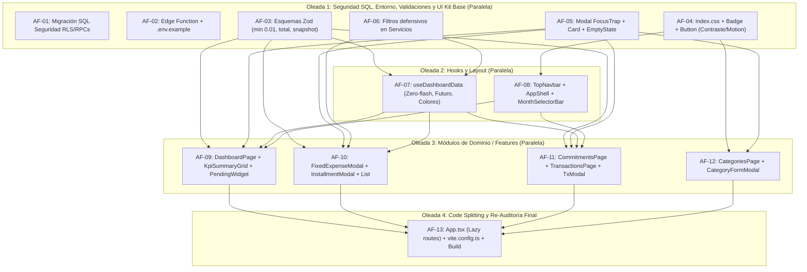

# Auditoría Integral y Plan de Remediación — Fase 1 (Core MVP) — SB-Finance

> **Fecha de auditoría:** 2026-11-15  
> **Versión:** 1.0.0  
> **Documentos contrastados:** `specs/constitution.md`, `specs/fase-1-core/01-functional-spec.md`, `specs/fase-1-core/02-tech-spec.md`  
> **Áreas auditadas:** QA Funcional, Seguridad BaaS/RLS, Accesibilidad y UI/UX.  
> **Regla de ejecución:** Tareas atómicas de **1 a 3 archivos máximo**, organizadas en oleadas paralelas con **intersección cero de archivos**.

---

## 1. Resumen Ejecutivo

- **Veredicto Global:** **REQUIERE CORRECCIONES PUNTUALES ANTES DE CERRAR LA FASE 1**
- **Build & TypeScript (`tsc -b && vite build`):** **PASS** (`0` errores de compilación bajo `strict: true`; advertencia de chunk JS único de `1.022,03 kB` > `500 kB`).
- **Cumplimiento de Criterios de Aceptación (`CA-01` a `CA-07`):**
  - **6 de 7 criterios cumplen (`CA-01`, `CA-02`, `CA-04`, `CA-05`, `CA-06`, `CA-07`)**, con un riesgo puntual en proyección/alertas de meses futuros no inicializados (`CA-06` / Regla 2.4.1).
  - **1 criterio (`CA-03` / Regla 2.4.2)** presenta un faltante de interfaz: la función `updateMonthlyBudgetSnapshot` existe en `src/services/settingsService.ts`, pero no está conectada a ningún botón o modal en el selector mensual.
- **Seguridad BaaS & RLS:**
  - **Cero secretos expuestos en el cliente** (`VITE_SUPABASE_URL` y `VITE_SUPABASE_ANON_KEY` únicamente; `.env` ignorado en `.gitignore`; Edge Function `admin-create-user` aislada en Deno con validación de JWT y `is_admin = true`).
  - **7 de 7 tablas con RLS estricto** por `auth.uid() = user_id` y protección contra auto-escalación de `is_admin`.
  - **Hallazgo de Severidad ALTA (`SEC-01`):** Las claves foráneas `category_id` no validan pertenencia al mismo `user_id` (*Cross-Tenant FK*) ni tipo (`expense`/`income`) en SQL/RPCs.
- **Puntaje de Salud UX/UI:** **13/20 (Acceptable)** — Ver desglose en la Sección 2.

---

## 2. Evaluación UX/UI e Integridad de Implementación

| # | Dimensión | Puntaje | Hallazgo Principal |
|---|---|---|---|
| 1 | **Accessibility (A11y)** | **2/4** | `Modal.tsx` carece de *focus trap*, auto-foco y restauración de foco; controles de pestañas/tipo sin `role="tab"`/`aria-pressed`; textos `#737373` (`3.89:1`–`4.11:1`) y rojo sobre fondo tintado (`4.14:1`) por debajo de WCAG AA `4.5:1`. |
| 2 | **Performance** | **2/4** | `useDashboardData.ts` activa `isLoading = true` en cada `refresh()`, desmontando toda la vista y los 3 gráficos Recharts (*skeleton flash*); `TransactionsPage` y `CommitmentsPage` ejecutan `getSixMonthsEvolution` innecesariamente; chunk único de `1.022 kB`. |
| 3 | **Theming & Identidad** | **3/4** | Paleta Amarillo/Negro (`#FACC15`/`#0A0A0A`) consistente, pero `#22C55E` (verde ingreso) se usa en la 3.ª categoría de gastos del gráfico Dona y en el badge `"Proyección futura"`; los tokens `:root` de `src/index.css` no se consumen vía clases. |
| 4 | **Responsive Design** | **3/4** | Buena adaptación de tabla a tarjetas en `< 768px`, pero las pestañas de `CategoriesPage` (`inline-flex`, `min-h-[40px]`) y montos largos en `320px` desbordan; enlaces de acción independientes miden `20px` de alto (`< 44px`). |
| 5 | **Implementation Integrity** | **3/4** | Sistema financiero coherente en modo *Operate* con números tabulares (`JetBrains Mono`), pero presenta 3 brechas: `updateMonthlyBudgetSnapshot` desconectado, selector `icon` de categorías sin renderizar y errores `zod` de `notes` sin mapear en modales. |
| **Total** | | **13/20** | **Acceptable** — Base sólida; aplicando las tareas `AF-01` a `AF-13` se proyecta alcanzar **18–20/20 (Excellent)**. |

- **Implementation Integrity Verdict:** **PASS CON OBSERVACIONES (`3/4`)**. La arquitectura expresa un producto financiero real (jerarquía clara de Disponible Real con fórmula explícita, previsualización en vivo de límites en modales, tabla responsiva en móvil y labels accesibles en `InputField`/`SelectField`), pendiente de cerrar las brechas listadas abajo.

---

## 3. Registro Maestro de Hallazgos (QA + Seguridad + UX/UI)

### 3.1 Hallazgos de Seguridad, RLS, Precisión y Validaciones (`SEC-XX`)

| ID | Severidad | Archivo y Línea Exacta | Descripción e Impacto | Tarea |
| :--- | :---: | :--- | :--- | :---: |
| **SEC-01** | **ALTA** | `supabase/migrations/20261115000001_phase1_core_mvp.sql:106,131,164,214,443-630` | Las FKs `category_id REFERENCES public.categories(id) ON DELETE RESTRICT` no validan que la categoría pertenezca al mismo `user_id` (*Cross-Tenant FK*). Un usuario autenticado podría referenciar un `category_id` ajeno vía API y bloquear la eliminación de cuenta de otro usuario por `ON DELETE RESTRICT`. Tampoco las RPCs de cuotas validan pertenencia y `type = 'expense'`. | `AF-01` |
| **SEC-02** | **MEDIA** | `src/lib/validations.ts:59-62,90-111,116-120,136-141` | 1) `installmentPurchaseSchema` valida `installment_amount` e `installments_count` por separado, pero no valida que `installment_amount * installments_count <= 9999999999.99` (`NUMERIC(12,2)`). 2) `.positive()` permite `0.001`, que `roundCurrency` convierte a `0.00` y falla en SQL `CHECK (amount > 0)`. | `AF-03` |
| **SEC-03** | **MEDIA** | `supabase/migrations/20261115000001_phase1_core_mvp.sql:555-601` | En `update_installment_purchase`, si `p_purchase_id` no existe o es de otro usuario, `v_paid_count = 0`, `v_purchase.id` queda `NULL` y falla el `INSERT` posterior por `chk_commitment_source_coherence` en vez de abortar explícitamente. | `AF-01` |
| **SEC-04** | **BAJA** | `src/features/commitments/FixedExpenseFormModal.tsx:113-120` `src/features/commitments/CommitmentsPage.tsx:177` `src/features/dashboard/KpiSummaryGrid.tsx:41` | Cálculos de vista previa (`projectedTotal`, `excessAmount`) sin envolver en `roundCurrency(...)`, expuestos a residuos IEEE 754 al comparar contra `fixedExpensesLimit`. | `AF-09`, `AF-10`, `AF-11` |
| **SEC-05** | **BAJA** | `supabase/migrations/20261115000001_phase1_core_mvp.sql:22,369,443,526` | `set_updated_at`, `ensure_monthly_period`, `create_installment_purchase` y `update_installment_purchase` omiten `SET search_path = public`. | `AF-01` |
| **SEC-06** | **BAJA** | `supabase/migrations/20261115000001_phase1_core_mvp.sql:257-263` | Refuerzo en profundidad para `user_settings.is_admin`: complementar la política RLS `WITH CHECK` con un trigger `BEFORE UPDATE` que impida modificar `is_admin` desde el rol `authenticated`. | `AF-01` |
| **SEC-07** | **BAJA** | `src/services/categoriesService.ts:68-121` `src/services/commitmentsService.ts:335-410` `src/services/transactionsService.ts:88-121` | Mutaciones filtran solo por `.eq('id', id)` confiando en RLS; añadir `.eq('commitment_type', 'fixed_expense')` en `updateMonthlyCommitmentAmount` y verificación explícita/defensiva de sesión o `userId` donde corresponda. | `AF-06` |
| **SEC-08** | **BAJA** | `supabase/functions/admin-create-user/index.ts:102` | `await req.json()` lanza `SyntaxError` (HTTP `500`) ante un cuerpo JSON malformado en lugar de responder `400 Bad Request`. | `AF-02` |
| **SEC-09** | **BAJA** | Raíz del repositorio / `src/features/auth/LoginPage.tsx:85` | Falta el archivo `.env.example` referenciado en `.gitignore`, `02-tech-spec.md` y `LoginPage.tsx`. | `AF-02` |

### 3.2 Hallazgos Funcionales y Casos Borde (`BUG-XX` / `OBS-XX`)

| ID | Severidad | Archivo y Línea Exacta | Descripción e Impacto | Tarea |
| :--- | :---: | :--- | :--- | :---: |
| **BUG-01** | **ALTA** | `src/services/settingsService.ts:153-180` `src/components/layout/MonthSelectorBar.tsx` `src/features/dashboard/DashboardPage.tsx` | **Falta UI para editar puntualmente el presupuesto de un mes (`CA-03` / Regla 2.4.2):** `updateMonthlyBudgetSnapshot` no está conectada a ningún botón o modal de la interfaz. | `AF-08`, `AF-09` |
| **BUG-02** | **MEDIA** | `src/hooks/useDashboardData.ts:132-179` `src/features/commitments/InstallmentFormModal.tsx:145-160` | **Meses futuros no inicializados omiten gastos fijos recurrentes (`CA-06` / Regla 2.4.1):** Al proyectar un mes futuro (`targetMonth > currentCalendarMonth`) o evaluar el límite al cargar una cuota que inicia el mes próximo, no se suman las plantillas activas de `fixed_expense_templates`. | `AF-07`, `AF-10` |
| **BUG-03** | **BAJA** | `src/features/commitments/FixedExpenseFormModal.tsx:108-114` | Al editar una plantilla pausada (`is_active = false`), el cálculo previo resta `initialTemplate.default_amount` aunque no esté sumado en `currentCommittedTotal`. | `AF-10` |
| **OBS-01** | **BAJA** | `src/features/transactions/TransactionFormModal.tsx:81-110` `src/features/commitments/FixedExpenseFormModal.tsx:84-104` `src/features/commitments/InstallmentFormModal.tsx:101-132` | `useEffect` de inicialización del modal incluye `categories` / `availableCategories` en sus dependencias, arriesgando resetear inputs si la referencia del arreglo cambia con el modal abierto. | `AF-10`, `AF-11` |
| **OBS-02** | **INFO** | `specs/fase-1-core/01-functional-spec.md:159,286` | Nombres cortos de categorías en `01-functional-spec.md` (*Comida*, *Ocio*) vs. nombres compuestos en `02-tech-spec.md` y migración SQL (*Comida y Supermercado*, *Ocio y Salidas*). *(Resuelto en la actualización documental adjunta).* | Documental |

### 3.3 Hallazgos UX/UI y Accesibilidad (`UX-XX`)

| ID | Severidad | Archivo y Línea Exacta | Descripción e Impacto | Tarea |
| :--- | :---: | :--- | :--- | :---: |
| **UX-01** | **P1 / Alta** | `src/hooks/useDashboardData.ts:85` `src/features/dashboard/DashboardPage.tsx:142` `src/features/commitments/CommitmentsPage.tsx:313` | *Skeleton flash* completo en cada `refresh()` tras marcar `Pagado` o guardar/borrar registros, desmontando gráficos Recharts y perdiendo scroll/foco. | `AF-07`, `AF-09`, `AF-11` |
| **UX-02** | **P1 / Alta** | `src/components/ui/Modal.tsx:35-77` | `Modal` sin *focus trap*, sin foco inicial al abrir y sin restauración de foco al cerrar (WCAG 2.4.3). | `AF-05` |
| **UX-03** | **P1 / Alta** | `src/components/layout/MonthSelectorBar.tsx` `src/features/dashboard/DashboardPage.tsx` | Ver `BUG-01`: falta acceso UI en el selector mensual para editar el presupuesto puntual del mes. | `AF-08`, `AF-09` |
| **UX-04** | **P1 / Alta** | `src/components/layout/AppShell.tsx:21` `src/features/commitments/InstallmentsList.tsx:192` `src/features/dashboard/PendingCommitmentsWidget.tsx:94` `src/components/ui/Badge.tsx:21` `src/components/ui/Button.tsx:28` | Contraste `< 4.5:1` (WCAG AA) en textos `#737373` sobre `#0A0A0A`/`#121212` (`3.89:1`–`4.11:1`) y texto rojo `#EF4444` sobre fondos tintados (`4.14:1`). | `AF-04`, `AF-08`, `AF-09`, `AF-10` |
| **UX-05** | **P1 / Alta** | `src/features/categories/CategoriesPage.tsx:135-160` `src/features/dashboard/KpiSummaryGrid.tsx:48,76` `src/components/ui/Card.tsx:30` | Desborde horizontal en `320px`/`390px` en pestañas de `CategoriesPage` (`min-h-[40px]` < `44px`) y en cifras largas de `KpiSummaryGrid` dentro de `Card padding="lg"`. | `AF-05`, `AF-09`, `AF-12` |
| **UX-06** | **P2 / Media** | `src/features/transactions/TransactionFormModal.tsx:146-151` `src/features/commitments/FixedExpenseFormModal.tsx:136-141` `src/features/commitments/InstallmentFormModal.tsx:218-225` | Errores `zod` del campo `notes` (`max(500)`) no se mapean a `errors.notes` ni se muestran bajo el input. | `AF-10`, `AF-11` |
| **UX-07** | **P2 / Media** | `src/features/categories/CategoriesPage.tsx:135-160` `src/features/transactions/TransactionFormModal.tsx:188-218` | Pestañas sin `role="tablist"`/`role="tab"`/`aria-selected` y botones de tipo de movimiento sin `aria-pressed`. | `AF-11`, `AF-12` |
| **UX-08** | **P2 / Media** | `src/hooks/useDashboardData.ts:34-45` `src/components/layout/MonthSelectorBar.tsx:32` `src/features/commitments/CommitmentsPage.tsx:252-258` | Uso de `#22C55E` (verde reservado para ingresos/disponible) en la 3.ª categoría de **gastos** del gráfico Dona y en el badge `"Proyección futura"`; inconsistencia de badge `<85%` entre Dashboard (`neutral`) y Compromisos (`green`). | `AF-07`, `AF-08`, `AF-11` |
| **UX-09** | **P2 / Media** | `src/features/categories/CategoryFormModal.tsx:27-39` `src/features/categories/CategoriesPage.tsx:200-259` | El selector `"Referencia visual"` (`icon`) persiste en BD pero jamás se renderiza en `CategoriesPage`. | `AF-12` |
| **UX-10** | **P2 / Media** | `src/features/transactions/TransactionsPage.tsx:33` `src/features/commitments/CommitmentsPage.tsx:50-56` `src/App.tsx` / `vite.config.ts` | Consultas redundantes de `getSixMonthsEvolution` en páginas sin gráficos y chunk JS único de `1.022 kB`. | `AF-07`, `AF-11`, `AF-13` |
| **UX-11** | **P2 / Media** | `src/features/dashboard/DashboardPage.tsx:211-216` `src/features/dashboard/PendingCommitmentsWidget.tsx:66-71` `src/components/ui/Button.tsx:34` | Enlaces de acción independientes con `20px` de alto (`< 44px` / `< 24px` WCAG 2.5.8); `Button size="sm"` baja a `38px` en tablet `>= 640px`. | `AF-04`, `AF-09` |
| **UX-12** | **P2 / Media** | `src/index.css:139-148` `src/components/layout/TopNavbar.tsx:121-185` | `prefers-reduced-motion` no cubre `animate-pulse`/`animate-spin` ni transiciones de barras; el menú móvil no cierra con `Escape`, no bloquea el scroll del `body` y usa `
` en vez de `<nav>`. | `AF-04`, `AF-08` |
| **UX-13** | **P2 / Media** | `src/index.css:14-37` y componentes UI | Variables CSS de `:root` sin exposición en `@theme` y hexadecimales dispersos con leves variaciones de gris (`#1E1E1E`..`#262626`). | `AF-04` |
| **UX-14** | **P3 / Baja** | `src/features/dashboard/KpiSummaryGrid.tsx:167` `src/features/commitments/CommitmentsPage.tsx:274` `src/features/commitments/InstallmentsList.tsx:170` `src/components/ui/EmptyState.tsx:37` | Barras de progreso sin `role="progressbar"`/`aria-valuenow`; `EmptyState` usa `<h3>` fijo saltando `<h2>` en vistas sin subcláusulas previas. | `AF-05`, `AF-09`, `AF-10`, `AF-11`, `AF-12` |
| **UX-15** | **P3 / Baja** | `src/features/dashboard/DashboardPage.tsx:100-116` `src/features/commitments/CommitmentsPage.tsx:192-215` | Botones de cabecera en móvil (`390px`/`320px`) sin `w-full sm:w-auto`. | `AF-09`, `AF-11` |
| **UX-16** | **P3 / Baja** | `src/features/dashboard/KpiSummaryGrid.tsx:85-95` `src/features/dashboard/PendingCommitmentsWidget.tsx:75-78` `src/features/commitments/CommitmentsPage.tsx:316-319` | Montos del desglose de fórmula sin `font-mono-num`; `EmptyState` de compromisos sin botón CTA directo. | `AF-09`, `AF-11` |

---

## 4. Matriz de Casos de Prueba Verificados (Línea Base Pre-Remediación)

| ID | Escenario | Paso a paso | Resultado Esperado | Estado Pre-Fix | Evidencia en Código |
| :--- | :--- | :--- | :--- | :---: | :--- |
| **CP-01** | Acceso anónimo a rutas privadas (`CA-01`) | Navegar sin sesión a `/`, `/transactions`, `/commitments`, `/categories`, `/settings`. | Redirige a `/login`. No hay registro público. | **PASS** | `src/App.tsx:32-40`, `ProtectedRoute.tsx:27-29`, `LoginPage.tsx:129-133` |
| **CP-02** | Aislamiento RLS por `auth.uid()` (`CA-01`) | Consultar cualquiera de las 7 tablas intentando leer filas de otro usuario. | Devuelve `0` filas ajenas. | **PASS** | `20261115000001_phase1_core_mvp.sql:241-324` |
| **CP-03** | Protección de privilegio `is_admin` (`CA-01`) | Con `is_admin = false`, acceder a `/settings`, invocar `admin-create-user` o actualizar `is_admin`. | Panel oculto; Edge Function `403`; RLS bloquea cambio de `is_admin`. | **PASS** | `SettingsPage.tsx:50`, `admin-create-user/index.ts:95-100`, `20261115000001_phase1_core_mvp.sql:257-263` |
| **CP-04** | Onboarding de usuario nuevo en `$0,00` (`CA-02`) | Crear usuario nuevo e iniciar sesión en `/`. | Trigger crea `user_settings` en `$0,00`, 12 categorías y `SetupAlertBanner` visible. | **PASS** | `20261115000001_phase1_core_mvp.sql:330-366`, `SetupAlertBanner.tsx:23-64` |
| **CP-05** | Inmutabilidad de meses pasados al actualizar `/settings` (`CA-03`) | Cambiar sueldo en Noviembre de `$1.000.000` a `$1.300.000` y consultar Octubre. | Noviembre muestra `$1.300.000`; Octubre mantiene `$1.000.000`. | **PASS** | `settingsService.ts:107-151`, `useDashboardData.ts:89-93` |
| **CP-06** | Edición puntual de presupuesto de un mes específico (`CA-03` / 2.4.2) | Seleccionar un mes en Dashboard e intentar editar su sueldo/límite puntual sin alterar `user_settings`. | Modal accesible desde selector mensual invoca `updateMonthlyBudgetSnapshot`. | **FAIL** (`AF-08`/`AF-09`) | `settingsService.ts:153-180` sin conectar en UI |
| **CP-07** | Navegación a mes pasado sin cierre (`CA-03` / 2.4.3) | Retroceder a un mes pasado sin snapshot ni datos. | No autogenera gastos; muestra `EmptyState` con botón `"Inicializar mes para carga histórica"`. | **PASS** | `useDashboardData.ts:89-93`, `DashboardPage.tsx:154-161` |
| **CP-08** | Pre-generación de cuotas y apartado desde día 1 (`CA-04`) | Crear compra de 3 cuotas de `$50.000` desde `2026-11-15` con sueldo `$1.000.000`. | Crea 3 filas (`Nov`, `Dic`, `Ene`), `Disponible Real` baja a `$950.000` y `Pendiente de Abonar` sube a `$50.000`. | **PASS** | `20261115000001_phase1_core_mvp.sql:443-523`, `useDashboardData.ts:163-191` |
| **CP-09** | Anulación en cascada de compra en cuotas (`CA-04`) | Anular compra padre de 3 cuotas. | `ON DELETE CASCADE` elimina las 3 cuotas; `Disponible Real` vuelve a `$1.000.000`. | **PASS** | `20261115000001_phase1_core_mvp.sql:169-170`, `commitmentsService.ts:335-344` |
| **CP-10** | Advertencia al anular compra con cuotas pagadas | Marcar 1 cuota como pagada y presionar `"Anular compra"`. | Modal advierte explícitamente la cantidad de cuotas pagadas que se eliminarán. | **PASS** | `InstallmentsList.tsx:60-74,237-243` |
| **CP-11** | Edición de compra en cuotas (`0` vs `>=1` pagadas) | Editar compra sin pagadas vs con 1 cuota ya pagada. | Con `0` pagadas regenera todo; con `>=1` preserva pagadas y actualiza solo pendientes. | **PASS** | `20261115000001_phase1_core_mvp.sql:526-630`, `InstallmentFormModal.tsx:273-277` |
| **CP-12** | Marcar compromiso `Pagado` vs `Pendiente` (`CA-05`) | Marcar compromiso pendiente de `$80.000` como `Pagado`. | `Disponible Real` no cambia; `Pendiente de Abonar` baja en `$80.000`. | **PASS** | `useDashboardData.ts:163-191`, `PendingCommitmentsWidget.tsx:35-52` |
| **CP-13** | Alerta preventiva no bloqueante en mes actual (`CA-06`) | Con límite `$300.000` y `$280.000` comprometidos, sumar `$50.000`. | Alerta roja en vivo (`$330.000`, exceso `$30.000`, `110%`), guarda sin bloquear y muestra `toast`. | **PASS** | `FixedExpenseFormModal.tsx:254-274`, `InstallmentFormModal.tsx:386-410` |
| **CP-14** | Alerta preventiva y proyección en mes futuro no inicializado (`CA-06` / 2.4.1) | Con `$280.000` en plantillas activas y límite `$300.000`, proyectar mes siguiente o cargar cuota iniciando el mes próximo. | Proyección/alerta debe sumar plantillas activas + cuotas pre-generadas. | **RIESGO** (`AF-07`/`AF-10`) | `InstallmentFormModal.tsx:145-160`, `useDashboardData.ts:91-93` |
| **CP-15** | Edición y pausa de plantilla de gasto fijo (2.5) | Editar plantilla con instancia pendiente/pagada; pausar plantilla con instancia pendiente. | Edita mes actual solo si `is_paid = false`; al pausar pregunta si quitar del mes actual o conservar. | **PASS** | `commitmentsService.ts:140-228`, `FixedExpensesList.tsx:106-163` |
| **CP-16** | Ajuste puntual de monto de gasto fijo en el mes (2.5) | Presionar `"Ajustar mes"` en un gasto fijo del checklist. | Modifica solo `monthly_commitments.amount` sin alterar la plantilla. | **PASS** | `CommitmentsPage.tsx:370-378,468-512` |
| **CP-17** | Borrado lógico de categoría e historial (`CA-07`) | Archivar `"Ocio y Salidas"`, crear gasto nuevo, editar gasto antiguo y ver gráficos. | Oculta en altas nuevas, visible en gráficos/historial y marcada como `"(Archivada)"` al editar registro histórico. | **PASS** | `categoriesService.ts:93-106`, `TransactionFormModal.tsx:56-78` |
| **CP-18** | División por cero con `fixed_expenses_limit = 0` | Dejar límite en `$0` y tener compromisos cargados. | Muestra `"Límite sin configurar"` sin `NaN` ni `Infinity`. | **PASS** | `useDashboardData.ts:181-184`, `KpiSummaryGrid.tsx:190-192` |
| **CP-19** | Fechas en fin de mes (`2026-01-31` en cuotas) | Registrar compra en 3 cuotas con 1.ª cuota `2026-01-31`. | Vencimientos `2026-01-31`, `2026-02-28`, `2026-03-31` sin desfase UTC. | **PASS** | `20261115000001_phase1_core_mvp.sql:508-517`, `formatters.ts:131-135` |
| **CP-20** | Concurrencia en `ensure_monthly_period` | Invocar inicialización del mes en paralelo desde 2 pestañas. | `UNIQUE` + `ON CONFLICT DO NOTHING` evita duplicados. | **PASS** | `20261115000001_phase1_core_mvp.sql:397-435` |
| **CP-21** | Validación de montos extremos y sub-centavos (`SEC-02`) | Ingresar `0.001` o cuota `$1.000.000.000` x `12` cuotas; notas `> 500` caracteres (`UX-06`). | Debe bloquear sub-centavos (`< 0.01`), overflow de `total_amount` y mostrar error bajo `notes`. | **RIESGO** (`AF-03`/`AF-10`/`AF-11`) | `validations.ts:59-141`, modales sin `errors.notes` |

---

## 5. Mapa de Oleadas y Dependencias (Tareas Atómicas de Remediación)

---

## 6. Detalle de Tareas Atómicas (`AF-01` a `AF-13`)

### Oleada 1: Seguridad SQL, Entorno, Validaciones y UI Kit Base

#### AF-01 — Hardening SQL/RLS: Claves Foráneas Compuestas, Validación en RPCs y `search_path`
- **Hallazgos que resuelve:** `SEC-01`, `SEC-03`, `SEC-05`, `SEC-06`
- **Archivos a crear/modificar (1):**
  - `supabase/migrations/20261115000002_phase1_audit_security_fixes.sql`
- **Dependencias:** Ninguna (corre en paralelo con `AF-02` a `AF-06`).
- **Cambios concretos:**
  1. Agregar `ALTER TABLE public.categories ADD CONSTRAINT uq_categories_id_user UNIQUE (id, user_id);`.
  2. Reemplazar las FKs simples `category_id` en `fixed_expense_templates`, `installment_purchases`, `monthly_commitments` y `transactions` por FKs compuestas `FOREIGN KEY (category_id, user_id) REFERENCES public.categories(id, user_id) ON DELETE RESTRICT`, garantizando en motor que ningún usuario referencie categorías de otro usuario.
  3. Añadir trigger `BEFORE UPDATE` en `public.user_settings` como defensa en profundidad impidiendo cambiar `is_admin` cuando `auth.role() = 'authenticated'`.
  4. Fijar `SET search_path = public` en `set_updated_at`, `ensure_monthly_period`, `create_installment_purchase` y `update_installment_purchase`.
  5. En `create_installment_purchase` y `update_installment_purchase`: validar que `p_category_id` exista con `user_id = v_user_id AND type = 'expense'`.
  6. En `update_installment_purchase`: verificar existencia y pertenencia de `p_purchase_id` antes de consultar `v_paid_count`, lanzando excepción explícita si no existe.
- **Definition of Done (DoD):**
  - Un intento de insertar un movimiento o compra en cuotas con `category_id` de otro usuario falla con error de FK/validación en PostgreSQL.
  - `update_installment_purchase` con un UUID inexistente o ajeno lanza `'Compra en cuotas no encontrada o sin permisos'`.
  - Cero funciones públicas con `search_path` mutable.

---

#### AF-02 — Hardening de Edge Function `admin-create-user` y Plantilla `.env.example`
- **Hallazgos que resuelve:** `SEC-08`, `SEC-09`
- **Archivos a crear/modificar (2):**
  - `supabase/functions/admin-create-user/index.ts`
  - `.env.example`
- **Dependencias:** Ninguna (corre en paralelo con `AF-01`, `AF-03` a `AF-06`).
- **Cambios concretos:**
  1. En `supabase/functions/admin-create-user/index.ts`: envolver `await req.json()` en un bloque `try/catch` específico para responder HTTP `400` (`{ error: 'Cuerpo JSON inválido.' }`) ante payloads malformados en vez de `500`.
  2. Crear `.env.example` en la raíz con `VITE_SUPABASE_URL=` y `VITE_SUPABASE_ANON_KEY=` (sin valores reales).
- **Definition of Done (DoD):**
  - Enviar un body no-JSON a `admin-create-user` devuelve `400 Bad Request`.
  - `.env.example` existe en la raíz y no contiene secretos reales.

---

#### AF-03 — Endurecimiento de Esquemas `zod` (Sub-centavos, Overflow de Cuotas y Presupuesto Puntual)
- **Hallazgos que resuelve:** `SEC-02`, `BUG-01`
- **Archivos a crear/modificar (1):**
  - `src/lib/validations.ts`
- **Dependencias:** Ninguna (corre en paralelo con `AF-01`, `AF-02`, `AF-04` a `AF-06`).
- **Cambios concretos:**
  1. Reemplazar `.positive(...)` por `.min(0.01, 'El monto debe ser de al menos $0,01.')` en `fixedExpenseTemplateSchema`, `installmentPurchaseSchema`, `transactionSchema` y `monthlyAmountEditSchema`.
  2. En `installmentPurchaseSchema`, agregar `.refine((data) => Math.round((data.installment_amount * data.installments_count + Number.EPSILON) * 100) / 100 <= MAX_MONEY, { message: 'El monto total financiado supera el máximo permitido.', path: ['installment_amount'] })`.
  3. Exportar `monthlyBudgetSnapshotSchema` (con `fixed_salary` y `fixed_expenses_limit` `>= 0` y `<= MAX_MONEY`) y `MonthlyBudgetSnapshotFormValues` para la edición puntual del mes (`AF-09`).
- **Definition of Done (DoD):**
  - `0.001` es rechazado por `zod` antes de llegar a PostgreSQL.
  - Una cuota de `$1.000.000.000` en `12` cuotas es rechazada por superar `NUMERIC(12,2)`.

---

#### AF-04 — Tokens CSS en `@theme`, `prefers-reduced-motion` Completo y Contraste WCAG AA en `Badge`/`Button`
- **Hallazgos que resuelve:** `UX-04`, `UX-11`, `UX-12`, `UX-13`
- **Archivos a crear/modificar (3):**
  - `src/index.css`
  - `src/components/ui/Badge.tsx`
  - `src/components/ui/Button.tsx`
- **Dependencias:** Ninguna (corre en paralelo con `AF-01` a `AF-03`, `AF-05`, `AF-06`).
- **Cambios concretos:**
  1. En `src/index.css`: exponer los tokens de color principales mediante `@theme` de Tailwind v4 para unificar superficies/bordes, y ampliar `@media (prefers-reduced-motion: reduce)` para desactivar `animate-pulse`, `animate-spin` (o ralentizar/suavizar indicador estático) y reducir `transition-duration` en barras de progreso.
  2. En `src/components/ui/Badge.tsx`: actualizar la variante `red` a `text-[#F87171]` (ratio `>= 5.8:1` sobre `bg-[#EF4444]/12`) manteniendo el borde `#EF4444]/40`.
  3. En `src/components/ui/Button.tsx`: actualizar la variante `danger` en reposo a `text-[#F87171]` y mantener `min-h-[44px]` en `size="sm"` para cumplir el área táctil de `44px` también en tablets (`768px`).
- **Definition of Done (DoD):**
  - Los badges y botones `danger` cumplen ratio WCAG AA `>= 4.5:1`.
  - Todos los botones cumplen `>= 44px` de altura en todos los viewports.

---

#### AF-05 — Accesibilidad de `Modal` (*Focus Trap*), Padding Responsivo de `Card` y Headings de `EmptyState`
- **Hallazgos que resuelve:** `UX-02`, `UX-05`, `UX-14`
- **Archivos a crear/modificar (3):**
  - `src/components/ui/Modal.tsx`
  - `src/components/ui/Card.tsx`
  - `src/components/ui/EmptyState.tsx`
- **Dependencias:** Ninguna (corre en paralelo con `AF-01` a `AF-04`, `AF-06`).
- **Cambios concretos:**
  1. En `src/components/ui/Modal.tsx`: guardar `document.activeElement` al abrir y restaurar `.focus()` al cerrar; mover el foco al primer elemento enfocable (o al contenedor `dialogRef` con `tabIndex={-1}`) al montar; atrapar `Tab` y `Shift+Tab` dentro del diálogo.
  2. En `src/components/ui/Card.tsx`: ajustar `PADDING_CLASSES.lg` a `'p-4 sm:p-6 lg:p-7'` para evitar desbordamientos de cifras grandes en `320px`.
  3. En `src/components/ui/EmptyState.tsx`: añadir prop `headingLevel?: 'h2' | 'h3'` (por defecto `'h3'`) para respetar la jerarquía de encabezados cuando sigue directo a un `<h1>`.
- **Definition of Done (DoD):**
  - Al navegar con `Tab`/`Shift+Tab` dentro de cualquier modal, el foco nunca escapa hacia el fondo, y al cerrar con `Escape` regresa al botón disparador.

---

#### AF-06 — Filtros Defensivos en Capa de Servicios (`categories`, `commitments`, `transactions`)
- **Hallazgos que resuelve:** `SEC-07`
- **Archivos a crear/modificar (3):**
  - `src/services/categoriesService.ts`
  - `src/services/commitmentsService.ts`
  - `src/services/transactionsService.ts`
- **Dependencias:** Ninguna (corre en paralelo con `AF-01` a `AF-05`).
- **Cambios concretos:**
  1. En `src/services/commitmentsService.ts`: agregar `.eq('commitment_type', 'fixed_expense')` en `updateMonthlyCommitmentAmount` para evitar modificar cuotas individuales por error; documentar o reforzar filtro `user_id` donde esté disponible.
  2. En `src/services/categoriesService.ts` y `src/services/transactionsService.ts`: asegurar validación defensiva del usuario autenticado o filtro explícito `.eq('user_id', ...)` / comentarios de contrato RLS en mutaciones.
- **Definition of Done (DoD):**
  - `updateMonthlyCommitmentAmount` solo afecta filas de tipo `fixed_expense`.
  - Todos los servicios compilan sin romper las firmas actuales o actualizando sus invocaciones de forma limpia.

---

### Oleada 2: Hooks y Layout

#### AF-07 — Refresco Sin Parpadeo (*Zero-Flash*), Proyección de Gastos Fijos Futuros y Paleta de Gráficos (`useDashboardData`)
- **Hallazgos que resuelve:** `UX-01`, `UX-08`, `UX-10`, `BUG-02`
- **Archivos a crear/modificar (1):**
  - `src/hooks/useDashboardData.ts`
- **Dependencias:** `AF-03`, `AF-06`.
- **Cambios concretos:**
  1. **Zero-Flash Refresh (`UX-01`):** Usar `isInitialLoading` (true únicamente cuando cambia `targetMonth` o aún no hay datos cargados para ese mes) para `isLoading`, manteniendo el DOM montado durante `refresh()`. Opcionalmente exponer `isRefreshing`.
  2. **Opciones de consulta (`UX-10`):** Aceptar un segundo parámetro `options?: { includeEvolution?: boolean; includeTransactions?: boolean }` (por defecto ambos `true`) para que `TransactionsPage` y `CommitmentsPage` no disparen `getSixMonthsEvolution` innecesariamente.
  3. **Proyección de gastos fijos en meses futuros (`BUG-02`):** Cuando `isFuture && !resolvedBudget`, consultar `getFixedExpenseTemplates()` y proyectar en memoria las plantillas `is_active = true` como compromisos proyectados del mes futuro (marcados o integrados en `fixedExpensesTotal` y `pendingCommitmentsTotal`) siempre que no exista ya una instancia para esa plantilla en `commitmentsData`.
  4. **Paleta sin verde semántico en gastos (`UX-08`):** Reemplazar `'#22C55E'` de `CHART_CATEGORY_COLORS` por un tono ámbar/neutro de alto contraste (ej. `'#D4D4D4'`).
- **Definition of Done (DoD):**
  - Al marcar `Pagado` o guardar un movimiento desde el Dashboard, los gráficos y el scroll no parpadean ni se desmontan.
  - Al navegar al mes siguiente no inicializado, los gastos fijos recurrentes activos aparecen en la proyección de `Disponible Real` y `Comprometido`.
  - El gráfico de Dona de gastos ya no usa `#22C55E`.

---

#### AF-08 — Mejoras de Navegación Móvil, Contraste en Footer y Slot de Ajuste Puntual en `MonthSelectorBar`
- **Hallazgos que resuelve:** `UX-04`, `UX-08`, `UX-12`, `BUG-01`
- **Archivos a crear/modificar (3):**
  - `src/components/layout/TopNavbar.tsx`
  - `src/components/layout/AppShell.tsx`
  - `src/components/layout/MonthSelectorBar.tsx`
- **Dependencias:** `AF-04` (corre en paralelo con `AF-07`).
- **Cambios concretos:**
  1. En `src/components/layout/TopNavbar.tsx`: cambiar el contenedor interno del menú móvil a `<nav aria-label="Navegación principal móvil">`, cerrar el menú con tecla `Escape` y bloquear `document.body.style.overflow = 'hidden'` mientras `isMobileMenuOpen === true`.
  2. En `src/components/layout/AppShell.tsx`: reemplazar `text-[#737373]` del footer por `text-[#A3A3A3]` para alcanzar ratio `> 7:1` (`UX-04`).
  3. En `src/components/layout/MonthSelectorBar.tsx`: cambiar el badge `"Proyección futura"` de `variant: 'green'` a `variant: 'neutral'` (`UX-08`) y asegurar que `rightSlot` permita alojar cómodamente en desktop y mobile el botón `"Ajustar presupuesto del mes"` (`BUG-01`).
- **Definition of Done (DoD):**
  - En mobile, el menú se cierra con `Escape` y no scrollea el fondo.
  - El footer supera contraste `4.5:1` WCAG AA.
  - `"Proyección futura"` ya no usa verde semántico reservado a saldo positivo.

---

### Oleada 3: Módulos de Dominio (`src/features/`)

#### AF-09 — Dashboard: Edición Puntual del Presupuesto del Mes, Ajuste 320px/44px, `roundCurrency` y ARIA
- **Hallazgos que resuelve:** `BUG-01`, `UX-01`, `UX-03`, `UX-04`, `UX-05`, `UX-11`, `UX-14`, `UX-15`, `UX-16`, `SEC-04`
- **Archivos a crear/modificar (3):**
  - `src/features/dashboard/DashboardPage.tsx`
  - `src/features/dashboard/KpiSummaryGrid.tsx`
  - `src/features/dashboard/PendingCommitmentsWidget.tsx`
- **Dependencias:** `AF-03`, `AF-05`, `AF-07`, `AF-08` (corre en paralelo con `AF-10`, `AF-11`, `AF-12`).
- **Cambios concretos:**
  1. En `DashboardPage.tsx`:
     - Conectar `updateMonthlyBudgetSnapshot` (`settingsService.ts`) mediante un botón `"Ajustar presupuesto del mes"` en `<MonthSelectorBar rightSlot={...} />` y un modal validado con `monthlyBudgetSnapshotSchema`, aclarando que solo afecta el mes seleccionado sin modificar `user_settings`.
     - Hacer `w-full sm:w-auto` los botones de cabecera en móvil (`UX-15`) y `inline-flex items-center min-h-[44px] px-2 -mx-2` el enlace `"Ver pantalla completa de movimientos →"` (`UX-11`).
  2. En `KpiSummaryGrid.tsx`:
     - Envolver `excessAmount` en `roundCurrency(...)` (`SEC-04`).
     - Usar `text-2xl sm:text-4xl lg:text-[42px] break-all` en el monto del Disponible Real para evitar desbordamiento en `320px` (`UX-05`).
     - Añadir `font-mono-num` a los 3 importes del texto de la fórmula (`UX-16`) y `role="progressbar"` + `aria-valuenow`/`aria-valuemin`/`aria-valuemax` en la barra del límite (`UX-14`).
  3. En `PendingCommitmentsWidget.tsx`:
     - Cambiar `text-[#737373]` de ítems pagados a `text-[#A3A3A3]` (`UX-04`), añadir `min-h-[44px]` al enlace `"Gestionar fijos y cuotas →"` (`UX-11`) y agregar CTA al `EmptyState` (`UX-16`).
- **Definition of Done (DoD):**
  - El usuario puede editar el sueldo/límite de un mes específico desde el Dashboard sin alterar `user_settings` ni meses anteriores (`CA-03`).
  - Ninguna cifra desborda en `320px` y los enlaces alcanzan `>= 44px`.

---

#### AF-10 — Compromisos: Modales (`FixedExpenseFormModal`, `InstallmentFormModal`) y Listado (`InstallmentsList`)
- **Hallazgos que resuelve:** `BUG-02`, `BUG-03`, `SEC-04`, `UX-04`, `UX-06`, `UX-14`, `OBS-01`
- **Archivos a crear/modificar (3):**
  - `src/features/commitments/FixedExpenseFormModal.tsx`
  - `src/features/commitments/InstallmentFormModal.tsx`
  - `src/features/commitments/InstallmentsList.tsx`
- **Dependencias:** `AF-03`, `AF-05`, `AF-06`, `AF-07` (corre en paralelo con `AF-09`, `AF-11`, `AF-12`).
- **Cambios concretos:**
  1. En `FixedExpenseFormModal.tsx`: envolver `projectedTotal` y `excessAmount` en `roundCurrency(...)` (`SEC-04`); solo restar `previousAmount` si `initialTemplate?.is_active === true` (`BUG-03`); mapear `errors.notes` al input de nota (`UX-06`); estabilizar dependencias del `useEffect` de inicialización (`OBS-01`).
  2. En `InstallmentFormModal.tsx`: en `loadStartMonthExposure`, si el mes de inicio es futuro (`> currentCalendarMonth`) y no tiene filas de `fixed_expense` instanciadas, sumar las plantillas activas de `getFixedExpenseTemplates()` para no subestimar la alerta preventiva (`BUG-02`); mapear `errors.notes` (`UX-06`); estabilizar `useEffect` (`OBS-01`).
  3. En `InstallmentsList.tsx`: cambiar `text-[#737373]` de fechas por `text-[#A3A3A3]` (`UX-04`) y agregar `role="progressbar"` + atributos `aria-value*` a la barra de avance de cuotas (`UX-14`).
- **Definition of Done (DoD):**
  - Al cargar una compra en cuotas cuya 1.ª cuota vence el mes próximo, la alerta de límite incluye los gastos fijos recurrentes activos.
  - Notas de `> 500` caracteres muestran el error claro bajo el campo `Nota (opcional)`.

---

#### AF-11 — Páginas `CommitmentsPage` / `TransactionsPage` y `TransactionFormModal`
- **Hallazgos que resuelve:** `SEC-04`, `UX-01`, `UX-06`, `UX-07`, `UX-08`, `UX-10`, `UX-11`, `UX-14`, `UX-15`, `UX-16`, `OBS-01`
- **Archivos a crear/modificar (3):**
  - `src/features/commitments/CommitmentsPage.tsx`
  - `src/features/transactions/TransactionsPage.tsx`
  - `src/features/transactions/TransactionFormModal.tsx`
- **Dependencias:** `AF-03`, `AF-05`, `AF-07`, `AF-08` (corre en paralelo con `AF-09`, `AF-10`, `AF-12`).
- **Cambios concretos:**
  1. En `CommitmentsPage.tsx`: llamar `useDashboardData(undefined, { includeEvolution: false, includeTransactions: false })` (`UX-10`); evitar skeleton flash en `refresh()`; unificar badge `< 85%` con `KpiSummaryGrid` (`variant: 'neutral'` o `'yellow'`) (`UX-08`); envolver `excessAmount` en `roundCurrency` (`SEC-04`); agregar `role="progressbar"` (`UX-14`), `w-full sm:w-auto` en botones móviles (`UX-15`) y CTA en `EmptyState` del checklist (`UX-16`).
  2. En `TransactionsPage.tsx`: llamar `useDashboardData(undefined, { includeEvolution: false })` (`UX-10`), `w-full sm:w-auto` en botón principal móvil (`UX-15`), y pasar `headingLevel="h2"` a `EmptyState` cuando corresponda (`UX-14`).
  3. En `TransactionFormModal.tsx`: mapear `errors.notes` al input de nota (`UX-06`), añadir `aria-pressed` y `role="group"` al selector `"Gasto Variable"` / `"Ingreso Extra"` (`UX-07`), y estabilizar `useEffect` (`OBS-01`).
- **Definition of Done (DoD):**
  - `CommitmentsPage` y `TransactionsPage` no ejecutan consultas de 6 meses de evolución.
  - Los lectores de pantalla anuncian el estado seleccionado (`aria-pressed`) del tipo de movimiento.

---

#### AF-12 — Categorías: Pestañas Responsivas ARIA y Renderizado de Referencia Visual (`icon`)
- **Hallazgos que resuelve:** `UX-05`, `UX-07`, `UX-09`, `UX-14`
- **Archivos a crear/modificar (2):**
  - `src/features/categories/CategoriesPage.tsx`
  - `src/features/categories/CategoryFormModal.tsx`
- **Dependencias:** `AF-04`, `AF-05` (corre en paralelo con `AF-09`, `AF-10`, `AF-11`).
- **Cambios concretos:**
  1. En `CategoriesPage.tsx`:
     - Convertir el selector de pestañas en `grid grid-cols-2 w-full sm:w-auto sm:inline-flex` con botones `min-h-[44px]`, `role="tablist"`, `role="tab"` y `aria-selected` (`UX-05`, `UX-07`).
     - Renderizar un badge/ícono SVG limpio correspondiente a `cat.icon` junto al nombre de cada categoría (`UX-09`).
     - Usar `headingLevel="h2"` en `EmptyState` (`UX-14`).
  2. En `CategoryFormModal.tsx`: sincronizar un mapa reutilizable de íconos SVG (o compartir helper visual) para previsualizar el ícono elegido dentro del formulario (`UX-09`).
- **Definition of Done (DoD):**
  - Las pestañas no desbordan en `320px` ni `390px` y tienen `>= 44px` de alto.
  - El ícono elegido en `CategoryFormModal` se muestra visiblemente en las tarjetas de `CategoriesPage`.

---

### Oleada 4: Optimización de Bundle y Re-Auditoría Final

#### AF-13 — Code Splitting (`React.lazy` + `manualChunks`) y Verificación Final de Build/Auditoría
- **Hallazgos que resuelve:** `UX-10` (bundle único de `1.022 kB`)
- **Archivos a crear/modificar (2):**
  - `src/App.tsx`
  - `vite.config.ts`
- **Dependencias:** `AF-09`, `AF-10`, `AF-11`, `AF-12`.
- **Cambios concretos:**
  1. En `src/App.tsx`: cargar con `React.lazy` + `<Suspense>` las páginas principales (`DashboardPage`, `TransactionsPage`, `CommitmentsPage`, `CategoriesPage`, `SettingsPage`).
  2. En `vite.config.ts`: configurar `build.rollupOptions.output.manualChunks` separando `recharts` y `@supabase/supabase-js` en chunks independientes para optimizar el caché y eliminar la advertencia de chunk `> 500 kB`.
  3. Ejecutar `npx tsc --noEmit` y `npm run build` y validar la matriz `CP-01`..`CP-21`.
- **Definition of Done (DoD):**
  - `tsc -b && vite build` finaliza con `0` errores y sin advertencias de chunks `> 500 kB`.
  - Todos los casos `CP-01` a `CP-21` pasan a estado `PASS`.
