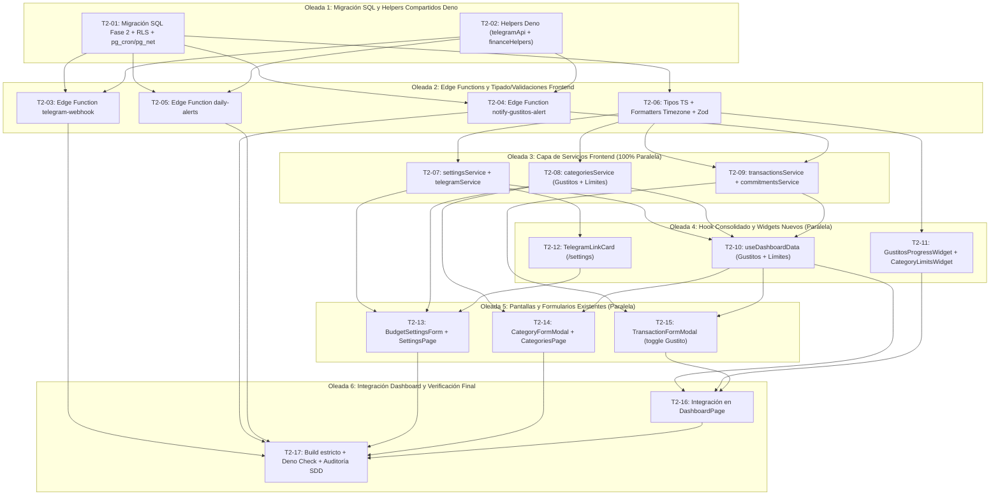

# Plan de Tareas Atómicas — Fase 2 (Automatización e Inteligencia) — SB-Finance

> **Versión:** 1.0.0  
> **Regla de aislamiento:** Ninguna tarea supera los **3 archivos** y las tareas dentro de una misma oleada paralela tienen **intersección cero de archivos** para evitar conflictos de escritura.

---

## Mapa de Oleadas y Dependencias (DAG de Ejecución)

---

## Oleada 1: Migración SQL y Helpers Compartidos Deno

### T2-01 — Migración SQL Incremental Fase 2 (`20261116000001_phase2_automation.sql`)
- **Archivos a crear/modificar (1):**
  - `supabase/migrations/20261116000001_phase2_automation.sql`
- **Dependencias:**
  - **Bloqueada por:** Ninguna.
  - **Corre en paralelo con:** `T2-02`.
- **Descripción:**
  Implementar la migración SQL completa de la Sección 1 de `02-tech-spec.md`:
  1. `ALTER TABLE` sobre `user_settings` (`gustitos_budget`, `timezone`), `monthly_budgets` (`gustitos_budget`), `categories` (`is_gustito` default `false`, `monthly_limit`), `transactions` (`is_gustito`) e `installment_purchases` (`is_gustito`, `source`).
  2. Crear `monthly_category_snapshots`, `telegram_links`, `telegram_link_codes`, `telegram_conversation_sessions`, `telegram_action_logs`, `telegram_processed_updates` y `notification_logs` con sus índices y triggers `updated_at`.
  3. Habilitar RLS y crear políticas estrictas por `auth.uid() = user_id` en todas las tablas nuevas de usuario (dejando `telegram_processed_updates` sin políticas públicas).
  4. Actualizar `ensure_monthly_period` (con `gustitos_budget` y `monthly_category_snapshots`) y `create_installment_purchase` (con `p_is_gustito` y `p_source` retrocompatibles).
  5. Configurar jobs de `pg_cron` + `pg_net` para `daily-alerts` (horario `0 * * * *`) y `keep-alive` de desarrollo (`0 12 * * *`).
- **Definition of Done (DoD):**
  - Sintaxis válida en PostgreSQL 15+ y compatible con ejecución idempotente sobre la BD de Fase 1.
  - Todas las cifras monetarias usan `NUMERIC(12, 2)` y ninguna clave/secreto aparece hardcodeado en SQL (usa `vault.decrypted_secrets`).

---

### T2-02 — Helpers Compartidos de Edge Functions en Deno (`_shared`)
- **Archivos a crear/modificar (3):**
  - `supabase/functions/_shared/telegramApi.ts`
  - `supabase/functions/_shared/financeHelpers.ts`
  - `supabase/functions/_shared/telegramIntentProcessor.ts`
- **Dependencias:**
  - **Bloqueada por:** Ninguna.
  - **Corre en paralelo con:** `T2-01`.
- **Descripción:**
  1. `telegramApi.ts`: wrappers tipados con `fetch` nativo para `sendTelegramMessage`, `editTelegramMessage`, `answerCallbackQuery` y `getTelegramFileBytes` (incluyendo conversión chunk-safe `Uint8Array -> Base64` sin `Buffer` de Node.js).
  2. `financeHelpers.ts`:
     - `getLocalDateParts(timezone, date?)` usando `Intl.DateTimeFormat`.
     - `ensureMonthlyPeriodForUser(supabaseAdmin, userId, monthDate)` para que las Edge Functions inicialicen el mes con `service_role` respetando los mismos snapshots que la RPC web.
     - `computeGustitosStatus(supabaseAdmin, userId, monthDate)` (excluyendo `fixed_expense` y evaluando `tx.is_gustito OR snap.is_gustito` + cuotas gustito).
     - `computeCategoryLimitStatus(supabaseAdmin, userId, monthDate, categoryId)`.
     - `formatCurrency(amount, currency)`.
  3. `telegramIntentProcessor.ts`:
     - Lógica compartida entre `telegram-webhook` y `process-telegram-queue` (`callGeminiFlash` con 1 reintento rápido sobre `gemini-3.8-flash` y `TransientAiError`, `mergeWithActiveSessionDraft`, `normalizeAndValidateParsedIntent`, `persistCompleteIntent`, `promptForClarification` y `dispatchParsedIntent`).
- **Definition of Done (DoD):**
  - Cero importaciones desde `package.json` del frontend ni APIs exclusivas de Node.js.
  - Documenta las decisiones de arquitectura en los comentarios del encabezado.

---

## Oleada 2: Edge Functions Deno y Contratos TypeScript/Zod

### T2-03 — Edge Function `telegram-webhook` y Worker `process-telegram-queue`
- **Archivos a crear/modificar (4):**
  - `supabase/functions/telegram-webhook/deno.json`
  - `supabase/functions/telegram-webhook/index.ts`
  - `supabase/functions/process-telegram-queue/deno.json`
  - `supabase/functions/process-telegram-queue/index.ts`
- **Dependencias:**
  - **Bloqueada por:** `T2-01`, `T2-02`.
  - **Corre en paralelo con:** `T2-04`, `T2-05`, `T2-06`.
- **Descripción:**
  Implementar el webhook y su worker de resiliencia en Deno:
  1. Verificación obligatoria de `X-Telegram-Bot-Api-Secret-Token` (`401` si es inválido).
  2. Deduplicación atómica de `update_id` en `telegram_processed_updates`.
  3. Manejo de comandos `/start`, `/ayuda`, `/cancelar`, `/vincular <CODIGO>` (con rechazo si el `chat_id` ya pertenece a otro `user_id` o si el código expiró/fue invalidado).
  4. Validación de audio `duration <= 60` y `<= 5 MB` antes de descargar, acuse inmediato `"⏳ Mensaje recibido, estamos procesando la transacción..."`, y envío inline a `gemini-3.8-flash` con JSON estructurado.
  5. Flujo híbrido: rechazo con ejemplo si falta monto y contexto claro; máquina de estados multi-turno en `telegram_conversation_sessions` para aclarar categoría (teclado inline) o monto por cuota / fecha de 1.ª cuota (prohibiendo dividir totales automáticamente); mensaje informativo si menciona Plazos Fijos (Fase 3).
  6. Respuesta enriquecida con saldo restante de Gustitos y límite individual de categoría + botón `[❌ Anular]` (válido 24 h, idempotente y bloqueado si alguna cuota tiene `is_paid = true`) + alerta inmediata si Gustitos `<= $0` + soporte de `save_to_savings` para ingresos directos a Bóveda de Ahorros.
  7. Cola ante errores transitorios (`503`, `429`, `5xx`, timeout): si falla el reintento rápido, encola en `telegram_pending_requests`, responde aviso personalizado y `process-telegram-queue` (`pg_cron` `* * * * *`, `X-Cron-Secret`) reintenta con *backoff* hasta 2 horas.
- **Definition of Done (DoD):**
  - Cumple los criterios `CA-01`, `CA-03`, `CA-04`, `CA-05` y `CA-07` de `01-functional-spec.md`.
  - Nunca expone secretos y maneja errores de Gemini/Telegram sin bucles de reintento (`200 OK` tras notificar o encolar).

---

### T2-04 — Edge Function `notify-gustitos-alert` (Alerta en Tiempo Real desde Web)
- **Archivos a crear/modificar (2):**
  - `supabase/functions/notify-gustitos-alert/deno.json`
  - `supabase/functions/notify-gustitos-alert/index.ts`
- **Dependencias:**
  - **Bloqueada por:** `T2-01`, `T2-02`.
  - **Corre en paralelo con:** `T2-03`, `T2-05`, `T2-06`.
- **Descripción:**
  Implementar la Edge Function autenticada por JWT de usuario (`Authorization: Bearer <jwt>`):
  1. Valida la identidad del usuario con `SUPABASE_ANON_KEY`.
  2. Comprueba en `telegram_links` si el usuario tiene Telegram vinculado.
  3. Verifica que el movimiento/compra indicado sea de Gustitos y que `gustitos_budget > 0`.
  4. Calcula `computeGustitosStatus` en el mes del gasto y, si `remaining <= 0`, envía la alerta inmediata al chat de Telegram del usuario.
- **Definition of Done (DoD):**
  - Un usuario nunca puede disparar alertas hacia el chat de otro usuario (`callerUser.id` tomado del JWT validado).
  - Soporta CORS estándar igual que `admin-create-user`.

---

### T2-05 — Edge Function `daily-alerts` (Cron Diario Multi-Timezone)
- **Archivos a crear/modificar (2):**
  - `supabase/functions/daily-alerts/deno.json`
  - `supabase/functions/daily-alerts/index.ts`
- **Dependencias:**
  - **Bloqueada por:** `T2-01`, `T2-02`.
  - **Corre en paralelo con:** `T2-03`, `T2-04`, `T2-06`.
- **Descripción:**
  Implementar la Edge Function invocada por `pg_cron` + `pg_net`:
  1. Valida obligatoriamente `X-Cron-Secret` contra `CRON_INTERNAL_SECRET`.
  2. Filtra usuarios con `telegram_links` cuya hora local en `user_settings.timezone` sea `08` (`08:00 AM`).
  3. Evalúa consumo `> 80%` y `>= 100%` en límites individuales por categoría y en `fixed_expenses_limit` respetando cooldown de **7 días** en `notification_logs`.
  4. Evalúa recordatorios de compromisos pendientes (`is_paid = false`) únicamente en el día local `15` y en `daysInMonth - 7` (7 días antes de fin de mes), con unicidad mensual en `notification_logs`.
- **Definition of Done (DoD):**
  - Cumple `CA-06` sin enviar notificaciones duplicadas dentro de los 7 días ni fuera de las `08:00 AM` locales del usuario.

---

### T2-06 — Actualización de Tipos TypeScript (`strict: true`), Formateadores y Esquemas `zod`
- **Archivos a crear/modificar (3):**
  - `src/types/database.types.ts`
  - `src/lib/formatters.ts`
  - `src/lib/validations.ts`
- **Dependencias:**
  - **Bloqueada por:** `T2-01`.
  - **Corre en paralelo con:** `T2-03`, `T2-04`, `T2-05`.
- **Descripción:**
  1. `database.types.ts`: añadir `gustitos_budget`, `timezone`, `is_gustito`, `monthly_limit`, `MonthlyCategorySnapshot`, `TelegramLink`, `TelegramLinkCode`, `CategoryLimitProgress`, `GustitosSummary` y extender `MonthlyFinancialSummary`.
  2. `formatters.ts`: añadir listado curado de zonas horarias IANA (con `'America/Argentina/Buenos_Aires'` por defecto) y helper de formato de tiempo restante para expiración de códigos.
  3. `validations.ts`: actualizar `userSettingsSchema`, `monthlyBudgetSnapshotSchema`, `categorySchema` y `transactionSchema`.
- **Definition of Done (DoD):**
  - Compila bajo `strict: true` sin ningún `any`.

---

## Oleada 3: Capa de Servicios Frontend (`src/services/`)

### T2-07 — Servicios de Configuraciones (`settingsService`) y Vinculación Telegram (`telegramService`)
- **Archivos a crear/modificar (2):**
  - `src/services/settingsService.ts`
  - `src/services/telegramService.ts`
- **Dependencias:**
  - **Bloqueada por:** `T2-06`.
  - **Corre en paralelo con:** `T2-08`, `T2-09`.
- **Descripción:**
  1. `settingsService.ts`: incluir `gustitos_budget` y `timezone` en lecturas, actualizaciones de `user_settings` y sincronización del mes actual en `monthly_budgets` (`updateUserSettings` y `updateMonthlyBudgetSnapshot`).
  2. `telegramService.ts`: implementar `getTelegramLink(userId)`, `getActiveLinkCode(userId)`, `generateTelegramLinkCode(userId)` (invalida códigos previos `used_at IS NULL` del usuario y genera código alfanumérico de 6 caracteres con TTL 15 min usando `crypto.getRandomValues`) y `unlinkTelegram(userId)`.
- **Definition of Done (DoD):**
  - Nunca almacena tokens del bot en el frontend; maneja errores de Supabase con mensajes claros en español.

---

### T2-08 — Actualización de `categoriesService` (Gustitos, Límites y Snapshots)
- **Archivos a crear/modificar (1):**
  - `src/services/categoriesService.ts`
- **Dependencias:**
  - **Bloqueada por:** `T2-06`.
  - **Corre en paralelo con:** `T2-07`, `T2-09`.
- **Descripción:**
  Actualizar `createCategory` y `updateCategory` para persistir `is_gustito` y `monthly_limit`, sincronizando automáticamente `monthly_category_snapshots` del **mes calendario actual** (si está inicializado) sin tocar meses pasados. Añadir `getMonthlyCategorySnapshots(monthDate)` y `toggleCategoryGustito(id, isGustito)` para el selector rápido en `/settings`.
- **Definition of Done (DoD):**
  - Editar límites o pertenencia a Gustitos nunca modifica snapshots de meses cerrados anteriores al actual.

---

### T2-09 — Actualización de `transactionsService` y `commitmentsService` (Flag Gustito + Alerta Real-Time)
- **Archivos a crear/modificar (2):**
  - `src/services/transactionsService.ts`
  - `src/services/commitmentsService.ts`
- **Dependencias:**
  - **Bloqueada por:** `T2-04`, `T2-06`.
  - **Corre en paralelo con:** `T2-07`, `T2-08`.
- **Descripción:**
  1. `transactionsService.ts`: persistir `is_gustito` en `createTransaction` y `updateTransaction`; tras guardar un gasto (`type = 'expense'`) del mes actual, invocar de forma no bloqueante `supabase.functions.invoke('notify-gustitos-alert', ...)` para disparar la alerta inmediata a Telegram si Gustitos llegó a `<= $0`.
  2. `commitmentsService.ts`: enviar `p_is_gustito` y `p_source: 'web'` al invocar `create_installment_purchase`, e invocar también `notify-gustitos-alert` si la primera cuota impacta en el mes actual sobre una categoría de Gustitos.
- **Definition of Done (DoD):**
  - Si falla el envío de la notificación a Telegram, no revierte el guardado de la transacción en BD (degradación elegante con log en consola).

---

## Oleada 4: Hook Consolidado y Widgets Nuevos

### T2-10 — Actualización de `useDashboardData` (Cálculo de Gustitos y Límites por Categoría)
- **Archivos a crear/modificar (1):**
  - `src/hooks/useDashboardData.ts`
- **Dependencias:**
  - **Bloqueada por:** `T2-07`, `T2-08`, `T2-09`.
  - **Corre en paralelo con:** `T2-11`, `T2-12`.
- **Descripción:**
  Cargar `monthly_category_snapshots` del mes seleccionado (con fallback a `categories` en meses futuros no inicializados) y calcular en `summary`:
  - `gustitos`: `isConfigured` (`budget > 0 && gustitoCategoriesCount > 0`), `budget`, `spent` (variables con `tx.is_gustito || catSnapshot.is_gustito` + cuotas de categorías gustito; **excluyendo `fixed_expense`**), `remaining = budget - spent`, `isExceeded = isConfigured && remaining <= 0`.
  - `categoryLimits`: lista ordenada de categorías con `monthly_limit > 0`, consumido (`variables + fijos + cuotas`) y porcentaje de uso.
- **Definition of Done (DoD):**
  - Redondeo exacto a 2 decimales y protección contra división por cero cuando `monthly_limit === 0` o `gustitos_budget === 0`.

---

### T2-11 — Widgets de Dashboard: `GustitosProgressWidget` y `CategoryLimitsWidget`
- **Archivos a crear/modificar (2):**
  - `src/features/dashboard/GustitosProgressWidget.tsx`
  - `src/features/dashboard/CategoryLimitsWidget.tsx`
- **Dependencias:**
  - **Bloqueada por:** `T2-06`.
  - **Corre en paralelo con:** `T2-10`, `T2-12`.
- **Descripción:**
  1. `GustitosProgressWidget.tsx`: barra de progreso regresiva (`Presupuesto Gustitos - Gastado`). Si `!gustitos.isConfigured`, muestra aviso amarillo/negro de configuración pendiente con accesos directos a `/settings` y `/categories` (sin rojo). Si `remaining <= 0`, cambia a rojo semántico (`#EF4444`).
  2. `CategoryLimitsWidget.tsx`: tarjeta compacta con las categorías que tienen `monthly_limit > 0`, mostrando barra de progreso (`<= 80%` amarillo, `> 80%` advertencia, `>= 100%` rojo) y montos en `.tabular-nums`.
- **Definition of Done (DoD):**
  - Aplica el sistema visual amarillo/negro (`#FACC15` / `#0A0A0A`, cero violeta/lavanda, responsive en `1440px` y `390px`).

---

### T2-12 — Tarjeta de Vinculación con Telegram (`TelegramLinkCard`)
- **Archivos a crear/modificar (1):**
  - `src/features/settings/TelegramLinkCard.tsx`
- **Dependencias:**
  - **Bloqueada por:** `T2-07`.
  - **Corre en paralelo con:** `T2-10`, `T2-11`.
- **Descripción:**
  Componente reutilizable para `/settings`: muestra estado actual (vinculado con `@username`/fecha o sin vincular), botón `"Generar código de vinculación"`, visualización del código alfanumérico con botón `"Copiar comando"` (`/vincular CODIGO`) y cuenta regresiva en vivo de los 15 minutos, botón `"Actualizar estado"` y botón `"Desvincular Telegram"` con confirmación.
- **Definition of Done (DoD):**
  - Todas las acciones muestran estado `isLoading` y notificaciones claras vía `react-hot-toast`.

---

## Oleada 5: Actualización de Vistas y Formularios Existentes

### T2-13 — Integración en `/settings` (`BudgetSettingsForm` y `SettingsPage`)
- **Archivos a crear/modificar (2):**
  - `src/features/settings/BudgetSettingsForm.tsx`
  - `src/features/settings/SettingsPage.tsx`
- **Dependencias:**
  - **Bloqueada por:** `T2-07`, `T2-08`, `T2-12`.
  - **Corre en paralelo con:** `T2-14`, `T2-15`.
- **Descripción:**
  1. `BudgetSettingsForm.tsx`: agregar campo `Presupuesto mensual de Gustitos ($)`, selector de `Zona horaria` (`timezone`) y sección rápida de checkboxes para marcar qué categorías activas de gasto pertenecen a la bolsa de Gustitos.
  2. `SettingsPage.tsx`: montar `TelegramLinkCard` debajo del formulario de presupuesto.
- **Definition of Done (DoD):**
  - Al guardar en `/settings`, se actualizan `gustitos_budget`, `timezone`, `categories.is_gustito` y el snapshot del mes actual.

---

### T2-14 — Integración en `/categories` (`CategoryFormModal` y `CategoriesPage`)
- **Archivos a crear/modificar (2):**
  - `src/features/categories/CategoryFormModal.tsx`
  - `src/features/categories/CategoriesPage.tsx`
- **Dependencias:**
  - **Bloqueada por:** `T2-08`, `T2-10`.
  - **Corre en paralelo con:** `T2-13`, `T2-15`.
- **Descripción:**
  1. `CategoryFormModal.tsx`: cuando `type === 'expense'`, mostrar toggle `"Incluir en bolsa de Gustitos"` y campo numérico opcional `"Límite máximo mensual ($)"`.
  2. `CategoriesPage.tsx`: mostrar badge `"Gustito"` en tarjetas marcadas y barra de progreso visual del mes actual en categorías de gasto con `monthly_limit > 0`.
- **Definition of Done (DoD):**
  - Las categorías de ingreso (`type === 'income'`) no muestran opciones de Gustito ni límite de gasto.

---

### T2-15 — Marca Puntual de Gustito y Ahorro Directo en `TransactionFormModal`
- **Archivos a crear/modificar (1):**
  - `src/features/transactions/TransactionFormModal.tsx`
- **Dependencias:**
  - **Bloqueada por:** `T2-09`, `T2-10`.
  - **Corre en paralelo con:** `T2-13`, `T2-14`.
- **Descripción:**
  - Cuando `type === 'expense'`, agregar el control `"Contar este gasto en la bolsa de Gustitos"` (`is_gustito`). Al cambiar de categoría al crear un gasto nuevo, se pre-marca automáticamente si la categoría tiene `is_gustito = true`, permitiendo también al usuario tildarlo manualmente en cualquier otra categoría de gasto.
  - Cuando `type === 'income'`, agregar el control `"Enviar este ingreso directamente a la Bóveda de Ahorros"` (`save_to_savings`), sincronizando de forma atómica el depósito vinculado en `savings_entries` (`source_transaction_id`).
- **Definition of Done (DoD):**
  - En modo edición conserva el valor `initialTransaction.is_gustito` o `initialTransaction.save_to_savings` guardado.

---

## Oleada 6: Integración Final y Verificación E2E

### T2-16 — Integración de Widgets y Ajuste Mensual de Gustitos en `DashboardPage`
- **Archivos a crear/modificar (1):**
  - `src/features/dashboard/DashboardPage.tsx`
- **Dependencias:**
  - **Bloqueada por:** `T2-10`, `T2-11`, `T2-15`.
  - **Corre en paralelo con:** Ninguna.
- **Descripción:**
  Montar `GustitosProgressWidget` y `CategoryLimitsWidget` en `DashboardPage.tsx`, y sumar el campo `Presupuesto de Gustitos` del mes al modal `"Ajustar presupuesto del mes"` para permitir ajustes puntuales mensuales sin modificar `user_settings`.
- **Definition of Done (DoD):**
  - Layout balanceado en `1440px`, `1024px`, `768px` y `390px` sin desbordes horizontales.

---

### T2-17 — Verificación Técnica E2E, Deno Check y Auditoría SDD
- **Archivos a crear/modificar (0 — solo verificación y despliegue/documentación):**
  - Ninguno (validación integral de los archivos creados en Oleadas 1–6).
- **Dependencias:**
  - **Bloqueada por:** `T2-03`, `T2-04`, `T2-05`, `T2-13`, `T2-14`, `T2-16`.
- **Descripción:**
  1. Ejecutar `npm run build` (`tsc -b && vite build`) verificando cero errores TypeScript en modo `strict: true`.
  2. Verificar sintaxis y tipos de las Edge Functions Deno (`deno check` si Deno está disponible en el entorno).
  3. Validar manualmente o mediante auditoría SDD los criterios `CA-01` a `CA-06` y las políticas RLS de Fase 2.
  4. Documentar los secretos requeridos en Supabase Cloud (`TELEGRAM_BOT_TOKEN`, `TELEGRAM_WEBHOOK_SECRET`, `GEMINI_API_KEY`, `CRON_INTERNAL_SECRET`, Vault `supabase_project_url` y `supabase_anon_key`) y el comando de registro del webhook (`setWebhook`).
- **Definition of Done (DoD):**
  - `npm run build` finaliza con código `0`.
  - Todas las políticas RLS, validaciones `zod`, restricciones `NUMERIC(12,2)` y flujos de Fase 2 verificados sin regresiones sobre Fase 1.
