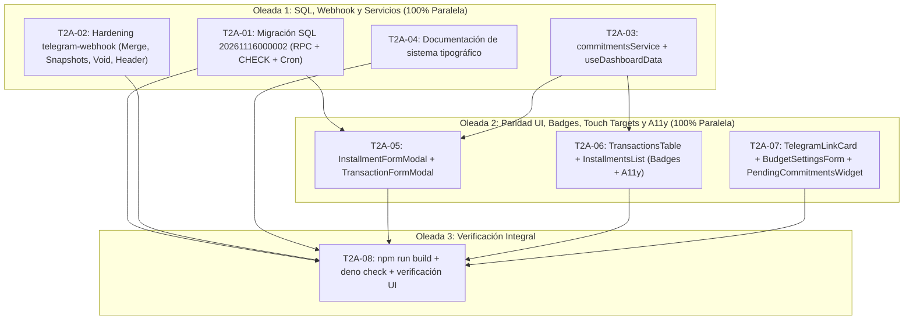

# Auditoría Integral SDD y Plan de Tareas de Corrección — Fase 2 (SB-Finance)

> **Versión:** 1.0.0  
> **Fecha de auditoría:** 2026-11-15  
> **Documentos contrastados:** `specs/constitution.md`, `specs/fase-2-automation/01-functional-spec.md`, `specs/fase-2-automation/02-tech-spec.md`, `specs/fase-2-automation/03-tasks.md` (y verificación de no regresión contra `CA-07` de `specs/fase-1-core/01-functional-spec.md`).  
> **Áreas auditadas:** QA Funcional, Seguridad BaaS/RLS, Accesibilidad y UI/UX.  
> **Regla de aislamiento:** Ninguna tarea supera los **3 archivos** y las tareas dentro de una misma oleada paralela tienen **intersección cero de archivos**.

---

## 1. Resumen Ejecutivo de la Auditoría

- **Dictamen General:** **APROBADO CON OBSERVACIONES MENORES (Requiere correcciones puntuales antes del cierre definitivo de Fase 2).**
- **Compilación y Tipado Estricto:**
  - Frontend (`npm run build` / `tsc -b && vite build` con `strict: true`): **PASS** (`0` errores, `0` warnings, `559` módulos en `6.47s`).
  - Edge Functions (`deno check` con Deno `2.9.8`): **PASS** (`0` errores en `telegram-webhook`, `daily-alerts`, `notify-gustitos-alert` y `_shared/*`).
- **Seguridad BaaS y RLS:** **PASS (`100%`)** — `0` vulnerabilidades críticas o altas; las 7 tablas nuevas tienen RLS activo filtrando por `auth.uid() = user_id`; no hay secretos en `src/`; validación de webhooks y crons en tiempo constante (`timingSafeEqualStr`); JWT verificado con `SUPABASE_ANON_KEY` antes de usar `service_role`.
- **Evaluación UX/UI y Diseño:**
  - **Evaluación Heurística (Heurísticas de Nielsen):** **31 / 40** (*Good — base sólida, resolver visibilidad de insignias y paridad en cuotas*).
  - **Auditoría Técnica UI (5 Dimensiones):** **16 / 20** (*Good — Accessibility `3/4`, Performance `3/4`, Theming `4/4`, Responsive `3/4`, Integrity `3/4`*).
  - **Análisis Estático Tipográfico (`src`):** `0` errores, `1` advertencia documental por `'Plus Jakarta Sans'` en `src/index.css:66`.

> **Nota de precisión sobre `CA-07`:** En `specs/fase-2-automation/01-functional-spec.md` solo existen **6 Criterios de Aceptación (`CA-01` a `CA-06`)**. El criterio `CA-07` pertenece a `specs/fase-1-core/01-functional-spec.md` (borrado lógico de categorías y separación de tipos `income`/`expense`), cuya no regresión también fue verificada con resultado **PASS**.

---

## 2. Verificación de Criterios de Aceptación

| Criterio | Descripción | Estado | Evidencia Principal |
| :--- | :--- | :---: | :--- |
| **CA-01** | Vinculación multi-usuario segura con código alfanumérico (`TTL 15 min`), invalidación de previos y relación `1:1` (`user_id ↔ telegram_chat_id`). | **PASS** | `src/services/telegramService.ts:88-139`, `supabase/functions/telegram-webhook/index.ts:1179-1284`, `supabase/migrations/20261116000001_phase2_automation.sql:85-90` |
| **CA-02** | Bolsa de Gustitos con exclusión estricta de `fixed_expense` y aviso de configuración pendiente (nunca rojo sin configurar). | **PASS** | `src/hooks/useDashboardData.ts:322-376`, `src/features/dashboard/GustitosProgressWidget.tsx:29-78`, `supabase/functions/_shared/financeHelpers.ts:306-373` |
| **CA-03** | Registro multimodal en Telegram (texto/audio `<= 60 s`), saldo restante, `[❌ Anular]` y alerta inmediata `<= $0` desde Telegram y Web. | **PASS** | `supabase/functions/telegram-webhook/index.ts:357-554, 696-780`, `src/services/transactionsService.ts:47-60`, `supabase/functions/notify-gustitos-alert/index.ts:146-241` |
| **CA-04** | Rechazo previo de audio `> 60 s`, multi-turno de categoría y compras en cuotas sin división automática. | **PASS** | `supabase/functions/telegram-webhook/index.ts:321-335, 783-844, 1342-1368` |
| **CA-05** | Botón `[❌ Anular]` con ventana de 24 h, idempotencia ante doble clic y bloqueo por cuotas `is_paid = true`. | **PASS** | `supabase/functions/telegram-webhook/index.ts:923-1029` |
| **CA-06** | Alertas proactivas diarias (`08:00 AM` local, cooldown 7 días, recordatorios día 15 y `fin_de_mes - 7`) + Keep-Alive diario. | **PASS** | `supabase/functions/daily-alerts/index.ts:115-358`, `supabase/migrations/20261116000001_phase2_automation.sql:450-514` |
| **CA-07** *(Fase 1)* | No regresión en borrado lógico de categorías (`is_active = false`) y separación `income` / `expense`. | **PASS** | `src/features/categories/CategoriesPage.tsx:98-128`, `src/features/transactions/TransactionFormModal.tsx:61-83`, `src/features/commitments/InstallmentFormModal.tsx:84-101` |

---

## 3. Catálogo Consolidado de Hallazgos y Mejoras Priorizadas

| ID | Severidad | Categoría | Archivo y Línea Exacta | Descripción del Hallazgo | Tarea Asociada |
| :--- | :---: | :---: | :--- | :--- | :---: |
| **BUG-01** | **Alta (P1)** | Paridad Funcional UI + RPC | `src/features/commitments/InstallmentFormModal.tsx:59-70, 382-390` y `20261115000002_phase1_audit_security_fixes.sql:269` | Falta el checkbox `"Contar esta compra en la bolsa de Gustitos"` en el modal web de Compras en Cuotas, y la RPC `update_installment_purchase` aún no recibe `p_is_gustito` al editar una compra. | `T2A-01`, `T2A-03`, `T2A-05` |
| **BUG-02** | **Alta (P1)** | Visibilidad de Estado (UX) | `src/features/transactions/TransactionsTable.tsx:108-117, 182-189` e `src/features/commitments/InstallmentsList.tsx:150-157` | Las filas de movimientos y tarjetas de cuotas no muestran insignia `<Badge variant="yellow">Gustito</Badge>` ni `<Badge variant="neutral">Telegram</Badge>`, impidiendo auditar qué movimientos consumieron Gustitos o vinieron del bot. | `T2A-06` |
| **BUG-03** | **Media (P1)** | Lógica Multi-Turno Bot | `supabase/functions/telegram-webhook/index.ts:488-489, 804` | En respuestas de texto/voz sobre una sesión multi-turno activa, el merge con `activeSession.draft_json` depende 100% de que Gemini repita los campos del turno 1. Si los omite, se pierden en `draft_json`. | `T2A-02` |
| **BUG-04** | **Media (P1)** | Alerta Real-Time Cuotas | `src/services/commitmentsService.ts:355-378` | `updateInstallmentPurchase` no invoca `triggerPurchaseGustitosAlertNonBlocking` tras editar una compra en cuotas cuya cuota del mes actual cruza la bolsa de Gustitos a `<= $0`. | `T2A-03` |
| **BUG-05** | **Media (P1)** | Snapshots de Meses Futuros | `supabase/functions/telegram-webhook/index.ts:529, 564` | `persistCompleteIntent` ejecuta `ensureMonthlyPeriodForUser` incluso para cuotas cuya 1.ª fecha cae en un mes futuro, congelando prematuramente snapshots de ese mes antes de que comience. | `T2A-02` |
| **BUG-06** | **Media (P2)** | Lógica UX Dashboard | `src/hooks/useDashboardData.ts:367` | `isGustitosConfigured` exige `gustitoCategoriesCount > 0` aunque el usuario tenga `gustitos_budget > 0` y gastos individuales marcados con `tx.is_gustito = true` (`gustitosSpent > 0`). | `T2A-03` |
| **BUG-07** | **Media (P2)** | Responsive / Touch Targets | `src/features/settings/TelegramLinkCard.tsx:179` y `src/features/settings/BudgetSettingsForm.tsx:270` | El enlace `"Abrir bot en Telegram ↗"` (vinculado) y los checkboxes de categorías Gustito en `/settings` usan `min-h-[36px]` en lugar del mínimo táctil `min-h-[44px]`. | `T2A-07` |
| **BUG-08** | **Baja (P2)** | Seguridad Bot (`void:`) + HTML | `supabase/functions/telegram-webhook/index.ts:923-945` | 1) `void:<logId>` no comprueba que `chatId` siga activo en `telegram_links` si el usuario desvinculó la cuenta minutos antes (`SEC-F2-01`). 2) En la rama idempotente (L943) falta `{ parseMode: 'HTML' }` en `editTelegramMessage` (`SEC-F2-02`). | `T2A-02` |
| **BUG-09** | **Baja (P2)** | Performance Timer / UX / A11y | `src/features/settings/TelegramLinkCard.tsx:73-79`, `src/features/transactions/TransactionFormModal.tsx:312-333`, `src/features/dashboard/PendingCommitmentsWidget.tsx:136` | 1) El `setInterval` de 1 s en `TelegramLinkCard` no se detiene cuando `countdown.isExpired === true` y no refresca al volver a la pestaña (`focus`). 2) En `TransactionFormModal`, cuando la categoría elegida ya es Gustito, permite destildar el checkbox aunque el gasto igual sume a Gustitos. 3) En `PendingCommitmentsWidget`, `"Pagado ✓"` no sigue Verbo + Objeto ni tiene `loadingText`. 4) Falta `role="group"` en checkboxes de `/settings` y `aria-label` por fila en `TransactionsTable`. | `T2A-05`, `T2A-06`, `T2A-07` |
| **SEC-F2-03** | **Observación** | Defensa en Profundidad SQL | `supabase/migrations/20261116000001_phase2_automation.sql:38-45` | Faltan restricciones `CHECK` en BD para garantizar que registros `type = 'income'` nunca tengan `is_gustito = true` ni `monthly_limit` en `categories` / `transactions`. | `T2A-01` |
| **SEC-F2-04** | **Observación** | Higiene Cron y Header Gemini | `20261116000001_phase2_automation.sql:500` y `telegram-webhook/index.ts:442` | 1) Desagendar el job legado `'sb-finance-keep-alive-daily'` de Fase 1 si coexiste con `'sb-finance-keep-alive-dev'`. 2) Mover `geminiApiKey` del query param `?key=` al header `'x-goog-api-key'`. | `T2A-01`, `T2A-02` |
| **UI-FONT-01** | **Observación** | Tipografía UI | `src/index.css:66` | Se documenta el uso intencional de `'Plus Jakarta Sans'` como fuente principal combinada con `'JetBrains Mono'`. | `T2A-04` |

---

## 4. Matriz de Casos de Prueba Verificados (24 Casos)

| ID | Escenario | Paso a paso | Resultado Esperado | Estado | Evidencia (`archivo:línea`) |
| :--- | :--- | :--- | :--- | :---: | :--- |
| **TC-01** | **Seguridad Webhook: header secreto faltante o inválido** | Enviar `POST /functions/v1/telegram-webhook` sin `X-Telegram-Bot-Api-Secret-Token` o con token erróneo. | Retorna `401 Unauthorized` con `timingSafeEqualStr`, sin consultar Gemini ni BD. | **PASS** | `telegram-webhook/index.ts:875-881`, `telegramApi.ts:38-52` |
| **TC-02** | **Deduplicación atómica de `update_id` repetido** | Enviar dos veces un `TelegramUpdate` válido con idéntico `update_id`. | El 1.er envío procesa y persiste; el 2.º colisiona (`23505`) en `telegram_processed_updates` y devuelve `200 OK`. | **PASS** | `telegram-webhook/index.ts:901-911` |
| **TC-03** | **Generación de código invalida el código anterior (`CA-01`)** | Generar `X1B2C3`, generar luego `K7M9P2` y enviar `/vincular X1B2C3` al bot. | `X1B2C3` queda con `used_at` al generar `K7M9P2`; el bot rechaza `X1B2C3` y acepta `K7M9P2`. | **PASS** | `telegramService.ts:98-109`, `telegram-webhook/index.ts:1192-1208` |
| **TC-04** | **Código `/vincular` expirado (> 15 min) (`CA-01`)** | Generar código, esperar > 15 min y enviar `/vincular CODIGO`. | UI muestra `"Expirado — generá uno nuevo"` y oculta copiar; el bot rechaza por `.gt('expires_at', nowIso)`. | **PASS** | `formatters.ts:238-258`, `TelegramLinkCard.tsx:275-324` |
| **TC-05** | **Restricción 1:1: mismo `chat_id` en otra cuenta (`CA-01`)** | Con `chat_id = 111` vinculado al Usuario A, Usuario B genera código y el `chat_id = 111` envía `/vincular`. | El webhook detecta `existingByChat.user_id !== targetUserId` y rechaza pidiendo desvincular la cuenta A. | **PASS** | `telegram-webhook/index.ts:1213-1226` |
| **TC-06** | **Usuario no vinculado escribe al bot** | Enviar `"Gasté 10.000 en panadería"` desde un `chat_id` sin fila en `telegram_links`. | Responde pidiendo generar código en `/settings` sin llamar a Gemini. | **PASS** | `telegram-webhook/index.ts:1287-1320` |
| **TC-07** | **Bolsa de Gustitos sin configurar (`CA-02`)** | Usuario con `gustitos_budget = 0` o `0` categorías/gastos Gustitos abre el Dashboard. | Muestra tarjeta amarilla/negra de configuración pendiente, nunca en rojo ni dispara alertas. | **PASS** | `GustitosProgressWidget.tsx:29-78` |
| **TC-08** | **Exclusión obligatoria de `fixed_expense` (`CA-02`)** | Con `gustitos_budget = $ 50.000` y *"Ocio"* como Gustito, crear fijo `$ 30.000` y variable `$ 20.000` en *"Ocio"*. | El gasto fijo no descuenta; la barra regresiva muestra `$ 30.000,00` disponibles (`60%`). | **PASS** | `useDashboardData.ts:322-331`, `financeHelpers.ts:306-312` |
| **TC-09** | **Inclusión de compras en cuotas en Bolsa de Gustitos** | Registrar compra en cuotas en categoría Gustito (o con `is_gustito = true`) por `$ 15.000`/cuota en mes actual. | La cuota (`commitment_type = 'installment'`) suma `$ 15.000` en Web y en Edge Functions. | **PASS** | `useDashboardData.ts:326-331`, `financeHelpers.ts:356-373` |
| **TC-10** | **Audio `<= 60 s` cruza a `<= $0` + recarga desde Web (`CA-03`)** | Con `$ 15.000` restantes, enviar audio de 6 s por `$ 20.000` y luego registrar `$ 2.000` Gustito desde Web. | Bot registra `-$ 5.000,00` y alerta; Web invoca `notify-gustitos-alert` y envía nueva alerta `-$ 7.000,00`. | **PASS** | `telegram-webhook/index.ts:696-780`, `notify-gustitos-alert/index.ts:209-241` |
| **TC-11** | **Rechazo de nota de voz `> 60 s` o `> 5 MB` (`CA-04`)** | Enviar audio de `65 s` (o archivo `> 5 MB`) al bot. | Se rechaza antes de descargar e invocar a Gemini indicando el límite de 60 segundos. | **PASS** | `telegram-webhook/index.ts:1342-1368` |
| **TC-12** | **Mensaje casual sin monto ni contexto claro** | Enviar `"hola, hoy gasté plata"` sin sesión activa. | Devuelve `unrecognized`, no abre sesión vacía y muestra 3 ejemplos claros. | **PASS** | `telegram-webhook/index.ts:405, 1487-1495` |
| **TC-13** | **Mención de Plazo Fijo en Telegram (Out-of-Scope)** | Enviar `"Armé un plazo fijo de 500.000 pesos"`. | Responde que Plazos Fijos estará disponible en Fase 3. | **PASS** | `telegram-webhook/index.ts:404, 1478-1485` |
| **TC-14** | **Multi-turno de categoría con teclado inline (`CA-04`)** | Enviar `"Gasté 12.000 en trámite"` y luego tocar botón `pick_cat:<uuid>`. | Guarda sesión `awaiting_category`, muestra teclado y al elegir categoría persiste y limpia sesión. | **PASS** | `telegram-webhook/index.ts:783-825, 1050-1151` |
| **TC-15** | **Compra en cuotas sin monto por cuota o sin fecha (`CA-04`)** | Enviar `"Compré bici a 300.000 en 6 cuotas"` y responder por texto en turno 2. | No divide ni inventa fecha; pregunta paso a paso. *(Riesgo en turno 2 si Gemini omite campos del turno 1 — `BUG-03`)*. | **RIESGO** | `telegram-webhook/index.ts:321-335, 488-489` |
| **TC-16** | **Fechas límite en cuotas (31 ene -> 28 feb -> 31 mar)** | Crear compra en 3 cuotas con `first_installment_date = '2026-01-31'`. | Genera `'2026-01-31'`, `'2026-02-28'` y `'2026-03-31'` sin desfase de mes. | **PASS** | `telegram-webhook/index.ts:154-169`, `20261116000001_phase2_automation.sql:452-464` |
| **TC-17** | **Botón `[❌ Anular]` < 24 h y doble clic idempotente (`CA-05`)** | Presionar `[❌ Anular]` dos veces seguidas sobre un gasto reciente. | 1.er clic elimina registro y quita botón; 2.º clic responde idempotentemente sin error. | **PASS** | `telegram-webhook/index.ts:923-946, 991-1029` |
| **TC-18** | **Bloqueo de `[❌ Anular]` > 24 h o con cuota pagada (`CA-05`)** | Marcar Cuota 1 como pagada en Web (o esperar > 24 h) y tocar `[❌ Anular]`. | Bloquea anulación y explica el motivo al usuario en Telegram. | **PASS** | `telegram-webhook/index.ts:948-984` |
| **TC-19** | **Inmutabilidad histórica de snapshots mensuales** | Modificar `gustitos_budget`, `is_gustito` y `monthly_limit` en el mes actual y consultar un mes pasado. | Mes actual aplica los cambios; meses anteriores mantienen sus snapshots históricos intactos. | **PASS** | `categoriesService.ts:60-94`, `useDashboardData.ts:240-278` |
| **TC-20** | **Valores límite (`$0`, `MAX_MONEY`) y división por cero** | Ingresar `$ 0` en transacción/límite y evaluar barras con `gustitos_budget = 0`. | `zod` y `CHECK` rechazan `< 0.01` en movimientos/límites; cálculos evitan división por cero. | **PASS** | `validations.ts:107-119`, `useDashboardData.ts:354-357` |
| **TC-21** | **Cron diario multi-timezone (`08:00 AM` local) y cooldown 7 días (`CA-06`)** | Invocar `daily-alerts` dos días seguidos a las `08:00` local con categoría al `85%`. | Día 1 envía `category_warning_80` y registra log; día 2 respeta cooldown de 7 días. | **PASS** | `daily-alerts/index.ts:115-205`, `financeHelpers.ts:77-130` |
| **TC-22** | **Recordatorio de pagos pendientes día 15 y `fin_de_mes - 7` (`CA-06`)** | Ejecutar `daily-alerts` el día `15` y `daysInMonth - 7` con cuotas `is_paid = false`. | Envía un único resumen por hito en el mes. | **PASS** | `daily-alerts/index.ts:290-358` |
| **TC-23** | **Marcar o editar compra en cuotas como Gustito en Web** | Intentar marcar `is_gustito` en `InstallmentFormModal` o editar cuota cruzando Gustitos a `<= $0`. | Falla por falta de checkbox en `InstallmentFormModal` (`BUG-01`) y ausencia de alerta en `updateInstallmentPurchase` (`BUG-04`). | **FAIL** | `InstallmentFormModal.tsx:382-390`, `commitmentsService.ts:355-378` |
| **TC-24** | **Falla temporal de Gemini Flash o corte de red** | Simular error HTTP 500/503 de Gemini durante un mensaje en `telegram-webhook`. | No guarda registros parciales, notifica error amigable y devuelve `200 OK` evitando reintentos infinitos. | **PASS** | `telegram-webhook/index.ts:466-469, 1522-1530` |

---

## 5. Mapa de Oleadas y Dependencias para Correcciones (`T2A-01` a `T2A-08`)

---

## 6. Tareas Atómicas de Corrección

### Oleada 1 (Backend, Servicios y Configuración — Intersección Cero)

#### T2A-01 — Migración SQL Incremental de Endurecimiento (`20261116000002_phase2_audit_fixes.sql`)
- **Archivos a crear/modificar (1):**
  - `supabase/migrations/20261116000002_phase2_audit_fixes.sql`
- **Dependencias:** Ninguna. Corre en paralelo con `T2A-02`, `T2A-03`, `T2A-04`.
- **Alcance:**
  1. Actualizar `public.update_installment_purchase(...)` agregando el parámetro retrocompatible `p_is_gustito BOOLEAN DEFAULT false` y persistiendo `is_gustito = COALESCE(p_is_gustito, is_gustito)` tanto cuando `v_paid_count = 0` como cuando `v_paid_count > 0` (`BUG-01`).
  2. Agregar restricciones `CHECK` defensivas (`NOT VALID` o validadas previa limpieza segura):
     - En `public.categories`: `type = 'expense' OR (is_gustito = false AND monthly_limit IS NULL)` (`SEC-F2-03`).
     - En `public.transactions`: `type = 'expense' OR is_gustito = false` (`SEC-F2-03`).
  3. Ejecutar `SELECT cron.unschedule('sb-finance-keep-alive-daily') WHERE EXISTS (SELECT 1 FROM cron.job WHERE jobname = 'sb-finance-keep-alive-daily');` para evitar duplicación con `'sb-finance-keep-alive-dev'` (`SEC-F2-04`).
- **Definition of Done (DoD):** Sintaxis PostgreSQL 15+ idempotente; `SECURITY INVOKER` + `SET search_path = public` preservados.

#### T2A-02 — Endurecimiento de `telegram-webhook` (Multi-turno, Snapshots, Void y Header Gemini)
- **Archivos a crear/modificar (1):**
  - `supabase/functions/telegram-webhook/index.ts`
- **Dependencias:** Ninguna. Corre en paralelo con `T2A-01`, `T2A-03`, `T2A-04`.
- **Alcance:**
  1. En `callGeminiFlash` (`L441-490`): mover `geminiApiKey` del query param `?key=` al header `'x-goog-api-key': geminiApiKey` (`SEC-F2-04`).
  2. Cuando exista `activeSession`, aplicar un **merge defensivo en TypeScript** entre `activeSession.draft_json` y `rawParsed` antes de `normalizeAndValidateParsedIntent` para conservar campos previos no nulos (`is_gustito`, `category_id`, `description`, `installments_count`, `amount`, etc.) si Gemini no los repitió en el turno actual (`BUG-03`).
  3. En `persistCompleteIntent` (`L529, L564`): invocar `ensureMonthlyPeriodForUser` **únicamente** cuando `affectedMonth <= normalizeMonthStart(todayLocal)` para no congelar prematuramente snapshots de meses futuros en compras en cuotas adelantadas (`BUG-05`).
  4. En `handleCallbackQuery` (`void:<logId>`, `L923-945`): verificar que exista vínculo activo en `telegram_links` para `(user_id, telegram_chat_id)` antes de anular (`BUG-08` / `SEC-F2-01`) y pasar `{ parseMode: 'HTML' }` al `editTelegramMessage` de la rama idempotente en `L943` (`BUG-08` / `SEC-F2-02`).
- **Definition of Done (DoD):** Pasa `deno check` con `0` errores sin importar módulos de `package.json`.

#### T2A-03 — Alerta al Editar Cuotas y Regla `isGustitosConfigured` (`commitmentsService` + `useDashboardData`)
- **Archivos a crear/modificar (2):**
  - `src/services/commitmentsService.ts`
  - `src/hooks/useDashboardData.ts`
- **Dependencias:** Ninguna. Corre en paralelo con `T2A-01`, `T2A-02`, `T2A-04`.
- **Alcance:**
  1. En `src/services/commitmentsService.ts` (`updateInstallmentPurchase`, `L355-378`): enviar `p_is_gustito: Boolean(input.is_gustito)` a la RPC `update_installment_purchase` (`BUG-01`), y verificar si la compra tiene cuota en `currentMonth` (o `firstInstallmentMonth === currentMonth`) para disparar de forma no bloqueante `triggerPurchaseGustitosAlertNonBlocking(currentMonth, updated.id)` (`BUG-04`).
  2. En `src/hooks/useDashboardData.ts` (`L367`): actualizar la condición a `const isGustitosConfigured = gustitosBudget > 0 && (gustitoCategoriesCount > 0 || gustitosSpent > 0);` (`BUG-06`).
- **Definition of Done (DoD):** Compila bajo `strict: true`; un usuario nuevo (`budget = 0`, `spent = 0`, `categories = 0`) mantiene `isConfigured = false` (`CA-02`).

#### T2A-04 — Registro de Sistema Tipográfico Base
- **Archivos revisados (1):**
  - `src/index.css`
- **Dependencias:** Ninguna. Corre en paralelo con `T2A-01`, `T2A-02`, `T2A-03`.
- **Alcance:**
  1. Documentar la selección intencional de `'Plus Jakarta Sans'` en `src/index.css:66` combinada con `'JetBrains Mono'` `tabular-nums` como sistema tipográfico base de SB-Finance (`UI-FONT-01`).
- **Definition of Done (DoD):** Sistema tipográfico verificado sin alterar diseño ni tipografía vigente.

---

### Oleada 2 (Componentes UI, Paridad y Accesibilidad — Intersección Cero)

#### T2A-05 — Paridad de Toggle `is_gustito` en Cuotas y Claridad en Gastos (`InstallmentFormModal` + `TransactionFormModal`)
- **Archivos a crear/modificar (2):**
  - `src/features/commitments/InstallmentFormModal.tsx`
  - `src/features/transactions/TransactionFormModal.tsx`
- **Dependencias:** Bloqueada por `T2A-01` y `T2A-03`. Corre en paralelo con `T2A-06` y `T2A-07`.
- **Alcance:**
  1. En `src/features/commitments/InstallmentFormModal.tsx`: agregar estado `isGustito`, inicializarlo con `initialPurchase.is_gustito` al editar o sincronizarlo con `selectedCategory.is_gustito` al crear, renderizar el control `min-h-[44px]` `"Contar esta compra en la bolsa de Gustitos"` (indicando cuando ya viene incluido por categoría) y enviarlo en `installmentPurchaseSchema.safeParse` y en el payload a `createInstallmentPurchase` / `updateInstallmentPurchase` (`BUG-01`).
  2. En `src/features/transactions/TransactionFormModal.tsx` (`L312-333`): cuando `selectedCategory?.is_gustito === true`, mantener el checkbox marcado e informar `"Incluido automáticamente por la categoría elegida"` para evitar la falsa expectativa de que destildarlo excluye el movimiento de la bolsa (`BUG-09`).
- **Definition of Done (DoD):** Mismos criterios táctiles (`min-h-[44px]`), contraste y foco visible que el resto del modal.

#### T2A-06 — Badges `Gustito` / `Telegram` y `aria-label` Contextual (`TransactionsTable` + `InstallmentsList`)
- **Archivos a crear/modificar (2):**
  - `src/features/transactions/TransactionsTable.tsx`
  - `src/features/commitments/InstallmentsList.tsx`
- **Dependencias:** Bloqueada por `T2A-03`. Corre en paralelo con `T2A-05` y `T2A-07`.
- **Alcance:**
  1. En `src/features/transactions/TransactionsTable.tsx` (vista desktop `L108-117` y vista mobile `L182-189`): mostrar `<Badge variant="yellow">Gustito</Badge>` cuando `!isIncome && (tx.is_gustito || Boolean(tx.category?.is_gustito))`, y `<Badge variant="neutral">Telegram</Badge>` cuando `tx.source === 'telegram'` (`BUG-02`).
  2. En `src/features/transactions/TransactionsTable.tsx` (`L129-144` y `L196-205`): agregar `aria-label={`Editar ${tx.description}`}` y `aria-label={`Eliminar ${tx.description}`}` en cada fila (`BUG-09`).
  3. En `src/features/commitments/InstallmentsList.tsx` (`L150-157`): mostrar `<Badge variant="yellow">Gustito</Badge>` cuando `purchase.is_gustito || Boolean(purchase.category?.is_gustito)` y `<Badge variant="neutral">Telegram</Badge>` cuando `purchase.source === 'telegram'` (`BUG-02`).
- **Definition of Done (DoD):** Sin desbordes horizontales en `390px` y `320px` gracias a `flex-wrap`.

#### T2A-07 — UX, Timers, Touch Targets `44px` y A11y (`TelegramLinkCard` + `BudgetSettingsForm` + `PendingCommitmentsWidget`)
- **Archivos a crear/modificar (3):**
  - `src/features/settings/TelegramLinkCard.tsx`
  - `src/features/settings/BudgetSettingsForm.tsx`
  - `src/features/dashboard/PendingCommitmentsWidget.tsx`
- **Dependencias:** Ninguna. Corre en paralelo con `T2A-05` y `T2A-06`.
- **Alcance:**
  1. En `src/features/settings/TelegramLinkCard.tsx`: cambiar `min-h-[36px]` a `min-h-[44px]` en el enlace al bot de Telegram (`L179`) (`BUG-07`); detener el `setInterval` apenas expire el código (`L73-79`) y agregar listener `window` `focus` / `visibilitychange` mientras haya `hasValidActiveCode` para ejecutar `loadLinkStatus(true)` automáticamente al volver de Telegram (`BUG-09`).
  2. En `src/features/settings/BudgetSettingsForm.tsx`: cambiar `min-h-[36px]` a `min-h-[44px]` en cada opción de categoría Gustito (`L270`) (`BUG-07`) y envolver el bloque (`L252-288`) en `role="group" aria-labelledby="gustito-categories-label"` (`BUG-09`).
  3. En `src/features/dashboard/PendingCommitmentsWidget.tsx` (`L128-136`): cambiar `"Pagado ✓"` por `"Marcar pendiente"` (Verbo + Objeto) y añadir `loadingText="Actualizando..."` (`BUG-09`).
- **Definition of Done (DoD):** Todos los controles interactivos cumplen `>= 44px` en mobile y `prefers-reduced-motion` conserva feedback textual claro en botones async.

---

### Oleada 3 (Verificación Integral)

#### T2A-08 — Validación Final Post-Correcciones (`build` y `deno check`)
- **Archivos a crear/modificar (0 — solo verificación):** Ninguno.
- **Dependencias:** Bloqueada por `T2A-01` a `T2A-07`.
- **Alcance:**
  1. Ejecutar `npm run build` (`tsc -b && vite build`) verificando código de salida `0`.
  2. Ejecutar `deno check supabase/functions/telegram-webhook/index.ts supabase/functions/daily-alerts/index.ts supabase/functions/notify-gustitos-alert/index.ts` verificando `0` errores.
  3. Verificar consistencia de tokens UI, contraste y ausencia de desbordes en `src/`.
- **Definition of Done (DoD):** Los tres comandos finalizan limpios y quedan listos los casos `TC-01` a `TC-24` en estado **PASS** para pruebas en vivo sobre Supabase Cloud.
