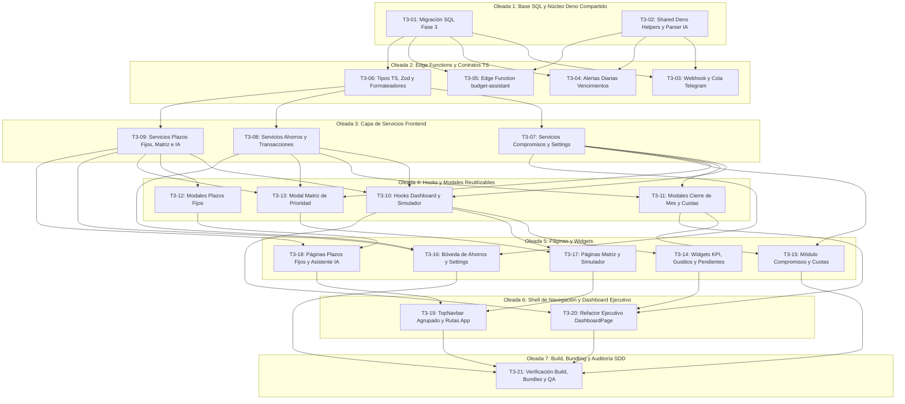

# Plan de Tareas Atómicas e Implementación — Fase 3: Herramientas de Decisión, Inversiones y Refinamiento Core

Este documento descompone la arquitectura definida en `01-functional-spec.md` y `02-tech-spec.md` en **tareas atómicas ejecutables por oleadas paralelas**.

> **Reglas de paralelismo del plan:**
> 1. Cada tarea modifica **entre 1 y 3 archivos máximo**.
> 2. Dentro de una misma **Oleada (Wave)**, **ninguna pareja de tareas comparte archivos** (intersección de archivos = ∅), garantizando ejecución en paralelo sin conflictos de escritura ni merge.
> 3. Cada tarea incluye dependencias explícitas (`Bloqueada por` / `Corre en paralelo con`) y un **Definition of Done (DoD)** verificable.

---

## Grafo de Dependencias (DAG)

---

## Oleada 1: Base de Datos y Núcleo Compartido Deno

### `T3-01` — Migración SQL de Fase 3 (Esquema, RLS y RPCs Contables)
- **Bloqueada por:** Ninguna
- **Corre en paralelo con:** `T3-02`
- **Archivos a crear/modificar (1):**
  - `supabase/migrations/20261117000001_phase3_decision_tools.sql` (crear)
- **Detalle técnico:**
  - Extender `user_settings` con `salary_payday SMALLINT NOT NULL DEFAULT 1 CHECK (salary_payday >= 1 AND salary_payday <= 31)` y `monthly_budgets` con `surplus_review_completed_at TIMESTAMPTZ NULL`.
  - Extender `installment_purchases` con `is_gustito BOOLEAN NOT NULL DEFAULT false` y `monthly_commitments` con `original_month_date DATE`, `original_due_date DATE`, `original_amount NUMERIC(12,2)`, `payment_batch_id UUID`.
  - Crear tablas `installment_payment_batches`, `fixed_term_deposits`, `priority_items`, además de las extensiones `savings_entries` (`source_type`, `fixed_term_id` con `ON DELETE CASCADE`, `source_month_date`), `telegram_conversation_sessions` / `telegram_action_logs` (`rollback_payload`) y `notification_logs` (nuevos `alert_type`: `'fixed_term_due_3d'`, `'fixed_term_due_today'`).
  - Mantener llaves compuestas `(category_id, user_id)` hacia `categories(id, user_id)` y políticas RLS estrictas por `auth.uid()`.
  - Implementar RPCs atómicas con soporte dual (`auth.uid()` o `service_role` + `p_actor_user_id`) y `SET search_path = public`: `advance_installments`, `revert_installment_payment_batch`, `get_liquid_savings_balance`, `create_fixed_term_deposit`, `accredit_fixed_term_deposit` y `reconcile_cap_surplus`.
- **Definition of Done (DoD):**
  - Archivo SQL idempotente (o seguro para migración secuencial) sin errores de sintaxis PostgreSQL.
  - Todas las tablas nuevas tienen `ENABLE ROW LEVEL SECURITY` e índices por `(user_id, ...)` según `02-tech-spec.md`.
  - Los cálculos monetarios usan exclusivamente `NUMERIC(12,2)` y distribución exacta de centavos en la última cuota adelantada.

### `T3-02` — Helpers Financieros Compartidos y Parser de Intenciones Telegram (Deno)
- **Bloqueada por:** Ninguna
- **Corre en paralelo con:** `T3-01`
- **Archivos a crear/modificar (2):**
  - `supabase/functions/_shared/financeHelpers.ts` (modificar)
  - `supabase/functions/_shared/telegramIntentProcessor.ts` (modificar)
- **Detalle técnico:**
  - En `financeHelpers.ts`: agregar `computeFixedTermReturn` (cálculo determinista en código de `expected_return_amount` cuando el usuario informa `%` de rendimiento o TNA en días) y `computeFixedLimitStatus` para excluir cuotas de Gustitos (`installment_purchases.is_gustito = true` o categoría con `is_gustito = true`).
  - En `telegramIntentProcessor.ts`: extender el prompt y esquema JSON de Gemini Flash (`gemini-3.8-flash`) para reconocer `pay_installments` (`purchase_query`, `purchase_id`, `installments_to_pay`, `total_paid_amount`) y `fixed_term_deposit` (`institution`, `principal_amount`, `expected_return_amount`, `yield_percent`, `rate_period`, `term_days`, `start_date`, `maturity_date`, `fixed_term_origin`).
  - Implementar el flujo interactivo de `fixed_term_deposit` con estado en `telegram_conversation_sessions`: preguntar aclaración (`awaiting_fixed_term_return`) si falta el rendimiento y preguntar siempre `fixed_term_origin` (`awaiting_fixed_term_origin`) mediante 2 botones inline (`pick_ft_origin:monthly_available` vs `pick_ft_origin:savings_fund`) antes de invocar `create_fixed_term_deposit`.
  - Implementar `pay_installments` llamando a la RPC `advance_installments` y guardando `batch_id` en `telegram_action_logs` para anulación con `[❌ Anular]`.
- **Definition of Done (DoD):**
  - Ninguna dependencia fuera de `std/` o `esm.sh` / `npm:` compatible con Deno.
  - Ningún cálculo financiero de porcentaje queda librado a la matemática mental del LLM.
  - Si `fixed_term_origin` no está confirmado, el bot jamás persiste un plazo fijo en BD antes del clic en el botón inline.

---

## Oleada 2: Edge Functions y Contratos TypeScript

### `T3-03` — Callbacks de Telegram (`webhook` y `queue`) para Cuotas y Plazos Fijos
- **Bloqueada por:** `T3-01`, `T3-02`
- **Corre en paralelo con:** `T3-04`, `T3-05`, `T3-06`
- **Archivos a crear/modificar (2):**
  - `supabase/functions/telegram-webhook/index.ts` (modificar)
  - `supabase/functions/process-telegram-queue/index.ts` (modificar)
- **Detalle técnico:**
  - En `telegram-webhook/index.ts`: manejar callbacks `void:<logId>` (si `target_table = 'installment_payment_batches'` invocar `revert_installment_payment_batch`; si `target_table = 'fixed_term_deposits'` eliminar el plazo fijo mientras `status = 'active'` con cascada en `savings_entries`), `pick_purchase:<id>` y `pick_ft_origin:monthly_available` / `pick_ft_origin:savings_fund` (validando saldo líquido en `create_fixed_term_deposit`).
  - En `process-telegram-queue/index.ts`: garantizar que las respuestas reencoladas por cuota/plazo fijo incluyan `inline_keyboard` con `[❌ Anular]` (o botones de origen/compra si falta confirmación) y actualicen el estado de auditoría en `telegram_pending_requests`.
- **Definition of Done (DoD):**
  - Todo callback valida pertenencia del `chat_id` al `user_id` vinculado antes de ejecutar RPCs con `service_role`.
  - Los callbacks son idempotentes frente a doble tap del usuario en Telegram (`answerCallbackQuery` siempre respondido).

### `T3-04` — Alertas Diarias de Vencimientos de Plazos Fijos (`daily-alerts`)
- **Bloqueada por:** `T3-01`, `T3-02`
- **Corre en paralelo con:** `T3-03`, `T3-05`, `T3-06`
- **Archivos a crear/modificar (1):**
  - `supabase/functions/daily-alerts/index.ts` (modificar)
- **Detalle técnico:**
  - Mantener la evaluación horaria para las `08:00` en la zona horaria local de cada usuario y actualizar la Sección B usando `computeFixedLimitStatus` (excluyendo cuotas de Gustitos).
  - Consultar `fixed_term_deposits` con `status = 'active'`:
    - Si `maturity_date = localPlus3Days`, enviar aviso preventivo (faltan 3 días) y registrar `notification_logs` con `alert_type = 'fixed_term_due_3d'` y `reference_id = ft.id`.
    - Si `maturity_date <= local.yyyyMmDd`, enviar aviso de vencimiento del día / listo para acreditar con `alert_type = 'fixed_term_due_today'` y `reference_id = ft.id`.
  - Aplicar deduplicación por `reference_id` y `alert_type` para no reenviar la misma alerta en ejecuciones posteriores.
- **Definition of Done (DoD):**
  - Alertas 3 días antes y el mismo día del vencimiento implementadas respetando `timezone` del usuario.
  - Sin duplicación de notificaciones ante múltiples corridas de `pg_cron`.

### `T3-05` — Nueva Edge Function `budget-assistant` (Asistente de Presupuesto IA)
- **Bloqueada por:** `T3-01`, `T3-02`
- **Corre en paralelo con:** `T3-03`, `T3-04`, `T3-06`
- **Archivos a crear/modificar (2):**
  - `supabase/functions/budget-assistant/deno.json` (crear)
  - `supabase/functions/budget-assistant/index.ts` (crear)
- **Detalle técnico:**
  - Verificar JWT del usuario en `Authorization` header (`supabase.auth.getUser()`), responder CORS seguro y manejar `OPTIONS`.
  - Leer `user_settings` (`fixed_salary`, `currency`, `default_monthly_savings_target`, `default_gustitos_budget`, `default_fixed_expenses_limit`), categorías activas y agregados de los **últimos 3 meses con datos reales** más compromisos fijos y cuotas vigentes del mes actual.
  - Si no existe historial suficiente (`0` meses o sueldo fijo en `0`), devolver estado controlado `insufficient_data` sin inventar cifras.
  - Llamar a Gemini Flash (`responseMimeType: "application/json"`) y validar la respuesta con reglas estrictas (suma sugerida consistente con sueldo fijo, IDs de categorías existentes, disclaimer orientativo obligatorio).
- **Definition of Done (DoD):**
  - Edge Function completamente aislada en Deno sin importar dependencias de `package.json`.
  - Respuesta JSON validada antes de retornar al cliente, con manejo explícito de errores de autenticación, ausencia de clave Gemini o falta de historial.

### `T3-06` — Tipos TypeScript, Esquemas Zod y Formateadores Fase 3
- **Bloqueada por:** `T3-01`
- **Corre en paralelo con:** `T3-03`, `T3-04`, `T3-05`
- **Archivos a crear/modificar (3):**
  - `src/types/database.types.ts` (modificar)
  - `src/lib/validations.ts` (modificar)
  - `src/lib/formatters.ts` (modificar)
- **Detalle técnico:**
  - En `database.types.ts`: agregar interfaces `FixedTermDeposit`, `FixedTermDepositInput`, `AccreditFixedTermInput`, `PriorityItem`, `PriorityItemInput`, `InstallmentPaymentBatch`, `AdvanceInstallmentsInput`, `AdvanceInstallmentsResult`, `BudgetAssistantProposal`, `SimulatedExpenseItem`, más los tipos `SavingsSourceType`, `FixedTermOrigin`, `FixedTermStatus`, `PriorityQuadrant` y las extensiones en `UserSettings` (`salary_payday`), `MonthlyBudget` (`surplus_review_completed_at`), `InstallmentPurchase` (`is_gustito`), `MonthlyCommitment` (`original_*`, `payment_batch_id`), `SavingsEntry` (`source_type`, `fixed_term_id`), `MonthlyFinancialSummary` y `AccumulatedSavingsSummary`.
  - En `validations.ts`: esquemas Zod para adelanto de `N` cuotas (`advanceInstallmentsSchema`), plazo fijo (`fixedTermDepositSchema`), acreditación (`accreditFixedTermSchema`), ítem de matriz (`priorityItemSchema`), cierre de sobrantes (`reconcileSurplusSchema`) y `salary_payday` en `userSettingsSchema`.
  - En `formatters.ts`: utilidades de cálculo de días hasta vencimiento, etiquetas en español de cuadrantes de prioridad y orígenes de ahorro/plazo fijo.
- **Definition of Done (DoD):**
  - `npx tsc --noEmit` sin errores en `src/types/` y `src/lib/`.
  - Ningún `any` introducido en los contratos nuevos.

---

## Oleada 3: Capa de Servicios Frontend

### `T3-07` — Servicios de Compromisos/Cuotas y Configuraciones (`salary_payday` + Sobrantes)
- **Bloqueada por:** `T3-06`
- **Corre en paralelo con:** `T3-08`, `T3-09`
- **Archivos a crear/modificar (2):**
  - `src/services/commitmentsService.ts` (modificar)
  - `src/services/settingsService.ts` (modificar)
- **Detalle técnico:**
  - En `commitmentsService.ts`: incorporar flag `is_gustito` en creación/edición de compras en cuotas, exponer `advanceInstallments` (RPC `advance_installments`), `revertInstallmentPaymentBatch` (RPC `revert_installment_payment_batch`) y `getRecentInstallmentBatches` para permitir deshacer desde Web.
  - En `settingsService.ts`: soportar `salary_payday` y exponer `reconcileCapSurplus` (RPC `reconcile_cap_surplus`) para enviar sobrantes a Bóveda, liberarlos al Disponible o marcar el cierre revisado (`surplus_review_completed_at`).
- **Definition of Done (DoD):**
  - Errores de Supabase traducidos a mensajes claros en español mediante manejo consistente.
  - Los parámetros de `reconcile_cap_surplus` validados antes de invocar la RPC.

### `T3-08` — Servicios de Bóveda de Ahorros y Transacciones (Patrimonio y Evolución)
- **Bloqueada por:** `T3-06`
- **Corre en paralelo con:** `T3-07`, `T3-09`
- **Archivos a crear/modificar (2):**
  - `src/services/savingsService.ts` (modificar)
  - `src/services/transactionsService.ts` (modificar)
- **Detalle técnico:**
  - En `savingsService.ts`: calcular saldo discriminado (`liquidBalance`, `immobilizedInFixedTerms`, `totalPatrimony`), exponer `source_type` en listados/creación y excluir `cap_surplus_*` / `fixed_term_return` del cómputo de `extraSavingsDeposits` operativos del mes.
  - En `transactionsService.ts`: alinear `getSixMonthsEvolution` con la fórmula de `Disponible Real` de Fase 3, soportar consultas de gastos olvidados desde el asistente de cierre y clasificar variables no-Gustito vs Gustitos.
- **Definition of Done (DoD):**
  - El saldo líquido de bóveda coincide con `get_liquid_savings_balance` y excluye capital inmovilizado en plazos fijos activos.

### `T3-09` — Nuevos Servicios: Plazos Fijos, Matriz de Prioridad y Asistente IA
- **Bloqueada por:** `T3-06`
- **Corre en paralelo con:** `T3-07`, `T3-08`
- **Archivos a crear/modificar (3):**
  - `src/services/fixedTermsService.ts` (crear)
  - `src/services/priorityMatrixService.ts` (crear)
  - `src/services/budgetAssistantService.ts` (crear)
- **Detalle técnico:**
  - `fixedTermsService.ts`: `getFixedTermDeposits`, `createFixedTermDeposit` (RPC), `accreditFixedTermDeposit` (RPC) y `deleteFixedTermDeposit`.
  - `priorityMatrixService.ts`: `getPriorityItems`, `createPriorityItem`, `updatePriorityItem`, `movePriorityItemQuadrant` y `deletePriorityItem` (invocada tras convertir el ítem en gasto al contado o compra en cuotas).
  - `budgetAssistantService.ts`: `generateBudgetProposal(userGoal?)` invocando `supabase.functions.invoke('budget-assistant')` tipada con `BudgetAssistantProposal`, y `applySuggestedLimits(proposal, applyToCurrentMonth)` (actualizando `user_settings` + `categories.monthly_limit`, y si `applyToCurrentMonth = true` también `monthly_budgets` y `monthly_category_snapshots` del mes en curso).
- **Definition of Done (DoD):**
  - Todos los servicios validan sus payloads con los esquemas Zod de `T3-06` antes de llamar a Supabase.
  - `applySuggestedLimits` respeta estrictamente el alcance del checkbox `"Aplicar también al mes en curso"`.

---

## Oleada 4: Hooks y Modales Reutilizables

### `T3-10` — Motor Contable Fase 3 (`useDashboardData`) y Simulador Efímero (`useExpenseSimulator`)
- **Bloqueada por:** `T3-07`, `T3-08`, `T3-09`
- **Corre en paralelo con:** `T3-11`, `T3-12`, `T3-13`
- **Archivos a crear/modificar (2):**
  - `src/hooks/useDashboardData.ts` (modificar)
  - `src/hooks/useExpenseSimulator.ts` (crear)
- **Detalle técnico:**
  - En `useDashboardData.ts`:
    - Implementar la nueva fórmula central de `Disponible Real` con apartado de topes desde el día 1: `max(fixedLimit, fixedPlusNonGustitoInstallments)` y `max(gustitosBudget, gustitosSpentIncludingInstallments)`.
    - Restar explícitamente `monthly_available` plazos fijos constituidos en el mes y sumar plazos fijos acreditados en el mes con destino `monthly_available`.
    - Aplicar la misma fórmula en `getSixMonthsEvolution` y exponer indicadores para el asistente de cierre (`surplusFixed`, `surplusGustitos`, `shouldPromptPaydayReview`).
  - En `useExpenseSimulator.ts`: estado puramente en memoria (sin persistencia) para agregar/quitar múltiples compras simuladas (contado o cuotas, Gustito o Fijo/Variable, inicio mes actual o siguiente) y recalcular al instante `simulatedRealAvailable`, impacto en tope de Fijos/Gustitos y categoría afectada.
- **Definition of Done (DoD):**
  - Cuotas con `is_gustito = true` (o de categoría Gustito) jamás incrementan `fixedCommitted`, pero sí aparecen en `pendingCommitments` y en `gustitosSpent`.
  - `useExpenseSimulator` no ejecuta ninguna escritura en BD o `localStorage`.

### `T3-11` — Modales de Cierre de Sobrantes y Adelanto de Cuotas
- **Bloqueada por:** `T3-07`, `T3-08`
- **Corre en paralelo con:** `T3-10`, `T3-12`, `T3-13`
- **Archivos a crear/modificar (2):**
  - `src/features/dashboard/SurplusCloseModal.tsx` (crear)
  - `src/features/commitments/AdvanceInstallmentsModal.tsx` (crear)
- **Detalle técnico:**
  - `SurplusCloseModal.tsx`: flujo guiado en dos pasos al cierre/día de cobro (`salary_payday`): (1) preguntar si se olvidó registrar algún gasto con botón de carga rápida inline para recalcular el sobrante real; (2) cuando `surplus > 0`, permitir elegir monto parcial o total a trasladar a Bóveda de Ahorros y liberar el resto al `Disponible Real`.
  - `AdvanceInstallmentsModal.tsx`: selector de `N` cuotas pendientes (siempre las `N` más próximas cronológicamente), input opcional de monto total `$X` (calculando diferencia/descuento y desglose por cuota con ajuste de centavos en la última) y confirmación clara.
- **Definition of Done (DoD):**
  - Accesibilidad completa (`Esc`, foco, contrastes WCAG AA, botones >= 44px en mobile) y validación Zod antes de enviar.

### `T3-12` — Modales de Constitución y Acreditación de Plazos Fijos
- **Bloqueada por:** `T3-09`
- **Corre en paralelo con:** `T3-10`, `T3-11`, `T3-13`
- **Archivos a crear/modificar (2):**
  - `src/features/fixed-terms/FixedTermFormModal.tsx` (crear)
  - `src/features/fixed-terms/AccreditFixedTermModal.tsx` (crear)
- **Detalle técnico:**
  - `FixedTermFormModal.tsx`: alta de plazo fijo con fechas inicio/vencimiento, capital, origen (`monthly_available` vs `savings_fund` mostrando saldo líquido disponible y bloqueando si excede), y cálculo auxiliar opcional desde `%` de rendimiento hacia `expected_return_amount`.
  - `AccreditFixedTermModal.tsx`: acreditación manual al vencer permitiendo confirmar/ajustar `actual_return_amount` y seleccionar destino (`savings_fund` por defecto o `monthly_available`).
- **Definition of Done (DoD):**
  - Feedback inmediato si el saldo líquido en Bóveda es insuficiente para constituir desde `savings_fund`.

### `T3-13` — Modal de Alta, Edición y Conversión de Matriz de Prioridad
- **Bloqueada por:** `T3-07`, `T3-08`, `T3-09`
- **Corre en paralelo con:** `T3-10`, `T3-11`, `T3-12`
- **Archivos a crear/modificar (1):**
  - `src/features/priority-matrix/PriorityItemFormModal.tsx` (crear)
- **Detalle técnico:**
  - Soporta modo `create/edit` (título, monto estimado, categoría, cuadrante discreto, impacto, notas) y modo `convert_to_purchase` (elegir `cash` vs `installments`, cantidad de cuotas, marca `is_gustito`, monto final) que al confirmar crea el gasto/plan y elimina el ítem de `priority_items`.
- **Definition of Done (DoD):**
  - Al convertir un ítem como comprado, el ítem desaparece definitivamente de la matriz y muestra enlace/toast de confirmación.

---

## Oleada 5: Páginas y Componentes Refactorizados

### `T3-14` — Refactor de Widgets del Dashboard (`KpiSummaryGrid`, `GustitosProgressWidget`, `PendingCommitmentsWidget`)
- **Bloqueada por:** `T3-10`
- **Corre en paralelo con:** `T3-15`, `T3-16`, `T3-17`, `T3-18`
- **Archivos a crear/modificar (3):**
  - `src/features/dashboard/KpiSummaryGrid.tsx` (modificar)
  - `src/features/dashboard/GustitosProgressWidget.tsx` (modificar)
  - `src/features/dashboard/PendingCommitmentsWidget.tsx` (modificar)
- **Detalle técnico:**
  - `KpiSummaryGrid.tsx`: jerarquía visual centrada en `Disponible Real` como KPI protagonista (`tabular-nums`, sin tarjetas ruidosas redundantes) y desglose compacto de topes apartados vs ingresos.
  - `GustitosProgressWidget.tsx`: barra unificada progresiva `0% → 100%` (amarillo de marca `#FACC15` en rango normal, rojo semántico `#EF4444` al alcanzar o superar `100%`), incluyendo las cuotas de Gustitos del mes.
  - `PendingCommitmentsWidget.tsx`: mostrar correctamente cuotas de Gustitos con badge identificatorio sin mezclarlas en el consumo del tope fijo.
- **Definition of Done (DoD):**
  - Cero uso de violeta/púrpura; contraste AA verificado sobre el sistema de superficies oscuras `#0A0A0A` / `#121212` / `#1A1A1A` con acento `#FACC15`.

### `T3-15` — Adelanto de Cuotas y Flag Gustito en Módulo Compromisos
- **Bloqueada por:** `T3-07`, `T3-11`
- **Corre en paralelo con:** `T3-14`, `T3-16`, `T3-17`, `T3-18`
- **Archivos a crear/modificar (2):**
  - `src/features/commitments/CommitmentsPage.tsx` (modificar)
  - `src/features/commitments/InstallmentsList.tsx` (modificar)
- **Detalle técnico:**
  - En `CommitmentsPage.tsx`: añadir selector/toggle `Pertenece a bolsa de Gustitos (is_gustito)` al registrar compras en cuotas (autocompletado según categoría).
  - En `InstallmentsList.tsx`: botón `"Adelantar cuotas"` por cada plan con >= 2 cuotas pendientes (abre `AdvanceInstallmentsModal`) y banner/botón `"Deshacer último adelanto"` mientras exista un batch reciente reversible en el mes actual.
- **Definition of Done (DoD):**
  - Al adelantar o revertir cuotas desde Web, la lista y los totales del mes se actualizan en tiempo real sin recargar la página.

### `T3-16` — Bóveda de Ahorros Discriminada y Día de Cobro en Configuración
- **Bloqueada por:** `T3-07`, `T3-08`, `T3-09`
- **Corre en paralelo con:** `T3-14`, `T3-15`, `T3-17`, `T3-18`
- **Archivos a crear/modificar (2):**
  - `src/features/savings/SavingsPage.tsx` (modificar)
  - `src/features/settings/BudgetSettingsForm.tsx` (modificar)
- **Detalle técnico:**
  - En `SavingsPage.tsx`: mantener saldo enmascarado por defecto, discriminando **Saldo Líquido en Bóveda**, **Capital Inmovilizado en Plazos Fijos** y **Patrimonio Total**, además de mostrar badges por `source_type` (incluyendo traslados de sobrantes de topes y retornos de plazos fijos).
  - En `BudgetSettingsForm.tsx`: agregar campo `Día de cobro del sueldo (1–31)` (`salary_payday`) junto a `fixed_salary`.
- **Definition of Done (DoD):**
  - Los movimientos automáticos por plazo fijo y cierre de sobrantes se muestran claramente diferenciados de los depósitos manuales.

### `T3-17` — Páginas de Matriz de Prioridad (`/priority-matrix`) y Simulador (`/simulator`)
- **Bloqueada por:** `T3-10`, `T3-13`
- **Corre en paralelo con:** `T3-14`, `T3-15`, `T3-16`, `T3-18`
- **Archivos a crear/modificar (2):**
  - `src/features/priority-matrix/PriorityMatrixPage.tsx` (crear)
  - `src/features/simulator/SimulatorPage.tsx` (crear)
- **Detalle técnico:**
  - `PriorityMatrixPage.tsx`: matriz de 4 cuadrantes discretos (`Alto Impacto / Bajo Costo`, `Alto Impacto / Alto Costo`, `Bajo Impacto / Bajo Costo`, `Bajo Impacto / Alto Costo`) con **HTML5 Drag & Drop nativo** en escritorio y pestañas/controles de reubicación táctiles accesibles (`>= 44px`) en móvil; acciones editar, eliminar y convertir a compra.
  - `SimulatorPage.tsx`: interfaz interactiva conectada a `useExpenseSimulator` con badge visible `"Simulación efímera — no guarda cambios en tus cuentas"`, constructor de escenarios (uno o varios gastos) y vista comparativa Antes vs. Después sobre `Disponible Real`, topes y categorías.
- **Definition of Done (DoD):**
  - Cero librerías externas de Drag & Drop instaladas.
  - Usabilidad completa en viewport móvil (`375px`) sin arrastre táctil roto.

### `T3-18` — Páginas de Plazos Fijos (`/fixed-terms`) y Asistente IA (`/budget-assistant`)
- **Bloqueada por:** `T3-09`, `T3-12`
- **Corre en paralelo con:** `T3-14`, `T3-15`, `T3-16`, `T3-17`
- **Archivos a crear/modificar (2):**
  - `src/features/fixed-terms/FixedTermsPage.tsx` (crear)
  - `src/features/budget-assistant/BudgetAssistantPage.tsx` (crear)
- **Detalle técnico:**
  - `FixedTermsPage.tsx`: KPI de total invertido activo e interés esperado (totalmente aislado del `Disponible Real`), pestañas `Activos` / `Acreditados`, alertas visuales de próximos a vencer (`<= 3 días` y vencidos listos para acreditar) y acciones Crear / Acreditar / Anular.
  - `BudgetAssistantPage.tsx`: vista dedicada con disparador de análisis sobre los últimos 3 meses con datos + compromisos del mes, tabla comparativa (Actual vs. Sugerido por categoría, Gustitos y Ahorro), aviso legal orientativo no-financiero visible, checkbox `"Aplicar también al mes en curso"` y botón `"Aplicar límites sugeridos"`.
- **Definition of Done (DoD):**
  - Estado vacío/sin historial manejado con explicación amigable sin romper la página.

---

## Oleada 6: Integración de Navegación y Refactor Ejecutivo del Dashboard

### `T3-19` — TopNavbar con Menús Agrupados y Rutas de Fase 3
- **Bloqueada por:** `T3-17`, `T3-18`
- **Corre en paralelo con:** `T3-20`
- **Archivos a crear/modificar (2):**
  - `src/components/layout/TopNavbar.tsx` (modificar)
  - `src/App.tsx` (modificar)
- **Detalle técnico:**
  - En `TopNavbar.tsx`: organizar la navegación en menú principal (`Dashboard`, `Movimientos`, `Fijos y Cuotas`) y menús desplegables accesibles por teclado/click/móvil: **`Inversiones`** (`/savings`, `/fixed-terms`), **`Decisión`** (`/priority-matrix`, `/simulator`) y **`Herramientas`** (`/budget-assistant`, `/categories`, `/settings`).
  - En `App.tsx`: registrar rutas protegidas `/fixed-terms`, `/priority-matrix`, `/simulator` y `/budget-assistant` usando `React.lazy` consistente con el resto del proyecto.
- **Definition of Done (DoD):**
  - Navegación accesible en escritorio y drawer móvil sin desbordamiento ni enlaces rotos.

### `T3-20` — Refactor Ejecutivo de `DashboardPage` con Sub-pestañas Internas
- **Bloqueada por:** `T3-10`, `T3-11`, `T3-14`
- **Corre en paralelo con:** `T3-19`
- **Archivos a crear/modificar (1):**
  - `src/features/dashboard/DashboardPage.tsx` (modificar)
- **Detalle técnico:**
  - Reducir la vista inicial superior al mínimo ejecutivo: selector de mes, acciones rápidas (+ Gasto, + Ingreso, botón de Cierre/Conciliación si hay sobrantes o llegó `salary_payday`), KPI protagonista `Disponible Real`, resumen compacto y las 2 barras `0% → 100%` (Fijos y Gustitos).
  - Organizar todo el detalle operativo debajo en **3 sub-pestañas internas**:
    1. `Resumen y Gráficos` (incluye `CategoryLimitsWidget`, `FinancialChartsSection` y evolución de 6 meses con fórmula Fase 3).
    2. `Pendientes de Pago` (incluye `PendingCommitmentsWidget`).
    3. `Movimientos del Mes` (listado operativo del mes).
- **Definition of Done (DoD):**
  - Carga visual limpia: un solo foco principal en la pantalla inicial y cero saturación de widgets simultáneos.

---

## Oleada 7: Verificación, Bundling y Auditoría SDD

### `T3-21` — Build, Bundling de Edge Functions y Auditoría SDD Completa
- **Bloqueada por:** `T3-15`, `T3-16`, `T3-19`, `T3-20`
- **Corre en paralelo con:** Ninguna (cierre de fase)
- **Archivos a verificar / generar (sin tocar código de negocio salvo fixes puntuales detectados):**
  - Verificación de compilación TypeScript y build de producción (`npm run build`).
  - Generación y verificación de bundles Deno (`npm run bundle:functions` -> `supabase/deploy-bundles/`).
  - Auditoría integral de QA funcional de fórmulas contables, RLS/seguridad SQL y Edge Functions, y auditoría visual/accesibilidad en viewport escritorio y móvil.
- **Definition of Done (DoD):**
  - `npm run build` finaliza con exit code `0` y cero errores de TypeScript (`strict: true`).
  - `npm run bundle:functions` genera correctamente los bundles actualizados incluyendo `budget-assistant`.
  - Todos los Criterios de Aceptación `CA-3.1` a `CA-3.8` de `01-functional-spec.md` verificados sin regresiones sobre Fases 1 y 2.
