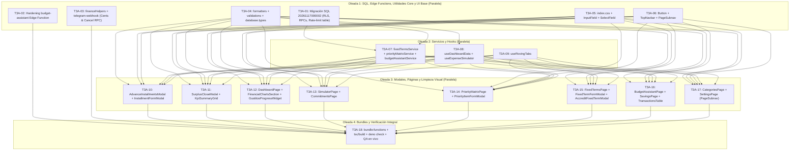

# Auditoría Integral SDD y Plan de Tareas de Corrección — Fase 3 (SB-Finance)

> **Versión:** 1.0.0  
> **Fecha de auditoría:** 2026-11-15  
> **Documentos contrastados:** `specs/constitution.md`, `specs/fase-3-decision-tools/01-functional-spec.md`, `specs/fase-3-decision-tools/02-tech-spec.md`, `specs/fase-3-decision-tools/03-tasks.md`.  
> **Áreas auditadas:** QA Funcional, Seguridad BaaS/RLS, Accesibilidad y UI/UX.  
> **Regla de aislamiento:** Ninguna tarea supera los **3 archivos** y las tareas dentro de una misma oleada paralela tienen **intersección cero de archivos**.

---

## 1. Resumen Ejecutivo de la Auditoría

- **Dictamen General:** **REQUIERE CORRECCIONES** antes de dar por cerrada la Fase 3.
- **Compilación y Tipado Estricto:**
  - Frontend (`npx tsc --noEmit` y `npm run build` / `tsc -b && vite build`): **PASS** (`0` errores, `572` módulos en `5.43s`).
  - Deploy bundles (`supabase/deploy-bundles/*.ts`): actualizados respecto a los fuentes de `supabase/functions/`.
- **Criterios de Aceptación (`01-functional-spec.md`):** **2 `PASS`** (`CA-3.2` y `CA-3.4` con bugs secundarios) y **6 `PARTIAL`** (`CA-3.1`, `CA-3.3`, `CA-3.5`, `CA-3.6`, `CA-3.7`, `CA-3.8`). No hay fallos totales, pero sí brechas de atomicidad, validaciones de borde y manejo de errores.
- **Seguridad BaaS y RLS:** Cero secretos o claves privadas en `src/`, autenticación JWT válida en `budget-assistant`, FKs compuestas `(category_id, user_id)` y RLS activo por `auth.uid()`. Sin embargo, existen **4 hallazgos de severidad Alta**, **4 de severidad Media** y **2 de severidad Baja** (bypass de RPCs contables vía DML directo, ausencia de `budget_assistant_logs` / rate limit, fuga de errores internos y CORS `*`, bordes en `advance_installments` / `revert_installment_payment_batch` y precisión IEEE-754).
- **Evaluación UX/UI:**
  - **Auditoría Técnica UI (5 Dimensiones):** **13 / 20** (*Aceptable — Accessibility `2/4`, Performance `3/4`, Theming `3/4`, Responsive `2/4`, Integrity `3/4`*).
  - **Evaluación Heurística (Heurísticas de Nielsen):** **25 / 40** (*Aceptable — base sólida, con sobrecarga arriba del pliegue en `390px` y fricción en Simulador y Matriz*).
  - **Análisis Tipográfico (`src`):** sistema intencional con `'Plus Jakarta Sans'` y `'JetBrains Mono'` en `src/index.css:66` (`0` errores bloqueantes).
  - **Inspección en navegador en vivo:** Bloqueada/omitida en entorno sandbox (restricción `WSAEACCES` sobre sockets loopback locales y barrera de login `ProtectedRoute` en `src/App.tsx:96-109`); verificable manualmente tras aplicar la Oleada 4.

---

## 2. Verificación de Criterios de Aceptación y Tareas (`03-tasks.md`)

| Criterio | Tareas | Estado | Evidencia y brechas detectadas |
| :--- | :--- | :---: | :--- |
| **CA-3.1** Adelanto de `N` cuotas web | `T3-01, T3-06, T3-11` | **PARTIAL** | `advance_installments` (`20261117000001_phase3_decision_tools.sql:378-424`) y `revert_installment_payment_batch` (`:489-531`) operan, pero: (1) revertir no limpia `original_* = NULL` (`:502-511`); (2) preview en `AdvanceInstallmentsModal.tsx:136-137` usa `Math.floor((finalTotal/n)*100)/100` (desfase potencial de `$0,01`); (3) typo `"Adelastaste"` (`:187`). |
| **CA-3.2** Adelanto Telegram + `[❌ Anular]` | `T3-02` | **PASS** | `telegramIntentProcessor.ts:357-417, 1087-1398` y `telegram-webhook/index.ts:230-278`. |
| **CA-3.3** Plazos Fijos + Bóveda + Alertas | `T3-01, T3-03, T3-04, T3-07, T3-13` | **PARTIAL** | Fórmula 365 días uniforme y lock en creación, pero: (1) `FixedTermFormModal.tsx:106-109` ignora tasa `< 0` en silencio y usa fallback `30` días si `maturity_date <= start_date`; (2) `FixedTermsPage.tsx:399-407` y `AccreditFixedTermModal.tsx:56-58` permiten acreditar antes del vencimiento prellenando fecha futura y sin advertir si `retorno < capital`. |
| **CA-3.4** Aislamiento Gustitos + `>= 100%` rojo | `T3-10, T3-18` | **PASS*** | Aislamiento funciona en Dashboard y servidor, con 2 bugs secundarios: (1) `InstallmentFormModal.tsx:178-183, 230-232` suma cuotas Gustito al proyectar alerta contra `fixed_expenses_limit`; (2) `DashboardPage.tsx:476-481` omite `gustitoCategoryIds` en `PendingCommitmentsWidget.tsx:89-94`. |
| **CA-3.5** Simulador efímero de gastos | `T3-15` | **PARTIAL** | No persiste en BD, pero `SimulatorPage.tsx:44-50, 103-126, 374` ignora `error` de `useDashboardData`, no valida `MAX_MONEY` ni `< 0.01`, y `useExpenseSimulator.ts:205` usa `>` estricto en `exceedsFixedLimit` vs `>=` en Gustitos y servidor. |
| **CA-3.6** Matriz Eisenhower + conversión | `T3-08, T3-14` | **PARTIAL** | `PriorityItemFormModal.tsx:182-183, 228-229` realiza creación y borrado en 2 pasos no atómicos; `PriorityMatrixPage.tsx:194-198` parpadea en `onDragLeave` por no validar `contains(relatedTarget)`. |
| **CA-3.7** Cierre de sobrantes de topes | `T3-01, T3-10, T3-12, T3-20` | **PARTIAL** | `SurplusCloseModal.tsx:61-72` reinicia `setStep(1)` al cambiar sobrante tras conciliar un rubro en Paso 2; `useDashboardData.ts:490-498` no dispara con `salary_payday = 31` en meses `< 31` días; `reconcile_cap_surplus` (`:898`) usa `CURRENT_DATE` UTC y carece de lock. |
| **CA-3.8** Asistente IA de presupuesto | `T3-05, T3-09, T3-16` | **PARTIAL** | Validar disponibilidad en Cloud de `gemini-3.8-flash` (`index.ts:24`); `JSON.parse(cleaned)` (`:468`) sin `try/catch` devuelve 500; `:446` expone `errBody`; `budgetAssistantService.ts:42-46` oculta errores en español; `applySuggestedLimits` (`:60-161`) no es transaccional. |

---

## 3. Catálogo Consolidado de Hallazgos y Mejoras Priorizadas

### 3.1 Bugs Funcionales, Seguridad RLS y Precisión

| ID | Severidad | Categoría | Archivo y Línea Exacta | Descripción del Hallazgo | Tarea Asociada |
| :--- | :---: | :---: | :--- | :--- | :---: |
| **SEC-F3-01** | **Alta** | Seguridad RLS / Integridad | `supabase/migrations/20261117000001_phase3_decision_tools.sql:258-284` | Políticas RLS permiten `INSERT/UPDATE/DELETE` directos en `fixed_term_deposits`, `installment_payment_batches` y `savings_entries` (`source_type <> 'manual'`), permitiendo bypassear RPCs contables y validaciones de saldo. | `T3A-01`, `T3A-03`, `T3A-07` |
| **SEC-F3-02** | **Alta** | Seguridad Edge / DoS | `supabase/functions/budget-assistant/index.ts:113-121, 420-439` | Ausencia de tabla `budget_assistant_logs` y rate limiting por usuario; falta límite de tamaño del request (`<= 4 KB`), `AbortSignal.timeout` en Gemini, sanitización de `userGoal` y tope de longitud en `summary_reasoning`. | `T3A-01`, `T3A-02` |
| **SEC-F3-03** | **Alta** | Seguridad Edge / Fuga | `supabase/functions/budget-assistant/index.ts:31, 139-163, 446, 468, 561-564` | CORS abierto (`*`), exposición de `detail: errBody` y `err.message` al cliente, `JSON.parse` sin `try/catch` (HTTP 500), y errores de queries DB (`categories`, `transactions`, `commitments`) silenciados como `[]`. | `T3A-02`, `T3A-07` |
| **BUG-F3-01** | **Alta** | Integridad SQL | `supabase/migrations/20261117000001_phase3_decision_tools.sql:378-424, 501-510` | `revert_installment_payment_batch` no limpia `original_month_date`, `original_due_date`, `original_amount` a `NULL` (corrompe re-adelantos tras editar); `advance_installments` falla contra `CHECK (amount > 0)` si `p_total_amount < p_count * 0.01`. | `T3A-01`, `T3A-04`, `T3A-10` |
| **SEC-F3-04** | **Media** | Seguridad SQL / Grants | `supabase/migrations/20261117000001_phase3_decision_tools.sql:535-566` | Funciones RPC conservan `EXECUTE` por defecto para `PUBLIC`/`anon`; `get_liquid_savings_balance` retorna `0.00` en silencio ante otro `p_user_id` en lugar de rechazar. | `T3A-01` |
| **SEC-F3-05** | **Media** | Concurrencia / Timezone | `supabase/migrations/20261117000001_phase3_decision_tools.sql:716-722, 792-797, 898, 918` | `accredit_fixed_term_deposit` y `reconcile_cap_surplus` omiten `pg_advisory_xact_lock`, usan `CURRENT_DATE` UTC (desfase > 21:00 ART), no validan `accredited_date >= start_date`, permiten `p_target_income_month` futuro arbitrario y omiten `IF NOT FOUND` en `mark_reviewed`. | `T3A-01` |
| **BUG-F3-02** | **Media** | Precisión Monetaria | `src/lib/formatters.ts:53-56`, `_shared/financeHelpers.ts:64-67`, `AdvanceInstallmentsModal.tsx:136` | `roundCurrency` con `Number.EPSILON` falla en bordes (`1.005`) y `Math.floor((finalTotal/n)*100)/100` diverge `$0,01` de `TRUNC` en Postgres (`0.87 / 3`). Operar en centavos enteros (`toCents`). | `T3A-03`, `T3A-04`, `T3A-10` |
| **BUG-F3-03** | **Media** | Atomicidad Multi-Paso | `src/services/budgetAssistantService.ts:60-161`, `PriorityItemFormModal.tsx:182-230` | `applySuggestedLimits` actualiza 4 tablas secuencialmente sin transacción ni validación Zod; conversión en Matriz puede dejar el ítem vivo y duplicar gastos ante fallo parcial. | `T3A-01`, `T3A-07`, `T3A-14` |
| **BUG-F3-04** | **Media** | Lógica UI / Triggers | `SurplusCloseModal.tsx:61-72`, `useDashboardData.ts:490-498` | `SurplusCloseModal` reinicia `setStep(1)` al actualizarse `summary` en Paso 2; `salary_payday = 31` nunca dispara cierre en meses de `< 31` días. | `T3A-08`, `T3A-11` |
| **BUG-F3-05** | **Media** | Consistencia & Alertas | `useExpenseSimulator.ts:205`, `InstallmentFormModal.tsx:178-183`, `DashboardPage.tsx:476-481` | `exceedsFixedLimit` usa `>` estricto (vs `>=` en el resto); `InstallmentFormModal` proyecta cuotas Gustito sobre `fixed_expenses_limit`; `DashboardPage` no pasa `gustitoCategoryIds` a `PendingCommitmentsWidget`. | `T3A-08`, `T3A-10`, `T3A-12` |
| **BUG-F3-06** | **Media** | Validación Formularios | `FixedTermFormModal.tsx:106-109`, `AccreditFixedTermModal.tsx:56-58`, `SimulatorPage.tsx:103-126` | Helper de tasa ignora `< 0` y fecha inválida (`30` días) en silencio; acreditación prellena fecha futura sin advertencia de anticipación o pérdida; Simulador acepta `0.001` y omite `MAX_MONEY`. | `T3A-04`, `T3A-08`, `T3A-13`, `T3A-15` |
| **BUG-F3-07** | **Baja** | Validación Zod vs DB | `src/lib/validations.ts:14`, `20261117000001_phase3_decision_tools.sql:93, 152`, `budget-assistant/index.ts:532` | `ISO_DATE_REGEX` acepta `2026-02-31`; faltan `CHECK (char_length(notes) <= 500)` en DB; guardrail suma floats sin `roundCurrency`; typo `"Adelastaste"` en `AdvanceInstallmentsModal.tsx:187`. | `T3A-01`, `T3A-02`, `T3A-04`, `T3A-10` |

### 3.2 Hallazgos UX/UI y Mejoras de Organización Visual

| ID | Prioridad | Categoría | Ubicación | Hallazgo / Mejora Propuesta | Tarea Asociada |
| :--- | :---: | :---: | :--- | :--- | :---: |
| **UX-F3-01** | **P1** | Layout / Carga Cognitiva | `DashboardPage.tsx:199-297`, `KpiSummaryGrid.tsx:88-201` | En `390px`, cabecera + barras + banners consumen ~510–650px antes de `Disponible Real`; `KpiSummaryGrid` duplica la fórmula 2 veces. Compactar cabecera, mover `"Ajustar presupuesto"` a `Ingresos y Flujo`, unificar desglose (con toggle `"Ver fórmula"`), emparejar `CategoryLimitsWidget` + Donut `lg:grid-cols-2`, y simplificar filtros en tab `Movimientos`. | `T3A-11`, `T3A-12` |
| **UX-F3-02** | **P1** | Layout / Integridad | `SimulatorPage.tsx:44-50, 374, 622-632` | Silencia `currentData.error` / `nextData.error` simulando sobre `$0`, y coloca la comparativa debajo del constructor (*Memory Bridge*). Mostrar errores explícitos, errores por campo, barra sticky comparativa derecha en desktop (`lg:col-span-7`) y resumen fijo compacto en `390px`. | `T3A-13` |
| **UX-F3-03** | **P1** | Responsive / A11y | `FixedTermsPage.tsx:214-282` | `role="tablist"` desborda `390px`; `"Mostrar/Ocultar"` (`32px`), enlace a Bóveda (`16px`) y chips en `FixedTermFormModal.tsx:297` (`36px`) están bajo `44px`. Pasar a `grid-cols-2 w-full sm:inline-flex`, `min-h-[44px]` y barra de progreso de plazo. | `T3A-15` |
| **UX-F3-04** | **P1** | Estado Async / A11y | `DashboardPage.tsx:122-130`, `TopNavbar.tsx:222-428`, `index.css:154-165` | `+ Plazo Fijo` fetch sin spinner y fallback silencioso a `$0`; `TopNavbar` carece de cierre al Tab/retorno de foco y trampa en sheet móvil; `prefers-reduced-motion` congela `.animate-spin`. | `T3A-05`, `T3A-06`, `T3A-12` |
| **UX-F3-05** | **P1** | A11y / Teclado | `DashboardPage.tsx:372-447`, `PriorityMatrixPage.tsx:464-500`, `InputField.tsx:36,55` | Tabs sin navegación por flechas (`useRovingTabs`) ni `tabpanel`; placeholders `#737373` (`4.28:1 < 4.5:1`); `*` sin `aria-hidden`; barras simuladas sin `role="progressbar"`. | `T3A-05`, `T3A-09`, `T3A-12`, `T3A-13`, `T3A-14` |
| **UX-F3-06** | **P1** | Responsive / Limpieza | `PriorityMatrixPage.tsx:194-375`, `PriorityItemFormModal.tsx:471` | Parpadeo `onDragLeave`; tarjetas con `<select>` + 3 botones siempre expandidos; botón modal `"Confirmar compra y quitar de matriz"` muy ancho para `320px/390px`. Compactar tarjetas (~35–40% menos altura), añadir ejes visuales y acortar botón a `"Confirmar compra"`. | `T3A-14` |
| **UX-F3-07** | **P2** | Navegación / Claridad | `PageSubnav` (nuevo), `BudgetAssistantPage.tsx`, `SavingsPage.tsx`, `CategoriesPage.tsx`, `SettingsPage.tsx` | Agregar sub-navegación contextual entre módulos hermanos (`Inversiones`, `Decisión`, `Herramientas`), chips de contexto/meta + delta pills en `BudgetAssistantPage`, y corregir copy `"últimos 3 meses"`. | `T3A-06`, `T3A-16`, `T3A-17` |
| **UX-F3-08** | **P2** | Semántica / A11y Tablas | `formatters.ts:320-325`, `TransactionsTable.tsx:75-108`, `Button.tsx` | Cambiar `badgeVariant: 'green'` de `high_impact_high_cost` a `'neutral'`; agregar `scope="col"` y `title` en truncamientos de tablas; unificar `linkButtonClasses` en `<Link>` con estilo botón; remover `break-all` del KPI héroe. | `T3A-04`, `T3A-06`, `T3A-11`, `T3A-16` |

---

## 4. Matriz Completa de Casos de Prueba (`QA-01` a `QA-20`)

| ID | Escenario | Paso a paso | Resultado Esperado | Estado | Evidencia (`archivo:línea`) |
| :--- | :--- | :--- | :--- | :---: | :--- |
| **QA-01** | Monto `$0` / `0.001` en Fase 3 | Ingresar `0` o `0.001` en modales y Simulador | Rechazo claro (`>= 0.01`) | **FAIL** | `SimulatorPage.tsx:103-121`, `useExpenseSimulator.ts:91-92` |
| **QA-02** | Monto máximo (`9999999999.99`) y overflow | Ingresar `1e12` en Simulador y `1e10 × 2` cuotas | Validación previa en UI | **FAIL** | `SimulatorPage.tsx:103-126` |
| **QA-03** | División por cero (`salary=0`, `budget=0`) | Configurar sueldo/topes en `0` y abrir Dashboard/Simulador/Asistente | `null` o `0%`, sin `NaN`/`Infinity` | **PASS** | `useExpenseSimulator.ts:156-180`, `financeHelpers.ts:461-464` |
| **QA-04** | Prorrateo de centavos al adelantar cuotas | Adelantar `$0.58` en `2` cuotas o `$0.87` en `3` | Preview en UI idéntico a SQL | **FAIL** | `AdvanceInstallmentsModal.tsx:136-137`, `20261117000001:378-381` |
| **QA-05** | Revertir → editar compra → re-adelantar | Adelantar 1/6, revertir, editar monto/fecha, volver a adelantar | Nuevo adelanto usa valores editados | **FAIL** | `20261117000001_phase3_decision_tools.sql:501-510` |
| **QA-06** | TNA `0%` y TNA negativa (`-5%`) en PF | Usar helper TNA con `0` y `-5` | `0%` da capital; `-5%` muestra error | **FAIL** | `FixedTermFormModal.tsx:106-107` |
| **QA-07** | Plazo Fijo 365 días (regular/bisiesto) | Crear PF `$100.000` a 30d, TNA `36.5%` | Interés `$3.000` en web y Telegram | **PASS** | `FixedTermFormModal.tsx:112`, `financeHelpers.ts:642-644` |
| **QA-08** | Vencimiento `<=` inicio en helper PF | Elegir `maturityDate <= startDate` y calcular | Avisa fecha inválida sin fallback `30` | **FAIL** | `FixedTermFormModal.tsx:109` |
| **QA-09** | Acreditación anticipada / retorno `<` capital | Acreditar PF vigente antes de fecha o con pérdida | Advertencia de pérdida/fecha anticipada | **RIESGO** | `FixedTermsPage.tsx:399-407`, `AccreditFixedTermModal.tsx:56-58` |
| **QA-10** | Anulación PF desde Bóveda (Web y Bot) | Crear PF desde `savings_fund` y anularlo | Borra PF y retiro, restaura líquido | **PASS** | `20261117000001:119-120`, `fixedTermsService.ts:165-170` |
| **QA-11** | Rollover 31 de enero en cuotas | Compra en 3 cuotas desde `2026-01-31` | `01-31`, `02-28`, `03-31` | **PASS** | `20261116000001:453,459`, `telegramIntentProcessor.ts:189-204` |
| **QA-12** | Asistente IA sin historial / sueldo `$0` | Probar con sueldo `0` y luego `>0` día 1 del mes | Bloquea sueldo `0`; advierte historial parcial | **PARTIAL** | `BudgetAssistantPage.tsx:111-128`, `budget-assistant/index.ts:337-339` |
| **QA-13** | Errores de red / JSON roto en Asistente IA | Simular 502 o JSON malformado desde Gemini | Mensaje claro en español sin leak/500 | **FAIL** | `budget-assistant/index.ts:446, 468`, `budgetAssistantService.ts:42-45` |
| **QA-14** | Consistencia al aplicar límites sugeridos | Aplicar propuesta con "Aplicar al mes en curso" | Cambio atómico en 4 tablas | **RIESGO** | `budgetAssistantService.ts:60-161` |
| **QA-15** | Flujo Paso 2 en `SurplusCloseModal` | Conciliar Fijos en Paso 2 habiendo sobrante Gustitos | Permanecer en Paso 2 para el otro rubro | **FAIL** | `SurplusCloseModal.tsx:61-72` |
| **QA-16** | `salary_payday = 31` en mes corto | Abrir Panel el 30/11 o 28/02 con día cobro `31` | Activar recordatorio último día | **FAIL** | `useDashboardData.ts:490-498` |
| **QA-17** | Umbral límite `>= 100%` vs `> 100%` | Alcanzar exactamente `100%` en Fijos y Gustitos | Todo pasa a estado rojo al `100%` | **FAIL** | `useExpenseSimulator.ts:205` vs `GustitosProgressWidget.tsx:81` |
| **QA-18** | Gráficos Recharts vacíos, `$0` y negativo | Dashboard vacío y con `realAvailable < 0` | `<EmptyState>` o barra negativa sin `NaN` | **PASS** | `FinancialChartsSection.tsx:92-125` |
| **QA-19** | Alerta preventiva en cuotas Gustito | Cargar compra Gustito en 3 cuotas con Fijos lleno | No alertar sobre `fixed_expenses_limit` | **FAIL** | `InstallmentFormModal.tsx:178-183, 230-232` |
| **QA-20** | Conversión Matriz con error de red en delete | Crear gasto y simular fallo al borrar de matriz | Operación atómica sin duplicación | **FAIL** | `PriorityItemFormModal.tsx:182-183, 228-229` |

---

## 5. Mapa de Oleadas y Dependencias (`T3A-01` a `T3A-18`)

---

## 6. Tareas Atómicas de Corrección

### Oleada 1 (Base SQL, Edge Functions, Utilidades Core y UI Base — Intersección Cero)

#### T3A-01 — Migración SQL Incremental de Endurecimiento (`20261117000002_phase3_audit_fixes.sql`)
- **Archivos a crear/modificar (1):**
  - `supabase/migrations/20261117000002_phase3_audit_fixes.sql`
- **Dependencias:** Ninguna.
- **Alcance:**
  1. Crear tabla `public.budget_assistant_logs` (`id`, `user_id`, `goal_length`, `created_at`) con RLS `SELECT` propio y escritura exclusiva `service_role` (`SEC-F3-02`).
  2. Agregar `CHECK (notes IS NULL OR char_length(notes) <= 500)` (`NOT VALID` / validado previa limpieza segura) en `fixed_term_deposits` y `priority_items` (`BUG-F3-07`).
  3. Endurecer RLS y RPCs contables (`SEC-F3-01`, `SEC-F3-04`):
     - Dejar únicamente política `SELECT` para `authenticated` en `installment_payment_batches` y `fixed_term_deposits` (eliminando `INSERT/UPDATE/DELETE` directos).
     - Agregar trigger/guard en `savings_entries` que rechace `INSERT/UPDATE/DELETE` directo desde `authenticated` sobre filas con `source_type <> 'manual'` fuera de contexto RPC autorizado.
     - Ejecutar `REVOKE ALL ON FUNCTION ... FROM PUBLIC` y `GRANT EXECUTE ... TO authenticated, service_role` en todas las RPCs de Fase 3, exigiendo `p_user_id = auth.uid()` en `get_liquid_savings_balance`.
  4. Corregir RPCs existentes (`BUG-F3-01`, `SEC-F3-05`):
     - `advance_installments`: exigir `p_total_amount >= p_count * 0.01` cuando `p_total_amount IS NOT NULL`.
     - `revert_installment_payment_batch`: limpiar `original_month_date = NULL, original_due_date = NULL, original_amount = NULL`.
     - `accredit_fixed_term_deposit` y `reconcile_cap_surplus`: añadir `pg_advisory_xact_lock`, derivar fecha local desde `user_settings.timezone` (evitando `CURRENT_DATE` UTC), exigir `v_acc_date >= v_ft.start_date`, validar `IF NOT FOUND` en `mark_reviewed` y acotar `p_target_income_month <= mes_local_actual` con período inicializado.
  5. Crear RPCs atómicas faltantes (`SEC-F3-01`, `BUG-F3-03`):
     - `cancel_fixed_term_deposit(p_fixed_term_id, p_actor_user_id)`: reemplaza el `DELETE` directo desde PostgREST/Telegram validando `status = 'active'`, `auth.uid()` / `service_role` y `pg_advisory_xact_lock`.
     - `apply_budget_assistant_limits(...)`: consolida en una única transacción `user_settings`, `categories` y (opcional) `monthly_budgets` + `monthly_category_snapshots`.
     - `convert_priority_item_to_purchase(...)`: crea el movimiento o compra en cuotas y elimina atómicamente el registro de `priority_items`.
- **Definition of Done (DoD):** Migración idempotente compatible con PostgreSQL 15+, `SET search_path = public` en todas las funciones, cero bypass directo vía PostgREST.

#### T3A-02 — Endurecimiento de la Edge Function `budget-assistant`
- **Archivos a crear/modificar (1):**
  - `supabase/functions/budget-assistant/index.ts`
- **Dependencias:** Ninguna (en runtime usa `budget_assistant_logs` de `T3A-01`).
- **Alcance:**
  1. Aplicar rate limit por `callerUser.id` consultando e insertando en `budget_assistant_logs` (ej. máx. 10 solicitudes por hora) (`SEC-F3-02`).
  2. Validar tamaño máximo de payload (`<= 4 KB`), agregar `AbortSignal.timeout(15000)` al `fetch` hacia Gemini, sanitizar/delimitar `userGoal` y acotar `summary_reasoning` (`<= 1200` chars) (`SEC-F3-02`).
  3. Verificar `.error` en todas las consultas Supabase (`categoriesRes`, `templatesRes`, `txRes`, `commRes`) devolviendo `500` controlado si alguna falla; envolver `JSON.parse(cleaned)` en `try/catch` retornando `502` genérico; remover `detail: errBody` y errores crudos de la respuesta JSON (`SEC-F3-03`).
  4. Reemplazar `'Access-Control-Allow-Origin': '*'` por allowlist configurable (`ALLOWED_ORIGINS`) (`SEC-F3-03`), usar `roundCurrency` en el guardrail de suma (`BUG-F3-07`), advertir si el mes actual está en curso y verificar/parametrizar el modelo Gemini activo en Cloud (`CA-3.8` / `QA-12`, `QA-13`).
- **Definition of Done (DoD):** Pasa `deno check`; ante fallo de Gemini o payload inválido responde JSON limpio en español sin filtrar stacktraces ni `errBody`.

#### T3A-03 — Precisión en Centavos para Edge Shared y Cancelación RPC en `telegram-webhook`
- **Archivos a crear/modificar (2):**
  - `supabase/functions/_shared/financeHelpers.ts`
  - `supabase/functions/telegram-webhook/index.ts`
- **Dependencias:** Ninguna (en runtime `void:<logId>` de plazos fijos usará `cancel_fixed_term_deposit` de `T3A-01`).
- **Alcance:**
  1. En `financeHelpers.ts`: migrar `roundCurrency` a aritmética exacta en centavos enteros (`toCents` + rechazo/guard para `NaN`/`Infinity`) (`BUG-F3-02`).
  2. En `telegram-webhook/index.ts`: reemplazar la eliminación directa `.from('fixed_term_deposits').delete()` dentro de `void:<logId>` por `supabaseAdmin.rpc('cancel_fixed_term_deposit', { p_fixed_term_id: log.target_id, p_actor_user_id: log.user_id })` (`SEC-F3-01`).
- **Definition of Done (DoD):** Pasa `deno check`; `[❌ Anular]` sobre plazo fijo opera exclusivamente vía RPC.

#### T3A-04 — Precisión Monetaria, Validaciones Zod y Tipos Base (`src/lib/` + `src/types/`)
- **Archivos a crear/modificar (3):**
  - `src/lib/formatters.ts`
  - `src/lib/validations.ts`
  - `src/types/database.types.ts`
- **Dependencias:** Ninguna.
- **Alcance:**
  1. En `formatters.ts`: implementar `toCents(value)` y reescribir `roundCurrency` con enteros en centavos (`Math.round(toCentsExact) / 100`, protegiendo `!Number.isFinite`) (`BUG-F3-02`); cambiar `badgeVariant` de `high_impact_high_cost` de `'green'` a `'neutral'` (`UX-F3-08`).
  2. En `validations.ts`: validar fecha real de calendario (`isValidCalendarDate`) en `isoDateSchema` (`BUG-F3-07`); exigir `custom_total_amount >= count * 0.01` en `advanceInstallmentsSchema` (`BUG-F3-01`); validar `accredited_date >= start_date` en acreditación (`SEC-F3-05`); agregar `simulatorItemSchema` (`>= 0.01`, `<= MAX_MONEY`, producto cuota×meses) (`BUG-F3-06`) y `budgetAssistantProposalSchema` (`BUG-F3-03`).
  3. En `database.types.ts`: añadir tipos de entrada/salida para `convert_priority_item_to_purchase`, `cancel_fixed_term_deposit` y `apply_budget_assistant_limits`.
- **Definition of Done (DoD):** `npx tsc --noEmit` con `0` errores; `roundCurrency(1.005) === 1.01` y `isValidCalendarDate('2026-02-31') === false`.

#### T3A-05 — Tokens Reduced-Motion y Accesibilidad Base de Inputs (`index.css` + `InputField` + `SelectField`)
- **Archivos a crear/modificar (3):**
  - `src/index.css`
  - `src/components/ui/InputField.tsx`
  - `src/components/ui/SelectField.tsx`
- **Dependencias:** Ninguna.
- **Alcance:**
  1. En `index.css`: en `@media (prefers-reduced-motion: reduce)`, conservar una transición sutil de opacidad (`150ms`) en lugar de `0.01ms` y no congelar `.animate-spin` sin alternativa visual (`UX-F3-04`).
  2. En `InputField.tsx` y `SelectField.tsx`: aclarar placeholders de `#737373` a `#8A8A8A` (`>= 4.5:1` sobre `#0A0A0A`) y agregar `aria-hidden="true"` en el asterisco `*` de campos obligatorios (`UX-F3-05`).
- **Definition of Done (DoD):** Contraste WCAG AA (`>= 4.5:1`) en placeholders y feedback visible en botones cargando bajo `prefers-reduced-motion`.

#### T3A-06 — Unificación de Botones-Enlace, Accesibilidad `TopNavbar` y Nuevo `PageSubnav`
- **Archivos a crear/modificar (3):**
  - `src/components/ui/Button.tsx`
  - `src/components/layout/TopNavbar.tsx`
  - `src/components/layout/PageSubnav.tsx` *(nuevo)*
- **Dependencias:** Ninguna.
- **Alcance:**
  1. En `Button.tsx`: exportar `linkButtonClasses(variant, size)` para reutilizar estilos exactos en enlaces `<Link>` (`UX-F3-08`), y ofrecer alternativa legible (`sr-only` / texto) cuando `isLoading` corre con `prefers-reduced-motion`.
  2. En `TopNavbar.tsx`: cerrar dropdown al perder foco con `Tab`, devolver foco al botón trigger tras `Escape`, agregar `role="dialog"` / `aria-modal="true"` y retorno de foco al menú móvil, y alinear el último menú desplegable (`Herramientas`) con `right-0` (`UX-F3-04`).
  3. Crear `PageSubnav.tsx`: barra contextual liviana de *pills* (`min-h-[44px]`) para navegar en 1 clic entre módulos hermanos (`Inversiones`, `Decisión`, `Herramientas`) (`UX-F3-07`).
- **Definition of Done (DoD):** Navegación completa por teclado (`Tab`, `Escape`, retorno de foco) sin trampas ni desbordes en `1024px` y `390px`.

---

### Oleada 2 (Servicios y Hooks — Intersección Cero)

#### T3A-07 — Refactor Transaccional de Servicios Fase 3 (`fixedTerms`, `priorityMatrix`, `budgetAssistant`)
- **Archivos a crear/modificar (3):**
  - `src/services/fixedTermsService.ts`
  - `src/services/priorityMatrixService.ts`
  - `src/services/budgetAssistantService.ts`
- **Dependencias:** `T3A-01`, `T3A-04`.
- **Alcance:**
  1. `fixedTermsService.ts`: cambiar `deleteFixedTermDeposit` para invocar `supabase.rpc('cancel_fixed_term_deposit', ...)` (`SEC-F3-01`).
  2. `priorityMatrixService.ts`: agregar `convertPriorityItemToPurchase(...)` llamando a la RPC atómica de conversión (`BUG-F3-03`, `QA-20`).
  3. `budgetAssistantService.ts`: extraer el mensaje de error JSON real cuando `supabase.functions.invoke` retorna `FunctionsHttpError` (`QA-13`), validar propuesta con `budgetAssistantProposalSchema` (`BUG-F3-03`), y reemplazar las mutaciones multi-tabla secuenciales de `applySuggestedLimits` por `supabase.rpc('apply_budget_assistant_limits', ...)` (`QA-14`).
- **Definition of Done (DoD):** Ninguna mutación crítica de Fase 3 depende de múltiples llamadas secuenciales sin transacción desde el cliente.

#### T3A-08 — Corrección de Hooks (`useDashboardData` + `useExpenseSimulator`)
- **Archivos a crear/modificar (2):**
  - `src/hooks/useDashboardData.ts`
  - `src/hooks/useExpenseSimulator.ts`
- **Dependencias:** `T3A-04`.
- **Alcance:**
  1. En `useDashboardData.ts`: calcular `effectivePayday = Math.min(salaryPayday, daysInCurrentMonth)` antes de evaluar `todayDayOfMonth >= effectivePayday` para `shouldPromptSurplusReview` (`BUG-F3-04`, `QA-16`).
  2. En `useExpenseSimulator.ts`: cambiar `exceedsFixedLimit` de `>` estricto a `>= 100%` (`BUG-F3-05`, `QA-17`) y validar `roundCurrency(item.amount) >= 0.01` (`QA-01`).
- **Definition of Done (DoD):** Coincidencia exacta de umbrales (`>= 100%`) y disparo de cierre con `salary_payday = 31` en febrero/abril/junio/septiembre/noviembre.

#### T3A-09 — Hook Compartido de Navegación en Tabs (`useRovingTabs`)
- **Archivos a crear/modificar (1):**
  - `src/hooks/useRovingTabs.ts` *(nuevo)*
- **Dependencias:** Ninguna.
- **Alcance:**
  1. Implementar hook accesible WAI-ARIA Tabs (`ArrowLeft`, `ArrowRight`, `Home`, `End`, gestión de `tabIndex` `0 / -1` y movimiento de foco al botón activo) para reutilizar en `DashboardPage`, `FixedTermsPage` y `PriorityMatrixPage` (`UX-F3-05`).
- **Definition of Done (DoD):** Tipado estricto genérico; soporta listas horizontales y cuadrículas de tabs sin dependencias externas.

---

### Oleada 3 (Componentes UI, Modales y Limpieza Visual — Intersección Cero)

#### T3A-10 — Paridad de Centavos y Exclusión Gustitos en Cuotas (`AdvanceInstallmentsModal` + `InstallmentFormModal`)
- **Archivos a crear/modificar (2):**
  - `src/features/commitments/AdvanceInstallmentsModal.tsx`
  - `src/features/commitments/InstallmentFormModal.tsx`
- **Dependencias:** `T3A-04`.
- **Alcance:**
  1. En `AdvanceInstallmentsModal.tsx`: calcular `baseUnit` en centavos enteros (`Math.floor(toCents(finalTotal) / n) / 100`) para coincidir al centavo con Postgres (`BUG-F3-02`, `QA-04`), validar `total >= n * 0.01` y corregir `"Adelastaste"` → `"Adelantaste"` (`BUG-F3-07`).
  2. En `InstallmentFormModal.tsx`: excluir compras/categorías marcadas como Gustito al proyectar la alerta preventiva contra `fixed_expenses_limit` (`BUG-F3-05`, `QA-19`).
- **Definition of Done (DoD):** Preview de adelanto idéntica al resultado SQL y cero falsas alarmas de tope fijo al cargar cuotas Gustito.

#### T3A-11 — Flujo del Modal de Sobrantes y Limpieza de KPIs (`SurplusCloseModal` + `KpiSummaryGrid`)
- **Archivos a crear/modificar (2):**
  - `src/features/dashboard/SurplusCloseModal.tsx`
  - `src/features/dashboard/KpiSummaryGrid.tsx`
- **Dependencias:** `T3A-04`, `T3A-08`.
- **Alcance:**
  1. En `SurplusCloseModal.tsx`: separar el reset de `setStep(1)` (solo al abrir el modal `isOpen` de `false → true`) de la actualización de los montos sugeridos cuando cambia `summary.*Surplus` tras conciliar el primer bucket (`BUG-F3-04`, `QA-15`).
  2. En `KpiSummaryGrid.tsx`: reemplazar la fórmula algebraica duplicada de 4 líneas por una línea ejecutiva (`"De $X ingresados · Y% libre tras apartados"`) + toggle opcional `"Ver fórmula"`; quitar `break-all` del monto héroe (usar escala tipográfica responsiva); hacer clickeable `"Pendiente de abonar (X/Y)"` para ir a la pestaña de pendientes (`UX-F3-01`, `UX-F3-08`).
- **Definition of Done (DoD):** Conciliar Fijos en Paso 2 mantiene al usuario en Paso 2 con el remanente de Gustitos visible; el KPI héroe nunca parte números a la mitad.

#### T3A-12 — Limpieza Visual del Dashboard y Robustez de Carga (`DashboardPage` + `FinancialChartsSection` + `GustitosProgressWidget`)
- **Archivos a crear/modificar (3):**
  - `src/features/dashboard/DashboardPage.tsx`
  - `src/features/dashboard/FinancialChartsSection.tsx`
  - `src/features/dashboard/GustitosProgressWidget.tsx`
- **Dependencias:** `T3A-06`, `T3A-08`, `T3A-09`, `T3A-11`.
- **Alcance:**
  1. En `DashboardPage.tsx`:
     - Añadir estado `isLoading` + manejo explícito de error en `handleOpenFixedTermModal` (sin silenciar a `$0`) (`UX-F3-04`).
     - Pasar `gustitoCategoryIds` a `PendingCommitmentsWidget` (`BUG-F3-05`).
     - Compactar cabecera mobile (`390px`) removiendo el subtítulo de 2 líneas, agrupando `+ Cuotas` y `+ Plazo Fijo` en `grid-cols-2`, moviendo `"Ajustar presupuesto del mes"` a `Ingresos y Flujo`, y evitando duplicar el CTA de cierre cuando el banner está visible (`UX-F3-01`).
     - Emparejar `CategoryLimitsWidget` y el Donut en `lg:grid-cols-2`, simplificar filtros en la pestaña `Movimientos del Mes`, montar modales solo cuando `isOpen`, e integrar `useRovingTabs` (`UX-F3-01`, `UX-F3-05`).
  2. En `FinancialChartsSection.tsx`: exponer diseño de gráficos adaptable para emparejar el Donut con `CategoryLimitsWidget` y mantener `Evolución 6 meses` a ancho completo (`UX-F3-01`).
  3. En `GustitosProgressWidget.tsx`: usar `linkButtonClasses` de `Button.tsx` (`UX-F3-08`).
- **Definition of Done (DoD):** En `390×844`, `Disponible Real` es visible dentro del primer pantallazo sin perder acciones rápidas ni métricas clave.

#### T3A-13 — Simulador Workbench Sticky + Errores por Campo y Carga en Compromisos (`SimulatorPage` + `CommitmentsPage`)
- **Archivos a crear/modificar (2):**
  - `src/features/simulator/SimulatorPage.tsx`
  - `src/features/commitments/CommitmentsPage.tsx`
- **Dependencias:** `T3A-04`, `T3A-06`, `T3A-08`.
- **Alcance:**
  1. En `SimulatorPage.tsx`:
     - Renderizar error + `Reintentar carga` cuando `currentData.error || nextData.error`, e incluir `nextData.isLoading` en el skeleton (`UX-F3-02`).
     - Validar con `simulatorItemSchema` (`>= 0.01`, `MAX_MONEY`, producto cuota×meses) mostrando errores por campo en cada `InputField` (`QA-01`, `QA-02`, `BUG-F3-06`).
     - Agregar `role="progressbar"` + `aria-valuenow/min/max/label` en todas las barras de uso (`UX-F3-05`).
     - Reorganizar en workbench 2 columnas (`lg:col-span-5` constructor + lista, `lg:col-span-7 lg:sticky lg:top-[84px]` comparativa con toggle `Mes actual | Mes próximo`), barra resumen compacta en mobile `390px` y `PageSubnav` (`UX-F3-02`, `UX-F3-07`).
  2. En `CommitmentsPage.tsx`: renderizar banner `role="alert"` con `Reintentar` cuando falle `useDashboardData` o `loadSources`.
- **Definition of Done (DoD):** Editar o agregar ítems en Simulador muestra el impacto en el mismo viewport sin scrollear y nunca simula sobre `$0` en silencio.

#### T3A-14 — Limpieza de Tarjetas y Conversión Atómica en Matriz (`PriorityMatrixPage` + `PriorityItemFormModal`)
- **Archivos a crear/modificar (2):**
  - `src/features/priority-matrix/PriorityMatrixPage.tsx`
  - `src/features/priority-matrix/PriorityItemFormModal.tsx`
- **Dependencias:** `T3A-04`, `T3A-06`, `T3A-07`, `T3A-09`.
- **Alcance:**
  1. En `PriorityMatrixPage.tsx`: validar `!e.currentTarget.contains(e.relatedTarget as Node)` en `onDragLeave` (`CA-3.6`); conectar `useRovingTabs` + `role="tabpanel"` en móvil (`UX-F3-05`); añadir `PageSubnav`, ejes visuales discretos en desktop y aligerar tarjetas (~35–40% menos altura con fila compacta de acciones `44×44px`) (`UX-F3-06`, `UX-F3-07`).
  2. En `PriorityItemFormModal.tsx`: reemplazar el flujo de 2 llamadas por `convertPriorityItemToPurchase` atómico (`BUG-F3-03`, `QA-20`) y acortar el texto del botón final a `"Confirmar compra"` (`UX-F3-06`).
- **Definition of Done (DoD):** Ningún fallo de red en conversión duplica gastos; las tarjetas muestran los 4 cuadrantes limpios en `1440px` y sin desborde en `390px`/`320px`.

#### T3A-15 — Responsive Mobile, Validación y Advertencias en Plazos Fijos (`FixedTermsPage` + `FixedTermFormModal` + `AccreditFixedTermModal`)
- **Archivos a crear/modificar (3):**
  - `src/features/fixed-terms/FixedTermsPage.tsx`
  - `src/features/fixed-terms/FixedTermFormModal.tsx`
  - `src/features/fixed-terms/AccreditFixedTermModal.tsx`
- **Dependencias:** `T3A-04`, `T3A-06`, `T3A-07`, `T3A-09`.
- **Alcance:**
  1. En `FixedTermsPage.tsx`: cambiar tabs a `grid-cols-2 w-full sm:inline-flex sm:w-auto`, integrar `useRovingTabs` + `role="tabpanel"`, elevar `"Mostrar/Ocultar"` y enlace a Bóveda a `min-h-[44px]`, agregar `PageSubnav`, barra temporal de progreso en tarjetas activas y `scope="col"` en tabla historial (`UX-F3-03`, `UX-F3-07`, `UX-F3-08`).
  2. En `FixedTermFormModal.tsx`: mostrar mensaje de error claro cuando tasa `< 0` o `maturity_date <= start_date` al usar el helper de TNA (`QA-06`, `QA-08`), y elevar chips `+30/+60/+90 días` a `min-h-[44px]` (`UX-F3-03`).
  3. En `AccreditFixedTermModal.tsx`: validar `accredited_date >= start_date`, no prellenar fecha futura si `hoy < maturity_date` y mostrar advertencia explícita ante acreditación anticipada o con retorno menor al capital (`QA-09`).
- **Definition of Done (DoD):** Cero desborde en `390px`, todos los controles `>= 44px` y validaciones explícitas sin fallbacks silenciosos.

#### T3A-16 — Asistente IA, Bóveda de Ahorros y Tabla de Movimientos (`BudgetAssistantPage` + `SavingsPage` + `TransactionsTable`)
- **Archivos a crear/modificar (3):**
  - `src/features/budget-assistant/BudgetAssistantPage.tsx`
  - `src/features/savings/SavingsPage.tsx`
  - `src/features/transactions/TransactionsTable.tsx`
- **Dependencias:** `T3A-06`, `T3A-07`.
- **Alcance:**
  1. En `BudgetAssistantPage.tsx`: añadir `PageSubnav`, chips de contexto previo (`Sueldo · Compromisos · Meses con datos`) y 3 chips de objetivo rápido; mostrar delta pill (`+$X` / `-$X`) en tabla comparativa, añadir `scope="col"` / `aria-label`, corregir copy `"últimos 3 meses"` → `"tu historial y compromisos"`, y unificar botón-enlace con `linkButtonClasses` (`UX-F3-07`, `UX-F3-08`).
  2. En `SavingsPage.tsx`: añadir `PageSubnav` (`Bóveda ↔ Plazos Fijos`) y unificar enlace CTA con `linkButtonClasses` (`UX-F3-07`, `UX-F3-08`).
  3. En `TransactionsTable.tsx`: agregar `scope="col"`, `aria-label` a la tabla y atributo `title` en notas truncadas (`UX-F3-08`).
- **Definition of Done (DoD):** Contexto y deltas legibles de un vistazo; tablas accesibles sin contenido oculto sin título.

#### T3A-17 — Sub-navegación Contextual en Herramientas (`CategoriesPage` + `SettingsPage`)
- **Archivos a crear/modificar (2):**
  - `src/features/categories/CategoriesPage.tsx`
  - `src/features/settings/SettingsPage.tsx`
- **Dependencias:** `T3A-06`.
- **Alcance:**
  1. Integrar `PageSubnav` en ambas páginas para completar el circuito contextual de `Herramientas` (`Asistente IA ↔ Categorías ↔ Configuración`) (`UX-F3-07`).
- **Definition of Done (DoD):** Navegación uniforme de 1 clic entre los 3 módulos de herramientas sin romper layout móvil.

---

### Oleada 4 (Bundles y Verificación Integral)

#### T3A-18 — Regeneración de Bundles y Validación Final Post-Correcciones
- **Archivos a crear/modificar (solo artefactos de bundle vía script, 0 edición manual en `src/`):**
  - `supabase/deploy-bundles/budget-assistant.ts`
  - `supabase/deploy-bundles/telegram-webhook.ts`
  - *(otros `supabase/deploy-bundles/*.ts` generados por `npm run bundle:functions` si corresponde)*
- **Dependencias:** Bloqueada por `T3A-01` a `T3A-17`.
- **Alcance:**
  1. Ejecutar `npm run bundle:functions`.
  2. Ejecutar `npx tsc --noEmit` y `npm run build` (`0` errores).
  3. Ejecutar `deno check` sobre `budget-assistant/index.ts`, `telegram-webhook/index.ts` y `daily-alerts/index.ts`.
  4. Verificar consistencia visual, contraste y ausencia de desbordes en `src/`.
  5. Ejecutar verificación autenticada en navegador (`1440×900` y `390×844`) recorriendo los 20 casos `QA-01` a `QA-20` y verificando consola limpia y ausencia de desbordes/contrastes `< 4.5:1`.
- **Definition of Done (DoD):** Todos los checks automáticos pasan en verde y los 20 casos `QA-01` a `QA-20` quedan en estado **PASS**.
